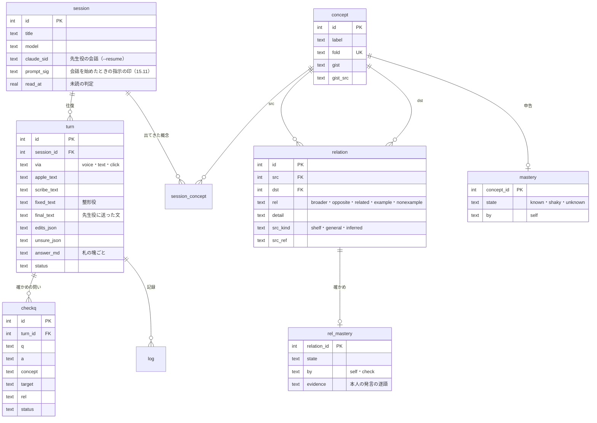

# となり（声で回す概念の学び）設計 v0.1（2026-10-29）

本人の依頼（2026-10-29・音声入力）を受けて作った、自分の Mac だけで使う学びのアプリの設計書。コードは同じフォルダ（`tonari/`）、使い方は `README.md`、調べた材料は `research/`。

## 0. 結論

話題（セッション）を何本も並べ、話題Aで声で質問したら答えを待たずに話題Bへ移り、Bで質問したらCへ、答えが届いた話題に戻って読む、という回し方を既定にしたデスクトップアプリにした。名前の「となり」は、本人の考え「言葉は、その周りの言葉との関係が分かれば分かる」から取った。

v0.5（2026-11-13・16章）で、この章の答えの型は変わった。答えはふつう 250字ほどの短い答えで、「続きを」で続きが出る。確かめの問いと記録用の地図は答えのあとに記録役が作り、位置の図は線を文として読む形になり、先生役の推測は考えの塊に分かれ、手元の資料に無いことは Web で調べてページにできる。下は v0.4 までの書き方である。

v0.6（2026-11-15・17章）で、主な経路（問う→読む）を止めていた所を直した。読む前の予想は、同じ話題で待つあいだは入力欄の上の帯で任意に誘い、別の話題から戻ったときだけ答えを畳む。戻ったときの確かめも同じ帯に出て、帯の欄に打つか帯の声のボタンで答える。片づけた話題を戻せ、右の列の「全部」は話題ごとの言葉の一覧になり、話題の最初の問いに別の読みがあったときは答えの下に札が出る。同じ日の本人の指摘と依頼で、予想には答えとの照らし合わせを返し（17.12）、話題と言葉の全体を1枚で見渡す地図を足した（17.13）。先生役の指示は変えていない。

v0.7（2026-11-17・18章）で、エンジニアリングの中身に合う表現を足した。答えの中のコードは、言語の名前・色分け・行番号・写すボタンの付いた箱で出て、行のまとまりに注釈を結んだ「読むコード」になる。依存の向きと全体の構成は「構成の図」（使う側が上の段・循環と層に逆らう線に機械が印・箱を指すと使うものと使われる相手が光る）で、状態の移り変わり・クラスや型の関係・テーブルの関係は関係の図の種類を増やして見せる。先生役の指示を変えたので、いまある話題は次の往復で新しい会話に替わる。

答えは声ではなく文字と図で返す。毎回の答えは、最初の1〜2文の言い切り、中身に合わせて選んだ図1つ、散文の説明、関係を確かめる問い1〜2個、の順に並ぶ。図の形は v0.2（2026-10-30・12章）から中身の形で決める。条件で結論が変わるなら分岐の木、期間なら時間軸、手順なら流れ、比べるなら比較の表、重なりなら重なりの図、計算なら計算の例、分類なら階層の木、言葉の意味なら位置の図、一言で足りれば文だけ。位置の図は置き場所に意味を固定していて、上が上位概念、下が下位概念、左右が対の概念、斜めが関係する概念になる。

頭脳は話題ごとに1本ずつ常駐させた Claude Code の opus（`claude -p`・Max プランのログイン・API キーは使わない）。声は Apple の端末内の文字起こしと ElevenLabs Scribe（この話題の用語の一覧つき）を並べて走らせ、整形役（sonnet）が2本を突き合わせて聞き違いだけを直してから先生役に送る。手元の試しでは、用語の一覧を渡した Scribe と、用語集を渡した整形役が、どちらも用語の聞き違いをほぼ消した（3章）。

理解度は概念ごとの申告（分かる・あやしい・分からない）と、関係ごとの確かめ（確かめの問いへの答えを先生役が判定し、根拠に本人の発言の逐語を要求する）の2本で持つ。本人の考えをそのまま数える形にして、概念Aの理解を「Aの周りの関係のうち確かめ済みの割合」として右の地図に出す。

## 1. 依頼と、設計で守ったこと

本人の依頼を要件に直すと次の表になる。

| 依頼の言葉 | 設計での形 |
|---|---|
| 返答まで時間がかかるのは仕方ない。その間に別のセッションで話す | 話題ごとに先生役を常駐させ、話題をまたいで並んで進める。送ったら答えの届いた話題へ自動で移る（切れる） |
| 音声入力が既定。返答は文字でよい | 押して話す（Space）・もう一度押すと送る。答えは画面に文字と図で出し、読み上げない |
| 裏は Claude の Opus 5.5 で問題ない | 先生役は `claude -p --model opus`（Max プラン）。整形役だけ sonnet |
| 音声入力の精度はばらつくので、誤字を推測して正しい文に直してから送る | 整形役が Apple と Scribe の2本を突き合わせて直す。直した箇所は下線で見せ、1つずつ戻せる |
| 音声認識の精度は高めておきたい（途中の追加の依頼） | 用語の一覧を Scribe に渡し、整形役には用語集・棚の題・過去の聞き違いを渡す。測り方も同梱（3章） |
| アーティファクトのようにリッチに見せる画面 | 答えの中に位置の図・比較の表・流れ図・全体の木・棚の札を描く。見た目は家のデザインシステム「精密・白」のトークン |
| 既存のまとめたアーティファクトを元に答えると早くなるかも | 棚（アーティファクト棚の写し156枚・約324万字）を先生役の作業フォルダに写し、Grep と Read で根拠にさせる |
| ER 図のように体系的に概念マップを、あなたも理解し私にも見せる | 概念と関係を記録に溜め（話題をまたいで1つの地図）、右の地図で見せ、毎回の問いに「この話題の概念」と「理解の記録」を添えて先生役に渡す |
| 分かる・分からないを相互に、どこまで分かっているか | 本人は図の札・確かめの問いで申告し、先生役は答えを判定して関係ごとの記録を更新し、次の説明は「分かる」の概念を足場にする |
| 言葉の意味は周りの言葉との関係で分かる | 答えの型そのものにした（位置の図と、分かる概念を足場にした説明）。理解の割合も関係で数える |
| デスクトップアプリとして | `~/Applications/となり.app`（swiftc 単体の WKWebView の窓。作りは作者の別のアプリの殻の写し） |

依頼に書かれていないが守った決まりは3つある。1つ目はリポジトリの正典の「Anthropic API は基本使わない」で、先生役も整形役も手を加えていない `claude -p` を本人のログインで動かし、子の環境から `ANTHROPIC_*` を外す。2つ目は捏造ゼロで、答えの「」は棚の本文と照らして一致したものだけに印を付け、判定は本人の発言の逐語が無ければ記録しない。3つ目は人の裁定を前提にしないことで、直しすぎ・判定の根拠・関係の出どころはすべて決まった規則で機械が決める（9章）。

## 2. 使い方の一巡と画面

一巡はこう回る。⌘N で新しい話題を作ると、そのまま録音が始まる。話し終えて Space を押すと送られ、画面は答えの届いている話題へ移る（届いていなければその場に残り、短い知らせが出る）。答えの届いた話題は左の列で青い印と「答えが届きました」になり、⌘] で古い順に回れる。⌘1〜⌘9 で直接開ける。話題を開くと上に「前回」の帯が光り、最後に聞いたことと経過時間と、答えが届いているかどうかを1行で示す（中断から戻ったときの手がかり。研究は7章）。

画面は3列にした。左が話題の列で、話題ごとに名前（最初の発言から整形役が付ける）、状態（録音中・文字にしています・聞き違いを直しています・考えています・答えが届きました・止まりました）、最後の問い、概念の数、経過時間を出す。真ん中が往復の列で、本人の発言（直した箇所に下線、決めきれなかった箇所に点線、聞き取りの元の2本は畳んで添える）と答えが並ぶ。右が地図で、「位置」は選んだ概念を中心にした記録の地図と、申告のボタン、関係で見た理解の割合、関係ごとの確かめのボタン、出てきた話題の一覧を出す。「この話題」と「全部」は概念を理解の状態ごとに並べる。

図の札を押すと右の地図がその概念を中心に描き直し、札を2回押すとその概念の説明を今の話題で頼む。右の地図の「これを説明して」は、本人が分かっている周りの概念を足場にした説明を頼み、「関係を問題にして」は周りの関係を確かめの問いにして出させる。

## 3. 声の精度

### 3.1 手元で測ったこと（2026-10-29）

合成音声6本（macOS の Kyoko と Eddy が、社労士と学習科学の用語を入れた3文を読んだもの・計45.8秒・`tests/audio/`）で、方式ごとの文字誤り率（句読点と空白を除いた CER）を測った。測り方は `uv run python -m tests.stt_eval --scribe` と `--fixer`。

| 方式 | CER | 中身 |
|---|---|---|
| Apple SpeechTranscriber（端末内・無料・1本0.3〜0.4秒） | 14.2%（33/232字） | 合格伴走→合格友層・寡婦加算→か不加算・ベイズ→レイズ・フレイヤー→プレイヤー |
| ElevenLabs Scribe v2（用語なし・1本約1秒） | 9.9%（23/232字） | 合格伴走→同核伴走・寡婦加算→加付加さん |
| Scribe v2 に用語の一覧（keyterms）を渡す | 0.0%（0/232字） | 6本とも一致 |
| Apple の結果を整形役（sonnet・用語集つき）に通す | 0.9%（2/232字） | 残ったのは「入り→あり」「を→に」の2字 |

この表は条件が甘い。用語の一覧と用語集には、読ませた文の用語がちょうど入っている。実際には、新しい話題の最初の発言では用語集が空で、渡せるのは棚の題とほかの話題の概念の名前だけになる。合成音声で、本人の肉声・部屋のマイク・言いよどみは測っていない。Scribe（用語なし）は同じ音声でも回によって結果が変わった（Kyoko-3 は1回目に誤り、2回目は正しかった）。

Apple の側でも2つ確かめた。SpeechTranscriber に文脈の語（`AnalysisContext.contextualStrings`）を渡しても結果は1字も変わらなかった。旧来の口述の方式（DictationTranscriber）は文脈の語が効き（「レイズ知識分析」が「ベイズ知識追跡」に直った）、そのかわり素の精度が落ちた。SpeechTranscriber は字ごとの確信度と別候補（「つ→対」「容→上」「了→理」）を返せるので、これを整形役への手がかりにした。

#### 3.1.1 端末内の2本目に Haas を試した（2026-11-02）

X のブックマークで見つけた日本語特化の認識モデル Haas-ja-v1.0（Third Intelligence・Apache-2.0・Parakeet-TDT 系・616M）を、speech.cpp（MIT・Mac は Metal、Windows は Vulkan か CPU）の `speech asr haas-ja-v1.0` で動かし、Scribe を切っているときの2本目になるかを測った。測り方は `uv run python -m tests.stt_eval --haas` と `--fixer --haas [--no-glossary]`。

| 方式 | CER | 中身 |
|---|---|---|
| Haas（用語なし・1本0.22秒、読み込み込み・M4 Pro） | 13.8%（32/232字） | Apple の 14.2% とほぼ同じ。合格伴走→楼鶴伴奏・寡婦加算→化不可さん |
| Haas に用語の一覧（`--keywords`）を渡す | 6.0%（14/232字） | 用語は直るが、6本中1本で前後の語を落とした（「の違い」）。用語に読み（かな）を添えると 7.8% で良くならず、6本中2本で語を落とした（「の違い」「の見せ方」） |
| 整形役に Apple と Haas の2本を渡す（用語集なし） | 4回で 3.4〜6.0%、平均 4.4% | 同じ条件の Apple だけは5回で 3.9〜9.1%、平均 5.2%。回ごとの揺れの方が大きく、差は言えない |
| 整形役に Apple と Haas の2本を渡す（用語集つき） | 0.4%（1回） | Apple だけは 0.9%（10/29 の1回）。どちらも1回で、差は揺れの中 |
| 本人の肉声10本（10/29〜30 の声の往復・計約7分19秒） | Apple 14.3%・Haas 22.7%・Haas を声の区間ごとに切って 25.5% | 基準は本人が通した文で、Apple の結果を整形役が直したものなので Apple に有利。整形役が Apple を直した64か所のうち、Haas が直したあとと同じ字を書いていたのは18か所（28%） |

決めたこと。Mac では、整形役を通したあとの得が回ごとの揺れより小さく、本人の肉声で Apple より良い証拠も無いので、既定では使わない（`TONARI_LOCAL_ASR=haas` で入る）。入れたときは、Haas が語を落とすことがあるので、整形役が失敗したときに戻す元の文は Apple にし（`fixer.base_text`）、整形役には「Apple にあって Haas に無い語は Apple から戻す」と指示した（試しでは、落ちた「の違い」を整形役が戻した）。Apple の無い PC（Windows など）では、既定の `TONARI_LOCAL_ASR=auto` で Haas が1本目になり、Haas だけで文字にする（`stt.apple_available`。2026-11-03 に Mac で Apple を外して試し、試しの音声1本を 0.37秒で、句読点のほかは誤りなく書いた）。整形役を比べるときは、1回ずつでなく3回以上回して平均と幅で見る。

### 3.2 決めた作り

録音は WKWebView の MediaRecorder（webm/opus。作者の別のアプリで実際に通った経路）で取り、サーバーが ffmpeg で 16kHz の wav にする。そこから Apple（`stt/bin/stt-helper`。作者の別のアプリの道具に確信度と別候補の出力を足したもの）と Scribe v2 を同時に走らせる。Scribe には、この話題の概念の名前を先に、ほかの話題の概念と過去の聞き違いの正しい字を後に並べて、50語まで渡す。

整形役は温めておいた sonnet（effort low）を1回だけ使って閉じる（話題をまたいで文脈を持ち越さない）。渡すのは、用語集（概念の名前120語まで）、棚のページの題、過去の聞き違い、直前のやりとり、Apple の本文と確信度の低い字と別候補、Scribe の本文。返すのは、直した文、直した箇所（元の字・直した字・理由）、決めきれなかった箇所と候補、往復の見出し、発言の種類（新しい問い・確かめへの答え・進め方の指示）。

整形役の結果は機械で確かめる。直した文と元の文（Scribe があれば Scribe、無ければ Apple）の一致の度合いが 0.6 を切ったら直しすぎとみなして元の文を使う。直した箇所は、元の字がどちらかの文字起こしにあり、直した字が直した文にあるものだけを見せる。決めきれなかった箇所は、本文の字と候補をそのまま先生役に添え、答えを左右するなら両方に触れるか確かめるよう指示してある（2026-10-29 の試しでは、先生役が「『合格バンド』はアプリの名前から『合格伴走』と読みました」と断ってから答えた）。

本人が「直して聞き直す」で字を書き換えると、書き換えた区間（両方20字以内）を聞き違いの台帳に足し、次から Scribe の用語と整形役の手がかりに入れる。使うほど本人の声と話題に合っていく、という狙い。

### 3.3 Scribe の費用と口座

Scribe は既定で「自動」にした。ElevenLabs の口座の残りが 5,000 を切ったら使わず、Apple と整形役だけにする（作者の別のアプリの読み上げと同じ下限）。左の列の下で「精度優先（毎回 Scribe）」「端末だけ（Apple）」に切り替えられ、今月 Scribe に送った分数を出す。2026-10-29 時点で口座は Starter、残りは 11,615。同じ日に Scribe を約3分ぶん使ったあと、口座の文字数の枠の数字はほとんど動かなかった（11,647 から 11,615）。音声の文字起こしがこの枠からどう引かれるかは確かめきれていないので、使った秒数をアプリの記録（`stt_usage`）に残し、月末に口座の数字と見比べる。録音は ElevenLabs に送られる（アプリのマイクの許可の説明にも書いた）。端末の外に出したくない日は「端末だけ」にする。

## 4. 答えの型

先生役の指示（`server/tutor.py` の SYSTEM）で、答えを次の順に書かせる。最初の段落で問いに1〜2文で答える。続けて `tonari-map` の塊（中心の概念・一文の説明・上位2・下位5・対2・関係6・例3・非例2、それぞれに出どころ）を出す。本文は散文で、対の概念があれば3〜5行の比較の表、仕組み・手順・データの関係なら mermaid の図（flowchart・sequenceDiagram・erDiagram）を1つ添える。最後に `tonari-check` で関係を問う短い問いを1〜2個出す。「全体像」「地図」「体系」を頼まれたら位置の図の代わりに `tonari-tree`（3段まで）を出す。確かめへの答えのときは先頭に `tonari-grade` を出す。

opus に JSON Schema で出させる方法（`--json-schema`）は1回約20秒かかった（作者の別のアプリでの測り）ので使わず、流れてくる文から札の塊を切り出す。塊が壊れていたら本文から外して記録に理由を残し、画面には出さない。

説明の芯は本人の考えにした。先生役には毎回、本人の理解の記録（分かる・あやしい・分からないの概念、確かめた関係）と、この話題の概念の一覧を添え、「分からない概念を、さらに分からない言葉で説明しない」「分かると記録した周りの概念を足場にする」と指示してある。

根拠は棚の写しで、先生役は作業フォルダの `<id>.txt` を Grep・Read で読む（`--restricted --tools Read,Grep,Glob` で、作業フォルダの外は読めない）。「」は棚の本文を写すときだけに使わせ、画面が畳んだ字で本文と照らして、一致したものに緑の地と「棚」の印を付ける。一致しない「」は印を付けずにそのまま出す。ページは〔id｜見出し〕の札になり、押すとそのページを開く。

（v0.2 で、上の「答えの型」は12章の見せ方の語彙に置き換えた。位置の図は定義の答えだけに描き、ほかの答えでも記録の地図には毎回書く。）

## 5. 知識の構造

記録の地図は概念（concept）と関係（relation）の2つの表でできている。概念は名前を畳んだ字（NFKC・空白なし・小文字）で1つにまとめ、話題をまたいで共有する。話題Aで出た「知識空間理論」と話題Bで出た「知識空間理論」は同じ札になり、右の地図の「出てきた話題」から行き来できる。

| 関係 | 向き | 図の置き場所 | 例 |
|---|---|---|---|
| broader（上位） | src の上位が dst | 中心の上（中心が src のとき）、下（中心が dst のとき） | 知識空間理論 → 学習者モデル |
| opposite（対） | 向きなし（id の小さい方を src にそろえる）・軸を detail に | 左右 | 知識空間理論 ⇔ ベイズ知識追跡（技能間の構造か時間の変化か） |
| related（関係） | 中心から相手へ・種類を detail に（部分・前提・原因・結果・道具。v0.5 から「同時に出る・似ている」は使わず、つなぐ言葉を phrase に持つ＝16章） | 部分は中心の箱の中、そのほかは図の下の文（v0.4 までは斜め） | 知識空間理論 → 適応型テスト（結果） |
| example（例） | 例が src・概念が dst | 図の下の緑の札 | 分数の足し算ができる人は約分もできる |
| nonexample（例ではない） | 同上 | 図の下の打ち消し線の札 | 1問ごとの正答率だけを並べた成績表 |

関係には出どころを持たせる。棚に根拠があれば shelf（実線）、一般の知識なら general（破線）、先生役の推測なら inferred（点線）。同じ関係を何度も言われたら、出どころの強いほう（棚 > 一般 > 推測）を残す。〔id〕の札が棚の目録に無ければ推測に落とす。

位置の図の置き場所は固定した。毎回同じ規則で置くので、何枚見ても「上にあるのは広いほう」「左右にあるのは比べる相手」と読める。答えの中の図（680×420）と右の地図（400×460・字が小さくならない詰めた配置）は同じ規則で、置き場所の数だけ違う。



ほかに、聞き違いの台帳（mishear：聞こえた字・正しい字・回数）、Scribe に送った秒数（stt_usage）、画面の設定（pref）がある。表の正典は `server/db.py` の SCHEMA。

## 6. 理解度

理解度は2本で持つ。1本目は概念ごとの申告で、本人が右の地図で「分かる・あやしい・分からない」を押す。もう一度押すと消せる。2本目は関係ごとの確かめで、答えの最後の確かめの問いに、ボタン（分かる・あやしい・分からない）で申告するか、「声で答える」で答える。声か文字で答えると先生役が `tonari-grade` で判定し、当たり・半分・まだ、と根拠の逐語を返す。根拠の字が本人の発言に無い「当たり」は記録しない（2026-10-29 の試しでは、2問とも本人の発言から逐語を引いて当たりと判定し、関係ごとの記録に入った）。

本人の考えを数える形にしたのが「関係で見た理解」で、概念Aの周りの関係（上位・下位・対・関係）のうち、確かめ済み（分かる）の割合を右の地図に棒で出す。申告の「分かる」と、関係で見た割合が食い違う概念（申告は分かるのに、周りの関係を1つも確かめていない）が、分かった気になっている候補になる。研究で分かっていることと限界は7章。

申告も確かめも記録（log）に足すだけで、今の状態はそこから引き直せる。忘れの模型（いつ問い直すか）はまだ入れていない。作者の別のアプリで式と検算を作ってあるので、記録が溜まってから足す。

## 7. 研究から分かっていることと仮説

調べ役2本（opus・一次ソースで確かめた数字だけ・2026-10-29）の結果を、設計に効くところだけ畳む。原文と出典の URL は `research/a-概念の理解と関係の学び-2026-10.md`（意味と関係・語彙の深さ・コンセプトマップ・比較と非例・自己説明と分かった気）と `research/b-見せ方と話題の回し方-2026-10.md`（中断と再開・交互と分散・図と文・図の読みやすさ・声と文字起こしの直し・自己申告の当たり外れ）。

### 7.1 本人の考えへの判定

前半の「言葉の意味は周りの言葉との関係で決まる」は、言語学と計算言語学の主流と合う（構造意味論の意義関係、意味ネットワーク、WordNet と ConceptNet の関係の種類。研究 a の1章）。概念の教え方の研究も、分類の構造、非例、比べることを重んじる（a の4章）。土台は正しい側にある。

ただし「関係が分かっていれば理解できる」は言い過ぎ、というのが調べ役の判定で、この設計もそれに従う。理由は3つ。仕組みの知識（どう働くか、なぜそうなるか）は上下左右の関係とは別の知識で、しかも分かった気が最も出やすい（説明の深さの錯覚・a の5-3）。語の知識には関係の図で表せない側面（使い方・連語・表記）が多い（a の2-1）。そして関係を見せることの効果は小さく、効いたのは関係を自分で思い出し、作り、説明したときだった（コンセプトマップのメタ分析で、見るは g＝0.43、作るは g＝0.72。検索練習はマップ作りより強い。a の3章）。「分かる」の中身が「見て納得した」なのか「何も見ずに言える」なのかで、本人の考えの当たり外れが分かれる。

後半の「文脈から推測もできる」は、日常語を大量の読書で増やす場面では成り立つが、新しい専門概念を1回の説明で分かる支えにはならない（自然な文脈で一度出会って分かる確率は .05〜.15。a の2-5）。

### 7.2 研究が支えていて、v0.1 に入れたこと

| 設計 | 研究 |
|---|---|
| 線に関係の名前を付ける（上位・下位・対・前提・原因・結果・部分・道具） | マップの利点の1つが線の名前で関係を明示すること。「関係」の一枠には部分・原因・前提・用途が混ざるので名前で分ける（a の1-5・3-2） |
| 下位は「一種」だけ、部品は related の「部分」 | WordNet の hyponym と meronym、ConceptNet の IsA と PartOf の区別（a の1-5） |
| 対は、同じ上位の下で取り違えやすい兄弟を第一候補にし、無ければ空にする。反意語は尺度を書く | 学びに効くのは構造を共有して決め手の1点だけが違う相手（Gentner・Schwartz & Bransford・Tennyson。a の4章）。ConceptNet は Antonym と DistinctFrom を分ける |
| 比較の表は共通点の行が先、決め手の違いが後 | 事例比較のメタ分析では共通点を探させる方が学びが大きい（Alfieri ほか 2013。a の4-5） |
| 非例は見かけをそろえて決め手だけ違うもの | Tennyson の概念教授（a の4-4） |
| 理解の記録を申告と確かめの2本にし、関係ごとに持つ | 漠然とした「分かった？」は過大に出る。仕組みの説明の知識で特に強い（b の6章・a の5-3） |
| 申告は「分かる」なのに関係を1つも確かめていない概念に注意を出す | 同上（申告と確かめのずれを別の印にする。a の6-3） |
| 確かめの問いを答えの最後に置き、声で答えられる | 練習テストの効用は「高い」（Dunlosky ほか 2013。a の5-2）。人に説明するつもりの学び（a の5-5） |
| 話題の最初の答えで「あとで自分の言葉で説明してもらう」と予告する | 声で説明する学びは、学ぶ前に説明を予告したときだけ効き、予告なしに後から説明させても得はなかった（b の5-2） |
| 戻ったときに「前回」の帯を目立たせ、最後の問いをはっきり指す | 直前の操作を大きな印で指すと再開が速く、控えめな印は印なしと変わらなかった（Trafton ほか。b の1-3） |
| 同じ概念は話題をまたいで同じ札、図の置き場所は固定 | 配置を保つと図の中で場所を見つけ直すのが速く正確になった（b の4-4）。ただし理解が深まる証拠は無い |
| 上下に上位・下位 | 上下は順位として自然に読まれる（Tversky ほか 1991。b の4-5） |
| 文字起こしの直しに別候補（N-best）と専門語の一覧を渡し、直したあとに機械で確かめる | 生成による誤り訂正の研究（N-best を渡す・専門語で偏らせる・N-best の範囲に縛る・直したあとに検証。b の5-4・5-5） |

### 7.3 研究が設計に不利なこと（隠さない）

関係の薄い話題を交互に回すことの学習上の得は見つかっていない（b の2-4）。交互練習の得は、似ているが違うものを見分ける学習で確かめられていて、似ているほど大きい。だから話題を回すことは「待ち時間を埋める効率」であって、学習の効果としては扱わない。待ち時間に別の話題へ移ると、覚えていたことを落とし、終わっていない話題に注意が残り、移る判断そのものにも時間がかかる（b の1-5・1-6）。

完成した図を渡すのは、本人が作るより得が小さい（b の3-8・a の3章）。左右に対を置く決まりは、効果を測った研究が見つからなかった（b の4-5）。慣れの効果に頼っている。配置を毎回同じにしても理解が深まる証拠は無い（b の4-4）。

言語モデルによる文字起こしの直しには、文法的に正しいが発話と違う文を作る危険がある（b の5-5）。整って読みやすい見た目は分かった気を上げ、言語モデルのまとめから学ぶと知識が浅くなるという大規模な実験もある（b の6-4・6-5）。この設計の答え（整った文と図のまとめ）は、この偏りが起きやすい条件にそのまま当たる。

### 7.4 v0.2 の候補（研究に沿うが、まだ入れていないこと）

同じ概念に何度目かで戻ったときは、完成した図を見せる前に、中心だけの空の図を出して本人が声で上位・下位・対を埋め、そのあとで先生役の図を重ねる（検索に基づくマップ作り・a の6-2。図を段階的に空ける・a の7-3）。答えを待つ間に、いまの話題の中で予想や知っている用語を一言言ってもらう形も選べるようにする（b の推測1。移ることの費用を払わない）。別の話題へ移る瞬間に「戻ったら何を確かめるか」を声で一言残し、戻ったら最初に見せる（b の1-2・推測2）。「分かる」を押したら、決め手の一語を声で言ってもらい、申告そのものを小さな思い出しにする（a の推測7-6）。似た概念どうしを意図して続けて問う（交互の得を本当に取る・b の2-3）。日をまたいで同じ関係を問い直す（分散の得は数分の行き来では取れない・b の2-6。狩り場の忘れの模型を使う）。確かめが通った話題では補助（事前訓練・合図）を減らす（熟達化反転・b の3-9・推測10）。

### 7.5 仮説（研究の外の推測・確かめる前提）

関係ごとに記録する方が、概念ごとより誤概念の場所を特定しやすいかもしれない。Tennyson らの誤りの3分類（過剰な一般化・過少な一般化・誤概念）は、どれも「どの概念がどの概念の一種か」という線の誤りとして書ける（a の7-2）。ただし関係ごとに記録して学びが良くなったという研究は見つかっていない。

戻ったときの手がかりは、操作の場所より「自分が最後に言った問い」と「そのとき引っかかっていた点」の方が学びの再開に効くかもしれない（b の推測3。研究は操作の場所しか調べていない）。v0.1 の「前回」の帯は最後の問いを出している。

関係を作るのが Claude であることの危険は残る。誤った上位や取り違えでない対は、そのまま誤概念の種になる（a の7-5）。棚に根拠のある関係（実線）と、一般の知識（破線）・推測（点線）を図で分けたのはこのためで、社労士のように一次の出典がある分野では、条文に結びついた関係だけを実線にするのが筋になる。

## 8. 並行と遅延（手元の実測・2026-10-29）

opus の `claude -p` を3本同時に起動し、1秒以内に短い問いを投げても、3本とも約2秒（モデルの時間1.8〜2.5秒・起動込み5.7〜6.6秒）で返り、混雑の拒否は出なかった。先生役は話題ごとに常駐させ、常駐は6本まで、30分使わなければ閉じる。閉じた話題は `--resume <会話の id>` で続きから始める（stream-json の入力で再開できることを sonnet で確かめた）。混雑やプロセスの停止で落ちたら、20秒・40秒・60秒あけて3回まで送り直し、画面に「先生役が混んでいます」と出す。送る文は先に記録に書いてあるので、落ちても失われない。

| 段 | 文字の質問（棚を読んだ） | 声の質問（Apple のみ） |
|---|---|---|
| 文字にする | — | 0.4秒（8.9秒の録音） |
| 聞き違いを直す | — | 4.2秒 |
| 先生役の最初の文字 | 23秒（Grep・Read を3回） | 約3秒で道具、文は道具のあと |
| 先生役の答え終わり | 33秒 | 34秒 |
| 確かめへの答えの判定（棚を読まない） | 15.5秒 | — |

答えまで30秒前後かかるので、その間に別の話題で1つ話す、という回し方に合う。整形役の4秒は、送ったあとに次の話題へ移っている間に済む。

## 9. 守っていること

Claude の API キーは使わない。サーバーは 127.0.0.1 だけで待ち受け、/api は独自の見出し `X-Tonari: 1` が無いと断る（ほかのサイトのページから本人の Max プランの枠と学びの記録を使わせないため）。録音と記録は `~/Library/Application Support/tonari/` に置き、リポジトリには入れない。先生役は作業フォルダ（棚の写し）の外を読めず、書く道具を持たない。

機械で決める規則（人の裁定を待たない）は次の5つ。直しすぎは一致の度合い0.6で切る。直した箇所は元の字と直した字の両方が見つかるものだけ見せる。判定の当たりは本人の発言の逐語が無ければ記録しない。関係の出どころは棚 > 一般 > 推測で強いほうを残し、目録に無い〔id〕は推測に落とす。「」の照合は畳んだ字の完全一致で、札のページを先に、無ければ棚の全体を見る。規則の検査は `uv run --group dev pytest`（8件）。

## 10. 確かめたこと・まだのこと

確かめたこと（2026-10-29）。文字の質問で、先生役が棚を Grep・Read して、位置の図・比較の表・流れ図・確かめの問い2つを返し、概念9つと関係が記録に入った。声の質問（合成音声のファイルを録音の代わりに送った）で、Apple の文字起こし→整形役が「中、高齢化価算→中高齢寡婦加算」「株価算→寡婦加算」を直し「合格バンド」を決めきれない箇所として添え→先生役が断ってから答える、まで通った。確かめへの答えで、判定が逐語つきで関係の記録に入り、関係で見た理解が 0/8 から 2/8 になった。アプリの窓を出さないモード（`--selftest --snapshot`）で、画面の読み込み・安全な場所の扱い・マイクと録音（webm/opus）の機能があること・3列の画面・位置の図・比較の表・流れ図・確かめの問いの表示を撮って確かめた。

本物のマイクでの録音は、2026-10-30 に本人が実際に使って通った（声の往復10回がすべて完了・録音は最長135秒・聞き取りは「端末だけ」に切り替えて Apple と整形役だけ・文字にするのに0.4〜1.5秒、直しに3〜16.5秒で長い発言ほど長い）。

まだのこと。本人の肉声での文字誤り率（記録に Apple・Scribe・直した文・本人が直した文が残るので、溜まったら同じ関数で測る）。話題を5本以上同時に回したときの混雑。Scribe の費用が口座の枠からどう引かれるか。

## 11. これから

先に効きそうな順に、本人の肉声での測り直し、忘れの模型（狩り場の式）で「そろそろ問い直す関係」を出す、申告と関係の割合が食い違う概念を知らせる、棚の見出しから用語集の種を作る（新しい話題の最初の発言の精度）、全体の地図（全部の概念を同じ規則で並べた図）、を考えている。

## 12. 見せ方の語彙（v0.2・2026-10-30）

本人の依頼（2026-10-30）は「表現をもっと多様に。マップだけでなく、答えによって別の表現を。シンプルなときはシンプルに、複雑さが要るときは複雑に。理解させるのに適した表現を選べるように」。調べ役 c（`research/c-表現の選び方-2026-10.md`・一次ソースで確かめた数字だけ）の結論で、作りを4か所変えた。表現は本人の好みでなく中身の構造で決める（学ぶ人に表現を選ばせる効果はほぼ無い・g＝0.05）。重なりはオイラー図か線形の図にする（ベン図は不可）。「別の見せ方」は置き換えず横に並べる（順に切り替えて見せる版が伸びが最も小さく誤解が最も多かった）。詳しさは2段にとどめ、既定は確かめの問いの結果で決める。

### 12.1 形の選び方（先生役の指示・`server/tutor.py` の SYSTEM）

中身の形を、上から順の問いに当てて、最初に当てはまった形の図を1つだけ出す。

| 順 | 中身の形 | 図 | 塊 |
|---|---|---|---|
| 1 | 一言で足りる（単純な事実・はい/いいえ・一つの数字） | 文だけ | なし |
| 2 | 場合によって結論が変わる | 分岐の木 | `tonari-decide` |
| 3 | 期間・年齢・期限の区間 | 時間軸 | `tonari-timeline` |
| 4 | 順番のある手順・原因から結果への仕組み | 流れ | `tonari-flow` |
| 5 | 2つ以上を観点ごとに比べる | 比較の表 | `tonari-compare` |
| 6 | 集合の重なり・含む含まれない | 重なりの図（2つはオイラー図、3つは線形の図） | `tonari-overlap` |
| 7 | 金額・日数・割合の計算 | 計算の例 | `tonari-calc` |
| 8 | 分類・全体像 | 階層の木 | `tonari-tree` |
| 9 | 多対多・データやシステムの関係 | 関係の図 | `mermaid` |
| 10 | 一つの概念の意味 | 文と例・非例、関係が実在するときだけ位置の図 | `tonari-map`（show: true） |
| 別 | 抽象的な仕組みを身近な物で | たとえ（成り立たない所を必ず書く） | `tonari-analogy` |

v0.4 作業B（2026-11-10）で、4（流れ）の次に「部品とその間の受け渡し・入れ子」のしくみの絵（`tonari-parts`）を5として足し、比較の表から下を1つずつ繰り下げた（15.10）。

どの図の塊にも表現の名前（name・1〜2語）と、中身の構造の理由（why。「場合分けが2段あるので」のように書き、正しさの主張は書かない＝説明は誤った図の受け入れも増やすため・研究 c の6-2）を入れさせ、確かでない項目には一人称の短い言葉（unsure）を入れさせる（不確かさの一人称の表現は過度の依存を減らした・同）。記録の地図（`tonari-map`）は図の種類にかかわらず毎回出させ、描かない答えでは show: false にする。これで関係ごとの理解度と話題をまたいだ地図は v0.1 のまま育つ。

### 12.2 機械の決まり（`verify_view`・決まりに合わない塊は捨てて本文だけ残す）

| 塊 | 決まり |
|---|---|
| 分岐の木 | 問いと2本以上の枝がそろう。深さ4段まで。結論の出どころが無ければ推測として描く（点線） |
| 時間軸・計算の例 | 範囲の数の順が正しい。数字は「例の数字」か、棚・一般の出どころがあるか。どちらでもなければ「確かめていない数字」の札を出す |
| 流れ | 段階が2〜8 |
| 比較の表 | 比べるものが2〜4、値の数が比べるものの数と合う行だけ。共通の行を先に並べ直す |
| 重なりの図 | 集合が2〜3、要素が2つ以上、番号が範囲内。空の領域は描かない |
| たとえ | 対応が2つ以上、成り立たない所が1つ以上（無ければ捨てる） |
| 階層の木・位置の図 | root・center がある |

捨てた理由は往復の記録（stage_ms の block_errors）に残す。選んだ形と理由も往復ごとに残す（stage_ms の shapes）。あとで「どの形の答えのあとに確かめの問いが当たったか」を数えるため。検査は `uv run --group dev pytest`（15件）。

### 12.3 画面

図の上に表現の名前の札と理由を出し、その形を初めて見るときだけ読み方を1行添える（初めて見る形式では得が逆転しうる・研究 c の3-4。見たことのある形は `pref` の seen_views）。答えの下に「短く」「別の見せ方で」「詳しく」の3つの札を置いた。「別の見せ方で」は新しい往復に見せ直しの元（ref_turn）を持たせ、画面は前の図と新しい図を「前の見せ方」「いまの見せ方」として横に並べ、先生役は2つを結びつける問いを1つ（答えなくてよい）添える。上の帯の「自動・短く・詳しく」は話題ごとの既定で、自動は記録を見て決める（関係を確かめの問いで答えられた概念ほど短く）。矢印は流れ（と分岐の進む向き）にだけ使い、位置の図・重なり・比較には使わない（研究 c の1-5）。狭い所に置いた流れは縦に並べ、矢印も下向きにする。

### 12.4 確かめたこと（2026-10-30・本物の opus）

| 問い | 選んだ形 | 理由（先生役の why） |
|---|---|---|
| 遺族基礎年金をもらえるかどうかは、どう判断するの？ | 分岐の木 | 亡くなった人の立場で道が分かれ、そのあと納付要件と遺族の条件が続くので |
| 中高齢寡婦加算と経過的寡婦加算は、それぞれ何歳から何歳まで付くの？ | 時間軸 | 2つの加算の違いが、付く年齢の区間そのものなので |
| ベイズ知識追跡で、答えが来たときに確率を更新する手順を教えて | 流れ | 答えが来てから p が新しくなるまで、段が順に進むので |
| 社会保険と労働保険には、それぞれどの保険が入る？重なるものはある？ | 重なりの図（線形・3集合） | 広い意味の社会保険が、狭い意味の社会保険と労働保険の両方を含む関係なので |
| BKT の slip って何？一言で | 文だけ（353字） | — |
| 老齢基礎年金で…年金額の計算を、例の数字でやって見せて | 計算の例（例の数字） | 月数の割合を満額に掛ける計算なので |
| 知識空間理論を、身近なものにたとえて説明して | たとえ | 前提をたどって状態が広がる仕組みが、依存関係の解決と同じ形なので |
| コンセプトマップの「命題」ってどういう意味？ | 位置の図 | 命題はコンセプトマップの部分で、ノードとリンク語からできているので |
| Kafka と RabbitMQ の違いは？ | 比較の表 | 2つの仕組みを、共通点と違いの観点ごとに並べるので |
| 労働基準法の全体像を見せて | 階層の木 | 法律の章立てを、中身のまとまりで上下に分けたものなので |

10問とも狙った形になり、捨てた塊は0、10問とも記録の地図が書かれた。答えまで15〜39秒（v0.1 と同じ程度）。形の選び方の安定（研究 c の推測1）は、迷いやすい4問（分岐・重なり・比較・定義）を新しい話題で3回ずつ聞いて、12回とも同じ形だった。「別の見せ方で」は時間軸の答えを流れで描き直し、「時間軸では2本の帯が65歳でぴったりつながっていました。流れの図では、その継ぎ目にどの段階が入っていますか」と結びつける問いを添えた。詳しさ「短く」では212字・比較の表1つ・確かめの問い1つになった。

### 12.5 不利な点とこれから

研究 c で設計に不利だったのは次のとおり。本人に表現や詳しさを選ばせる効果はほぼ無い（だから「別の見せ方で」も形は先生役が選ぶ。詳しさの切り替えは本人の依頼なので残したが、既定は自動）。ChatGPT（2026-10-07 から）と Claude はすでに中身に合わせて図を出すので、形を変えること自体は差にならない。差になりうるのは、形の名前と理由を示すこと、2つの表現を並べて見せること、たとえの成り立たない所を示すこと、本人の過去の答えで詳しさを決めること、そして話題をまたいで育つ関係ごとの理解の記録（研究 c の推測8）。図に説明や出典を添えると、誤った図でも信じられやすくなりうる（研究 c の6-2）。

まだのことは、並べた2つの図の対応する所を指したら光らせる連動、同じ手順を二度目に聞かれたら段階の一部を空けて埋めてもらう（だんだん消す例題）、復習のときに図の前に関係を1つ予想してもらう、形ごとの確かめの当たりの集計。

## 13. 理解の確かめ方（v0.3・2026-11-03）

研究 d（`research/d-人が理解する仕組み-2026-11.md`）の結論は、図を足すより本人が自分で考えて言う場面を増やす方が効く、だった。10/29〜30 の記録では、確かめの問い24問のうち20問が手つかずで、問いの多くは関係の名前を問う形だった。一方で本人は「確認ですけど〜ですよね」と自分から3回言い直していて、記録に入ったのは1回だけだった。v0.3 はここを直す。

### 13.1 先生役の側（コミット A）

言い直しを判定する。整形役の発言の種類に confirm（前の答えの中身を自分の言葉で言い直して確かめる発言）を足し、先生役は confirm のとき、言い直しに含まれる関係のうち記録の地図にあるもの（`<この話題の関係>` で渡す）を tonari-grade で判定する。言い直しの判定では、手つかずの確かめの問いを「答えた」にしない（`apply_grades` の kind）。

判定のあとの返し方を決めた。違う所は本人の言葉のまま1文で名指しし、打ち消し、正しい説明を厚めに書き、推論のずれた所を1文で言う。ほめ言葉・点数・比較は書かない。誤った理由をもっと説明させる問いは出さない。聞き取りで決めきれなかった語は名指ししない（研究 d の 1-14・4-7・4-8・4-10・5-8）。

確かめの問いの型を4つにした。もしも（仕組みや手順。条件・順番・依存だけを変え、法令の金額・日数・年齢の値は変えない）、当てはめ（やり方や判断）、共通点（例が2つ以上）、見分け（言葉の意味）。関係の名前だけを問う問いは出さない。想定の答えの字（畳んだ字で4字以上）が答えの本文にそのまま含まれる問いは機械で外す（`tutor.filter_checks`）。型は `checkq.qtype` に残す（あとで型ごとの当たりを比べるため）。

二度目の判定。先生役の当たり・半分を、判定役（sonnet・`server/judge.py`）がもう一度判定し、一致したものだけを記録する。判定役が取れなかったときも記録しない。先生役が自分で作った問いを自分で採点するので、1回の判定を記録の根拠にしない（研究 d の 1-3）。

迷いの語。整形役に通す前の文字起こしから「でしたっけ」「たぶん」「ですよね」などを拾い、往復の記録（`stage_ms.hedges`）に残して先生役に添える。今は記録だけで、判定の規則は変えていない。

本物の opus で確かめたこと（2026-11-03・一時的な記録で4往復）。Next.js の SSR と SSG の質問に、確かめの問いが「もしも」と「当てはめ」の型で2つ付き、どちらも本文を写しては答えられない問いだった（32秒）。半分間違えた言い直しには、「あなたは『ISRはSSRにキャッシュを付けたもの』と言いましたが」と名指しして正しい説明を返し、手つかずの問いは残った。前半の当たりは判定役が半分と見て食い違ったので記録せず、後半の半分は一致して記録した。わざと間違えた答えには、本人の言葉で名指しし、ずれた所（SSR の性質を SSG に当てはめた）を返し、ほめ言葉は無かった（16秒）。合っている答えは判定役も当たりで一致し、記録に入った（判定役 1.8秒）。

### 13.2 画面の側（コミット B）

読む前の予想。答えが届いた話題を開くと、問い（question）への答えは畳まれ、「あなたの問い」と「読む前に、答えはどうなると思いますか」が出る。Space で一言話して送ると答えが開き、予想は文字になりしだい答えの上に「読む前の予想」として出る。Enter（または「すぐ読む」）なら予想せずに開く。予想は先生役に送らず（往復は最初から superseded で作り、列にも話題の「最後」にも出ない・`pipeline.run_predict`）、次の発言のときに `<前の答えを読む前の本人の予想>` として先生役に添える。予想の効き目（外れたときの驚き）は予想の直後に答えを見る手続きで確かめられている（研究 d の 3-5・3-6）ので、送るときでなく開くときに置いた。命令（短く・詳しく）と確かめへの答えのあとには出さない。左の列の下の「答えを読む前に予想を一言話す」で止められる。開いた時刻は往復の `stage_ms.revealed_at`（v0.3 より前の答えは起動時に1回だけ、届いた時刻で埋める）。

戻ったときの確かめ。確かめの問いは答えの下には出さず（「次にこの話題に戻ったときに出します」とだけ書く）、答えを開いてから2分（`TONARI_RETURN_AFTER_SEC`）以上たってその話題を開いたときに、型のある開いた問いを古い順に1つだけ、上の帯に出す。そのあいだ元の答えと右の地図は伏せる。Space で声で答えると、その問いだけが「答えた」になり（`check_id`）、先生役が判定して二度目の判定役と一致すれば記録に入る。「分からない」は理解の記録に分からないと入り、「飛ばす」は記録に入れない（`checkq.status=skipped`）。1回の戻りにつき1問だけで、直近に済んだ3問がすべて飛ばしなら、その話題では出さなくなる（煩わしさの見張り）。話題を回す動きそのものが、数分から数日の間隔を空けた思い出す練習になる、という狙いで、研究 b の分散と研究 d の 3-7 に沿うが、間隔を空けた確かめが答える率を上げるかは確かめていない（仮説）。

確かめたこと（2026-11-03・一時的な記録・本物の opus と見えない Chrome）。遺族基礎年金と遺族厚生年金の質問（50秒）に「もしも」と「当てはめ」の問いが付き、話題を開くと予想の帯が出て Space の札が「予想を話す」になった。Enter で開き、答えの下は「確かめの問い 2問は、次に戻ったときに」になった。20秒（試しの設定）たって別の話題から戻ると、1問目が帯に出て答えと地図が伏せられ、「飛ばす」で記録に skipped が残って答えが開いた。試験音声を予想として送ると、往復の列にも話題の最後にも出ず、元の答えに予想が書き添えられた。戻ったときの問いに文字で答えると、その問いだけが答えたになり、ほかの問いは残り、判定役も当たりで一致した（28秒）。

まだのこと。本人の発話で正しく使った概念を「自分で使った」として記録する案（研究のブラッシュアップの仮説3）、迷いの語を判定に使うこと（いまは記録だけ）、問いの型ごとの当たりの集計と、話題ごとに型を交互にした比べ（記録が溜まってから）。本人の実際の使用で、確かめの問いに答えた率（v0.2 は24問中4問）がどう動くかを見る。

## 14. 設定の画面と、Windows で clone から起動まで（2026-11-03）

本人の依頼は「友人の Windows でも最低限のセットアップで使いやすく。キーの設定などの UI、無ければ既定。git clone して、どこかで claude を立ち上げてプロンプトを打てば自動でできるように」。公開の写し（GitHub の nomura-t/tonari）を前提に、次の形にした。公開のときに本人が「友人に送る文でなく、みんなが使える形に」と言ったので、README の文は誰でも Claude Code に貼れる一般の形にした。

設定の画面。左の列の下の「設定を開く」で `<dialog>` を開き、この PC の準備（`/api/health`＝`server/health.py`）、キーの割り当て、聞き取りの方式、ElevenLabs の鍵、先生役のモデル、読み方を1か所に集めた（これまで左の列の下にあった3つも移した）。準備の項目は、欠けると声の往復ができないもの（Claude Code・ffmpeg・声を文字にする方法の1つ以上）と、任意のもの（Apple・Haas・Vulkan・Scribe の鍵）に分け、欠けたものには OS ごとの直し方を添える。必須が欠けていれば、左の列と最初の画面に1行で知らせる。鍵は中身を返さず、どこから読んだか（環境変数・設定で入れた鍵・作者の手元の .env）だけを出す。

キーの割り当て。操作は6つ（新しい話題・答えの届いた話題へ・番号で開く・話す・予想せずに開く・録音をやめる）。形は `e.code` を + でつないだもの（例 `Alt+KeyN`、番号で開くは `Alt+Digit`）で、`pref.keys` には既定から変えたものだけを入れる。何も変えなければ今までと同じに動く（既定は Mac が ⌘、ほかが Alt。Ctrl+N・Ctrl+1〜9 はブラウザが先に取るため）。修飾キーつきの操作は文字の欄にいても効き、修飾キーの無い操作は文字の欄では効かない。同じキーを2つの操作に割り当てるのは画面とサーバーの両方で断る。番号で開くは数字だけを断る（文字の入力とぶつかる）。画面の `<kbd data-key>`・左の列の番号・案内の文は、今の割り当てから描き直す。

先生役のモデル。`pref.tutor_model` を新しい話題から使う（いまある話題は作ったときのモデルのまま。会話を `--resume` で続けるため）。選べるのは fable・opus・sonnet（2026-11-15 に fable を足した。`claude --model` の別名をそのまま渡す）。sonnet は opus の使えないプランの人の逃げ道で、`prepare.py` も claude に1回だけ短く聞いて、opus が答えなければ sonnet を記録の置き場の `.env` に書く。

起動と用意。`setup.ps1` は、Windows でしかできない入れ物（uv・ffmpeg・speech.cpp）だけを入れて `prepare.py` を呼ぶ薄い殻にし、確かめられる処理は Python に寄せた（作者の Mac で試せるように）。`launch.py` はサーバーを `sys.executable -m uvicorn` で立て、Edge のアプリ窓（専用の `--user-data-dir`）で開く。窓を閉じても Edge が裏に残る場合があるので、ブラウザの終わりを待つのではなく、サーバーが画面のつながり（`/api/events`）を数え、0 のまま15秒たったら自分で止まる（`TONARI_EXIT_WHEN_CLOSED`。開き直しの間は待つ。一度もつながらなければ2分で止まる）。Mac のとなり.app はこの変数を立てないので、動きは変わらない。記録の置き場の `.env` の `TONARI_*` は設定として読む（環境変数が勝つ・鍵の行は環境変数に入れない）。

確かめたこと（2026-11-03・作者の Mac）。規則の試験 29本。Windows に見せかけた見えない Chrome で、既定の表記が Alt+N、Alt+N で話題が増える、new を Ctrl+M に変えると Alt+N は効かず Ctrl+M で増える、重なりと数字だけを断る、すべて既定に戻すと Alt+N に戻る。Mac に見せかけると ⌘ のまま。`launch.py --headless --close-after 6` で、起動2.6秒、窓を閉じて16秒後にサーバーが止まり、窓もサーバーも残らなかった。`prepare.py` は Apple を外した状態で Haas のモデルを確かめ（0.3秒）、準備の表は、外した Apple のほかは全部「使えます」になった。`setup.ps1`・ショートカット・Edge の窓・マイクの許可は Windows の PC で初めて動かす。

試しの途中で見つけた不具合。画面がつながったまま `/api/shutdown` を呼ぶと、uvicorn が画面への流れ（`/api/events`）の終わりを待ち続けて止まらなかった（Mac のとなり.app は4秒後に SIGTERM を重ねて止めていた）。止めるときに `events.close_all()` で流れを終わらせ、止め始めたあとのつなぎ直しも受けないようにした。直したあとは、画面がつながったままでも 0.9秒で止まった。`launch.py` は念のため `--timeout-graceful-shutdown 5` も付ける。


## 15. 実物に結ぶ（v0.4・2026-11-10）

本人の依頼（2026-11-10）は「どんどん楽しく理解できるようにしたい。改善に使える論文・研究・記事を落とし込み、推測や仮説も試したい。たとえ話が、実際の値や名前とどう対応するのかが分かりづらいので直したい。図やイメージを、人が理解するのに最善の形で。UI と UX もいい感じに」。調べ役 e（`research/e1-たとえの対応づけ`・`e2-理解しやすい図`・`e3-楽しく続く条件`、いずれも 2026-11）と、本人の記録の数を材料に決めた。

### 15.1 記録で見えたこと（数だけ）

2026-10-29 から 11-10 までの13日で、使ったのは4日・16往復、最後は 11-04 だった。いまの指示（v0.2 以降）で出た答えは7つ。比喩の出方を4つに分けて数えると、たとえの塊は1つ、文の中の明示のたとえが3つ、定義の文に入った比喩の動詞や名詞が3つ以上、本人が自分から持ち込んだたとえが2つだった。つまり比喩の大半は、対応を書く決まりのある塊の外に出ていた。1つだけあった塊も、対は文と文で、実際の名前だけを抜き出した欄は無く、元の世界が4つ混ざっていた。定義の中の比喩の動詞1つが分からず、聞き直しに1往復を使った例が1件ある。確かめの問いは29問中25問が手つかずだった（戻ったときに出す形は 11-03 に入ったばかりで、そのあとの記録は数往復しかないので、効き目はまだ言えない）。

### 15.2 考え方

答えの中の言葉は、実物の世界（実際の名前・実際の値・実例）か、たとえの世界のどちらかに属する。画面は、どの言葉がどちらの世界のものかをいつでも見分けられるようにし、たとえの世界の言葉は必ず実物の世界の名前に結んで戻す。図も同じで、抽象の形だけで終わらせず、実例を1つ通す。楽しさは飾りや報酬で足さず、分かることそのものと、確かめに当たる見込みで作る。

### 15.3 たとえを実物に結ぶ

| 番号 | 決めたこと | 根拠 | 変わる所 |
|---|---|---|---|
| A1 | 定義の文と最初の段落では比喩の動詞・名詞を使わない。「何を受け取り、何をして、何を返すか」を実際の名前で書く。用語そのものが別の物の名前から来ているときは、名前の由来と、名前から連想すると誤る点を1文ずつ書く | 用語の比喩は易しい問いを助け誤概念の問いで害になった（e1 7-1 Hermans 2018）。比喩の動詞に注釈をつける効き目の研究は見つからず、ここは記録（聞き直し1件）からの推測 | 先生役の指示 |
| A2 | たとえは控えめに出す。出すのは、本人が頼んだとき、本人がたとえを持ち込んだとき、実例を通しても足りない抽象の仕組みのときだけ。1つの答えに元の世界は1つ。話題にすでにたとえがあれば同じ元を使い続ける。文の中で「〜のようなもの」と書くなら必ず塊を付け、塊なしのたとえは書かない。たとえの塊は「図は1つ」に数えない添え物にする | LLM が何も足さずに作ったたとえは30のうち16しか正しくなかった（e1 6-1 Shao 2025）。複数のたとえはばらばらに受け取られた（e1 2-3）。似た元は記憶に混じる（e1 2-5） | 先生役の指示、`<この話題のたとえ>` を渡す |
| A3 | 塊の形を変える。対ごとに、たとえの側の物（名詞）、実際の名前（本文で使う用語と同じ字）、両方に共通する働き、任意でたとえの側の値と実際の値を持つ。塊の全体に、共通する関係の1文、たとえに相手が無い実物の側の要素（unmapped）、成り立たない所を持つ | 対応を一つずつ明示したたとえは想起と保持を上げた（e1 1-2 Glynn & Takahashi 1998）。たとえが学ぶ側の要素を落とすと誤答を生んだ（e1 6-1）。知らない数は実際の値を消さずに言い換えを添えると効いた（e1 4-2 Barrio 2016） | `tutor.py` の塊の形と `verify_view` |
| A4 | 機械の決まり。対は2〜5。実際の名前（t）は16字以内で、塊の外の本文に同じ字で出ていること。たとえの側（s）は14字以内。合わない対は捨て、残りが2つ未満なら塊ごと捨てる。成り立たない所は1つ以上 | 文と文の対を止め、名前と名前の対にするため（15.1）。図のラベルを中身に結べない失敗が多い（e2 5-2） | `verify_view`、pytest |
| A5 | 二度目の確かめ。判定役（sonnet）に、本文と対の一覧を渡し、対ごとに「共通する働きが両方で成り立つか」を答えさせる。成り立たないとされた対は捨てる（残り2つ未満なら塊ごと）。判定役が取れなかったときは塊を出し、「確かめていない対応」の札を付ける | e1 6-1。先生役が自分のたとえを自分で確かめないため（13.1 の二度目の判定と同じ考え） | `judge.py`、`pipeline.py` |
| A6 | 見せ方。左にたとえの側、真ん中に共通する働き、右に実際の名前を、対ごとに同じ行にそろえる。対ごとに番号と色を振り、本文に出る同じ語にも同じ番号と色を付ける。たとえの側の語は琥珀色の下線、実際の名前は用語の見た目にして、2つの世界を見分けられるようにする。どちらかを指すと、対の相手と行が光る。値は名前の下に小さく並べる | 対応する部品を真横に並べると比べるのが速く正確（e1 3-4 Matlen 2020）。色をそろえると対応を探す手間が減り保持と転移が上がった（e1 3-1 Ozcelik 2009）。合図の全体の効果は d = 0.38（e1 3-3 Alpizar 2020） | `views.js`、`app.js`、`app.css` |
| A7 | たとえのあとは実物に戻る。塊のあとの本文は実際の名前だけで書く。たとえを出した答えの確かめの問いは、実際の名前で問い、成り立たない所か、たとえに相手が無い要素を優先して問う | 成り立たない所を明示しても、たとえの核だけが残る誤概念が起きた（e1 2-2 Spiro 1989）。たとえを読んで本体に戻らない学び方が見られた（e1 6-1） | 先生役の指示 |
| A8 | 本人のたとえ。本人がたとえを持ち込んだら、その言葉を元にして同じ塊で「どこまで使えるか」を返し、塊に「あなたのたとえ」の札を付ける。話題のたとえとして残し、次の答えでも同じ元を使う | 自分で元を出すと構造の似た元を選ぶ（e1 5-5）。持ち主意識が生まれるが独りよがりの危険がある（e1 5-2）ので、成り立たない所は必ず書く | 先生役の指示、記録（`analogy` の表） |
| A9 | 数の実感。大きさが実感しにくい数には、実際の値を消さずに、計算で出せる身近な言い換えを1つ添える | e1 4-2 | 先生役の指示 |
| A10 | 「実際には？」。答えの文を選ぶと「実際には何のこと？」の札が出て、押すと、選んだ字の実際の名前と実際の値・実例を短く聞き直す（予想の帯は出さない）。押した回数を数え、結ばれずに残った比喩の物差しにする | 残りを本人が安く潰せるようにする（推測） | `app.js`、往復の記録 |

### 15.4 図に実例を通し、しくみの絵を足す

| 番号 | 決めたこと | 根拠 | 変わる所 |
|---|---|---|---|
| B1 | 流れの図に実例を通す。実例を1つ決め（塊の case）、全部の段に、その実例でのその段の実際の値（ex）を入れる。全部の段に入れられないなら1つも入れない | 具体の図と抽象の図を組にすると片方より転移が良かった（e2 9-1 Moreno 2011）。値つきで実行を見せる道具は総説で支持（e2 9-3）。値を流す図と流さない図を比べた実験は見つからず、ここは仮説 | `tutor.py`、`views.js` |
| B2 | しくみの絵（`tonari-parts`）を足す。部品（6つまで・入れ子は1段）と、部品の間のやりとり（8つまで・順番つき・ラベルと任意の実例）を、箱と番号つきの矢印で描く。「何が何の中にあり、誰が誰に何を渡すか」が中身のときに選ぶ。部品の名前は本文に同じ字で出ていること、やりとりの両端は部品にあることを機械で確かめる | 関係の構造を浮かせた簡素な図はまとめる働きが強かった（e2 4-4 Butcher 2006）。図のコードの失敗はつながりとラベルに集中する（e2 5-2）ので、置き場所は画面が決め、先生役には部品とやりとりだけを書かせる | `tutor.py`、`views.js`、`app.css` |
| B3 | 文と図を結ぶ。図の中のラベルと同じ字の用語（『』）が本文にあれば、どちらかを指したときに相手を光らせる | e1 3-1・3-2（色と一時的な強調）。合図の無い所を見落とす副作用があった（e2 8-4）ので、常に光らせず指したときだけにする | `app.js`、`views.js` |
| B4 | 図を言葉に訳す。図の下に「この図を自分の言葉で言う」の札を置き、押すと言い直し（confirm）として録音が始まる | 図を見たあとは、描かせるより言葉で説明させるほうが理解のテストで良かった（e2 2-2 Fiorella 2020・2026）。声で言う形は研究の条件に無く推測 | `app.js` |

しないこと。画像生成の絵は足さない（科学の図や解剖の絵で目に見える誤りが出る・e2 5-1・5-3、写実より図式・研究 c 4-2）。飾りの絵や絵文字は足さない（気分は良くなるが応用は上がらず、図の中を探す速さを落とした・e2 4-3・6-2）。図を自由に操作させる仕掛けは作らない（見えるものをそろえると操作の得は消えた・e2 3-2）。図を順に組み立てる動きを理解の仕掛けとして当てにしない（応用には効かなかった・e2 1-1）。本人に図を描かせない（図がすでにある場面では応用が下がった・e2 2-2）。

### 15.5 楽しく続く

| 番号 | 決めたこと | 根拠 | 変わる所 |
|---|---|---|---|
| C1 | 確かめの問いにヒントを付ける。先生役は問いごとにヒントを2段（方向だけ・もう一歩）書く。想定の答えの字を含むヒントは機械で外す。戻ったときの帯に「ヒントをもらう」を置き、1段ずつ出す。使った段数を記録する | 当たる見込みがあれば人は自分から試し、選べるヒントつきの形が最も楽しいと選ばれ、学びは損なわれなかった（e3 10-3 Vaughn & Kornell 2019）。答えを当て推量できるヒントは得を減らした（同）。研究 d 5-6 の「ヒントを一段ずつ」とも合う | `tutor.py`、`db.py`、`app.js` |
| C2 | 得を本人の記録で見せる。戻ったときの問いが当たりで記録されたとき、判定の行に「読んでから○日あけて、何も見ずに言えた」と事実だけを書く（ほめ言葉は足さない） | 自分の結果で確かめの得を見せると長く使われた（e3 10-4 Hui 2021） | `app.js` |
| C3 | 物差し。本人の「楽しい」「分かった感じ」は物差しにしない。見るのは、使った日数と往復の数、確かめに答えた率、ヒントの段数、「実際には？」を押した回数、たとえのあとの聞き直しの数 | よく学べた授業ほど「学べた感じ」は低かった（e3 4-4 Deslauriers 2019） | 記録 |

しないこと。連続記録・バッジ・点数は足さない（意欲と行動への効き目は厳しい研究に絞ると有意でなく、予期した報酬は内発的な意欲を下げた・e3 6-1・6-2）。次の問いの候補を押せる札は足さない（AI の家庭教師では候補をただ押すだけの使われ方が多く、効き目を測った研究も見つからなかった・e3 9-1）。冗談は足さない（e3 7-3）。進みの棒は足さない（初めに遅く見えると離脱を増やした・e3 2-3）。

### 15.6 画面と使い心地

2026-11-10 にいまの画面を撮って見た。直す所は次のとおり。関係の図（mermaid）が既定の灰色の見た目のまま大きく描かれ、ほかの図と揃っていないので、色・線・字の大きさをアプリの決まりに合わせ、高さに上限を付ける。位置の図は、札の中で言葉が途中で折れ、札と線の名前が重なり、同じ概念の札が二度出ることがあるので、札の幅を字数で決め、重なりを避け、同じ概念は1つにまとめる。前回の帯の下に空の帯が残るので詰める。たとえの塊は15.3 の A6 の形にする。答えが開くとき・図が光るときの動きは 150〜200ms の短いものだけにし、動きを減らす設定の人には出さない。色は明るい面・暗い面の両方で文字の濃さの比を保つ。

### 15.7 入れる前に決めた、確かめの条件

機械の検査（pytest）は、たとえの塊の新しい決まり（本文に無い実際の名前の対は捨てる・文のような長い対は捨てる・古い形の塊も描ける）、流れの実例の全部か無しか、しくみの絵のやりとりの両端、ヒントが答えを含まないこと、を足して全部通ること。

本物の opus での確かめは、作り物の8問（たとえを頼む問い2・定義2・仕組み3・数1。本人の記録の話題は使わない）を新しい話題で3回ずつ流し、次を数える。たとえの塊の対の実際の名前が本文に同じ字で出ている割合（狙い 100%・機械が保証する）。塊なしで文に出たたとえの数と、最初の段落の比喩の動詞・名詞の数（判定役に数えさせる・狙いはどちらも0、v0.3 の指示で同じ8問を流した数と並べる）。12.4 の迷いやすい4問の形が3回とも変わらないこと。答えまでの時間の中央値が v0.3 より5秒を超えて延びないこと。画面は見えない窓で、たとえの答え・流れの実例・しくみの絵・ヒントの帯を撮って確かめる。

### 15.8 不利な点とまだのこと

LLM のたとえを人の監督なしの独学に使うことは、Shao 2025 の著者が向かないと結論した使い方そのものである。A2・A4・A5 は誤ったたとえを減らすが、無くす保証は無い。たとえを読んだあと自信だけが上がる（正答と自信の相関 |τ| ≤ 0.2・e1 6-1）ことへの手当ては、実際の名前で問う確かめ（A7）しか無い。色と番号の合図は、事前知識の多い人では得が消えた（e2 8-3）。B1・B4・A1・A10 は直接の実験の無い仮説で、記録の数（15.5 の C3）で見るしかない。本人ひとりの記録なので、数字は「この本人のこの使い方ではこうだった」までしか言えない。

### 15.9 確かめたこと（作業A・2026-11-10）

作業A として 15.3 の A1〜A10 と 15.4 の B1・B3・B4 を入れた。コミットは、測る道具（段0）、先生役の指示と機械の決まりと判定役（段1）、画面（段2）、指示の直し1回目（段3）の順である。規則の試験は 30本から 36本になり、全部通った（`uv run --group dev pytest`）。足した6本は、本文に無い実際の名前の対と文の対を捨て、残り2つ未満なら塊ごと捨てること、v0.4 より前に保存した答え（stage_ms に rules の印が無い）のたとえを読み直しで捨てずに前の形で描くこと、判定役の結果が届いたときと読み直しで同じに当たること（1対を捨てても2つ残る・2対を捨てると塊ごと・判定役が取れなければ checked:false）と画面に出したたとえだけが話題のたとえとして次の往復に渡ること、流れの実例が全部の段か無しかになること（8段に切ったあとの段で決める）、たとえを除いた最初の図と対の判定の読み取り、「実際には？」の往復に ground の印が付くこと、である。

測り方は `tests/eval_grounding.py` である。作り物の8問（たとえを頼む問い2・定義2・仕組み3・数1。公開鍵暗号、TCP の再送、キャッシュ、冪等性、DNS、ガベージコレクション、HTTPS、複利）と 12.4 の迷いやすい4問を、新しい話題として3回ずつ本物の opus に流した（12問×3回＝36答え）。経路はアプリと同じ pipeline.run_text と claude -p で、記録の置き場は起動のたびの一時フォルダ、アプリの起動と同じく棚の写し（198ページ）を作ってから流し、同時に動かしたのは3本までである。(b) は判定役と同じ呼び方（sonnet・effort low）の数える役に本文と最初の段落を渡し、数えた字を写させて数えた。数える役の指示は3回とも同じである。v0.3 の指示で流し（baseline）、v0.4 の指示で流すと答えまでの秒の中央値が 5.9秒延びたので、指示を1回直して流し直した（after）。

| 数えたもの | v0.3（baseline） | v0.4・直す前 | v0.4・直し1回目（after） |
|---|---|---|---|
| 届いた答え | 36 / 36 | 36 / 36 | 36 / 36 |
| (a) 対の実際の名前が本文にある（先生役が書いたまま） | 0 / 30（0%） | 17 / 24（71%） | 22 / 23（96%） |
| (a) 同（画面に出る対） | 0 / 30（0%） | 16 / 16（100%） | 22 / 22（100%） |
| (b) 塊に結ばれていない文の中のたとえ | 25 | 11 | 3 |
| (b) 最初の段落の比喩の動詞・名詞 | 45 | 11 | 19 |
| (c) 迷いやすい4問で3回とも狙いの形 | 4 / 4 | 4 / 4 | 4 / 4 |
| (d) 答えまでの秒の中央値（判定役の分を含む） | 30.0 | 35.9 | 34.2 |
| (d) 先生役だけの秒の中央値 | 29.7 | 35.5 | 33.0 |
| (e) 捨てた塊 | 0 | 0 | 0 |
| (e) 塊は残して対を捨てた答え | 0 | 5 | 1 |
| 答えの字数の中央値（塊を含む） | 2401 | 2712 | 2629 |

(a) の画面に出る対は機械の決まりが保証するので、v0.4 では 100% になる。意味があるのは先生役が書いたままの割合で、v0.3 では30対すべてが文と文の対で、実際の名前の側が本文に同じ字で出ていなかった（15.1 で記録に見えたことと同じ形）。v0.4 の直す前は、公開鍵暗号の答えで『平文』『暗号文』が流れの図の中にだけ出て本文の段落に無く、3回とも捨てられた。指示に「本文の段落（図やたとえの塊の外）」と書き足すと 23対中22対になった。判定役（A5）は v0.4 の2回で 12の塊・39対を確かめ、成り立たないとしたのは1対（TCP の通し番号と『シーケンス番号』）だった。判定役が取れなかった塊は0で、判定役にかかった時間は 1.7〜4.2秒、たとえのある答えだけにかかる。

(b) の文の中のたとえは 25 から 3 になった。残った3つのうち2つは、複利の答えで、棚のページでの言葉の使い方を説明した文で、もう1つは HTTPS の『ハンドシェイク』の名前の由来の文（A1 が求める書き方）である。最初の段落の比喩の語は 45 から 19 になったが、直す前の 11 より多い。残った語は「たどる」「印を付ける」「届く」「出発点」（ガベージコレクションの mark、到達可能、ルートの言い換え）、「覚えておく」「尋ねる」（DNS のキャッシュと問い合わせ）のように、技術の動きをふつうの動詞で言った所が多く、数える役がそれを比喩に数えるかどうかが回ごとに揺れている。狙いの0には届いていない。たとえの塊は、3回とも頼んだ問い（6答え）にだけ出て、定義・仕組み・数・迷いやすい問いの30答えには出なかった（A2 の控えめ）。

(c) の迷いやすい4問は、v0.4 でも 12回とも狙いの形（分岐の木・重なりの図・比較の表・位置の図）だった。たとえを頼む問いは、v0.3 ではたとえの塊だけ（図は無し）だったのが、v0.4 では流れの図にたとえを添える形になり、直し1回目では公開鍵暗号の1回が位置の図だった。迷いやすい問いの外では、冪等性の定義が2回文だけ・1回位置の図に割れた（v0.3 では3回とも位置の図）。

(d) は直し1回目で 4.2秒の延び（先生役だけでは 3.3秒）で、5秒以内に収まった。延びの多くは答えが長くなった分で、流れの図の全部の段に実例（ex）が付いたこと（v0.4 の2回で流れの図 29個のすべてに実例が通った）と、たとえを頼む問いでたとえと流れの図の2つを書くようになったことによる。v0.4 を測った時間帯には、同じ Mac で別の作業の claude -p が4本動いていた（v0.3 のときは数えていない）ので、秒には混み具合の揺れが入っている。

画面は、一時の記録の置き場に、v0.4 の指示で出た本物の答え2つ（TCP の再送・公開鍵暗号）、v0.3 の指示で出た本物の答え1つ（古い形のたとえ）、作り物の答え1つ（比較の表と本文の『用語』が同じ字）を入れ、となり.app の `--selftest`（TONARI_DATA_DIR を付けて起動）で撮って確かめた。アプリは web/ と server/ をフォルダから読むので作り直しは要らなかった（Info.plist の TonariAppDir がこのフォルダ）。たとえの表は3列で4対に番号と色が付き、表の4行すべてに本文の印があった。表の2行目を押すと、その行と本文の ACK の7か所が光った。暗い面でも番号の札と下線が読めた。古い形のたとえは前の2列の形で描かれ、印は付かなかった。比較の表では、本文の『Kafka』を押すと表の見出しの Kafka と本文のもう1か所が光った。流れの図には上に「通す実例」、7段すべてに「例」の札が出て、図の下に「この図を自分の言葉で言う」が出た。録音できない状態にしてその札を押すと文字の欄に焦点が移り、送った発言の種類は confirm だった。答えの「セグメント」を選ぶと、すぐ下に「実際には何のこと？」が出て、押すと「『セグメント』は、実際には何のことですか。実際の名前と、実際の値か実例で、短く答えてください」が via=click・ground つきで送られた。作り物の答え（本人が持ち込んだたとえ・判定役が取れなかった塊・対の値つき・たとえの側の語が本文に同じ字で出る）では、「あなたのたとえ」と「確かめていない対応」の札、名前の下の値（4つ）、本文のたとえの側の語の印（3か所・琥珀の破線と番号）が出て、本文の「スーパー」を押すと表の2行目と本文の『オリジン』が光った。最後に、同じ一時の記録の置き場でサーバーを立て、「実際には？」の文を via=click・ground で送る往復を本物の opus で1回通した（24秒）。届いた往復は stage_ms の ground が残り、開いた時刻が入って予想の帯は出ず、答えは位置の図つきで描けた。サーバーは /api/shutdown で止め、残ったプロセスは無かった。

設計どおりにできなかった所。B3 は関係の図（mermaid）のラベルには付けていない（mermaid が描いた SVG を後から読み直さないと印を付けられない）。本文のたとえの側の語（s）の印は、s が本文に同じ字で出たときだけ付くが、指示は t だけを本文に出させるので、たとえの側の語はほとんど本文に出ず、印も付かなかった（TCP の答えでは0か所）。番号の札は、同じ語の最初の1か所にだけ付け、2か所目からは色の下線だけにした（本文が番号だらけになるのを避けるため）。analogy の表は、列を足す MIGRATIONS ではなく、表を足す SCHEMA の `CREATE TABLE IF NOT EXISTS` に入れた（init のたびに流れるので、すでにある記録の DB にも入る）。「実際には？」を押した回数は往復の stage_ms.ground に残すだけで、数える画面はまだ無い。15.6 のうち、関係の図の見た目、位置の図の札の重なり、前回の帯の下の空の帯は作業A に入れていない。

気づいたこと。見えない窓（`--selftest`）では visibilityState が hidden になり、CSS の移り変わりが進まないので、光らせた状態は撮れない（撮るときだけ移り変わりを止めて撮った。ふつうの窓では起きない）。作り物の記録でも、答えを開いてから2分たつと戻ったときの確かめ（13.2）が答えを畳むので、撮るときは TONARI_RETURN_AFTER_SEC を大きくした。数える役は、A9 の身近な言い換え（「約200ミリ秒（まばたき1回くらい）」）を文の中のたとえに数えた。棚の写しがある状態では、複利のような一般の問いでも先生役が棚のページを引いて、そのページでの言葉の比喩の使い方まで説明することがある。

### 15.10 確かめたこと（作業B・2026-11-10）

作業B として 15.4 の B2、15.5 の C1・C2・C3、15.6 の画面の残りを入れた。コミットは、しくみの絵（段1・68cfb955a）、ヒントつきの確かめと記録の数の道具（段2・fe68df7f2）、画面と使い心地（段3・5af8cf1be）、形の選び方の見分けの直しと測り（段4）の順である。規則の試験は 36本から 43本になり、全部通った（`uv run --group dev pytest`）。足した7本は、本文に無い部品と両端が部品に無いやりとりと自分へのやりとりを捨てること（名前で指したやりとりは同じ部品とみなす）、入れ子を1段に整えること（自分自身・無い親・2段目・互いを親にした2つ）、部品6つ・やりとり8つまで、実例が全部のやりとりか無しか、答えの中のしくみの絵が描かれて一部を捨てた記録が残ること、ヒントの決まり（想定の答えの字を含む段を外し2段まで）、すでにある記録の DB に hints と hints_used の列が入ること、戻ったときの確かめでヒントが1段ずつ出て記録されることと当たりの行の「読んでから○日」、記録の数の道具が数だけを読み取り専用で数えること、である。

しくみの絵の機械の決まりは、部品の名前（label）を塊の外の本文に同じ字（畳んだ字）で照らし、無ければその部品とつながるやりとりを捨て、6つまでに切り、両端が部品に無いやりとり・自分へのやりとりを捨てて8つまでに切り、入れ子を整え、部品2つ未満かやりとり0なら塊ごと捨て、実例（ex）は残ったやりとりの全部にあるときだけ残す、の順にした。指示は名前を14字以内とするが、機械は24字を超えるものだけを「名前でなく文」として捨てる（14字を少し超えた名前で塊ごと落ちるのを避けるため）。やりとりの両端は id で指す決まりだが、名前で指していても同じ部品とみなす。通す実例の名前（case）は、流れの30字では宛先のメールアドレスが途中で切れたので48字までにした。

描き方は、横の並びと縦の並びの2枚の SVG を作り、図の枠が 520px 以下のとき、または横の並びが 760px を超えるときに縦の並びを見せる（`@container`）。座標は、上の段の部品が並ぶ向き（主の軸）と、それに直角の向きで計算して、横と縦のどちらにも写す。矢印は直角に折れる線だけで、隣の列どうしは列の間の溝を通り（2つの箱の重なる高さにそろえてまっすぐにする）、離れた列どうしは、行きを並びの手前、帰りを向こうの帯に通して上下にずらす。同じ親の中の隣どうしは子の箱の間、親と最初の子は親の名前の下からまっすぐ、親と後の子は親の内側の余白を通る。子を持たない上の段の部品は、やりとりの相手の高さにそろえる。番号の丸は最も長い区間の真ん中に置き、ほかの丸と近ければ区間に沿ってずらす。図の下の一覧の行か丸を指すと、その矢印・一覧の行・両端の箱が光り、部品の名前には作業A の B3 の印（data-lab）を付けたので、本文の『用語』と箱が結ばれる。

形の選び方。しくみの絵は流れ（四）の次の五に置いた。初めの見分けの文（段階の順番が中身なら流れ、部品の間の受け渡しが中身なら手順に見えてもしくみの絵）で、しくみの絵の2問と流れの4問を1回ずつ流すと、2問はしくみの絵になったが、流れの4問のうち DNS・HTTPS・TCP の再送の3問もしくみの絵に変わった。見分けを「質問が仕組みや手順の進み方を求めているなら部品が出てきても流れ、2つ以上の部品とその間の受け渡しを求めているならしくみの絵」と質問の側で決める文に直して同じ6問を流すと、流れの4問は4問とも流れに戻り、2問はしくみの絵のままだった。この直した指示で全部を流した。

測り方は作業A と同じ `tests/eval_grounding.py` で、作業A の12問に、しくみの絵を狙う作り物の2問（ブラウザで URL を開いてからページが出るまでの部品の受け渡し、メールを送ってから相手の受信箱に届くまでの部品の受け渡し）を足した14問を、新しい話題として3回ずつ本物の opus に流した（42答え・同時3本・一時の記録の置き場・棚の写しあり）。同じ Mac では別の作業の claude -p も動いていた（流す前に5本、流している間は合わせて8本）。

| 数えたもの | 作業A の after | 作業B |
|---|---|---|
| 届いた答え | 36 / 36 | 42 / 42 |
| しくみの絵を狙う2問で3回ともしくみの絵 | — | 2 / 2（6答えすべて） |
| 迷いやすい4問で3回とも狙いの形 | 4 / 4 | 4 / 4 |
| 流れの4問（DNS・GC・HTTPS・TCP の再送）の形 | 12答えとも流れ | 12答えとも流れ |
| 捨てた塊 | 0 | 0 |
| 塊は残して一部（対・部品・やりとり）を捨てた答え | 1 | 0 |
| ヒントの付いた確かめの問い | — | 79 / 79（100%） |
| ヒントの段（書いたまま → 残した・答えの字で外した） | — | 158 → 158・0 |
| 答えまでの秒の中央値（作業A と同じ12問・壁時計） | 34.2 | 35.2（+1.0） |
| 同・v0.3（baseline 30.0）との差（15.7 の条件は5秒以内） | +4.2 | +5.2（条件をわずかに超える） |
| 同・先生役だけ | 33.0 | 34.9（+1.9） |
| 答えまでの秒の中央値（14問・壁時計） | — | 34.0 |
| (a) たとえの対の実際の名前が本文にある（書いたまま） | 22 / 23 | 24 / 24 |
| (b) 塊に結ばれていない文の中のたとえ・最初の段落の比喩の語 | 3・19 | 7・8 |

しくみの絵は 8答え（狙いの2問の6答えと、公開鍵暗号をたとえで頼む問いの2答え）に出て、部品は 4〜6、やりとりは 3〜8、8つとも入れ子が1〜2つあり、8つとも実例（case と全部のやりとりの ex）が通っていた。機械が捨てた部品・やりとりは0だった。形が変わったのは、たとえを頼む公開鍵暗号の問い（作業A では位置の図1・流れ2、作業B では位置の図1・しくみの絵2）と、冪等性の定義の問い（作業A では文だけ2・位置の図1、作業B では3回とも位置の図）である。答えまでの秒の延びは、作業A の after と比べると、同じ12問で壁時計 1.0秒・先生役だけ 1.9秒で、作業B で決めた +3秒の内だったので、指示の文は削っていない。ただし 15.7 の条件は v0.3 との比べで決めてあり、v0.3（baseline）の 30.0秒に対して作業B は 35.2秒（+5.2秒）なので、「5秒を超えて延びない」をわずかに超えている（作業A の after の時点では +4.2秒で内だった）。(b) は数える役の揺れが大きく（作業A の 15.9 のとおり）、ここでは比べない。最初の段落の比喩の語は、v0.3 の 45 に対して作業A の after で 19、作業B で 8 で、どちらも狙いの0には届いていない。

ヒントの決まりで外れた段は0だった。先生役は確かめの問い79問すべてに2段のヒントを書き、どの段にも想定の答えの字（畳んで4字以上）は入っていなかった。

起動しての往復。一時の記録の置き場でサーバーを立て、作り物の問い（写真を送ってから相手の画面に出るまでの部品の受け渡し）を文字で送ると、37秒で届き、しくみの絵（部品6・やりとり8・実例つき）が描け、捨てた塊は0、確かめの問い2問にそれぞれ2段のヒントが付いた。答えを開いて戻ったときの確かめを取ると、ヒントの段の数は 2、出した段は 0 で、ヒントを1段求めると 1 / 2 になった。サーバーは /api/shutdown で止まり、待ち受けの番号も空いた。

戻ったときの確かめの当たりの一文（C2）も、同じ形で一時の記録の置き場のサーバーに通した。キャッシュの TTL の問いを送り、答えを開いて戻り、ヒントを1段出してから、その問いの想定の答えの字をそのまま答えとして送ると、往復は kind=answer・check_id つきで届き、間（2秒）とヒントの段（1）はサーバーで付いた（「読んでから1分あけて、何も見ずに言えた（ヒント1段）」。1分未満は1分と書く）。ただし先生役の判定は当たり、二度目の判定役は miss で食い違ったので記録に入らず、決まりどおり画面にはこの一文が出ない回だった。当たりで記録されたときの見え方は、作り物の記録で撮って確かめた。

しくみの絵の描き方の壊れにくさは、今回の答えと試しの流しから取り出したしくみの絵 15個と、機械の決まりを通した乱数の部品とやりとり 381個（入れ子あり 264個）を node で描き、例外0・座標に NaN と Infinity が0、横と縦の2枚がそろうことを確かめた（縦の並びになったのは 67個）。

記録の数の道具（C3）は、試しの記録の置き場でだけ動かした。読み取り専用で開く住所は `Path.as_uri()` で作る（Windows の `C:\` も、空白を含む置き場も開ける。空白を含む置き場で開けることを確かめた）。出力は次の形である（作り物の記録の数）。

| 出力の行 | 値 |
|---|---|
| 使った日数 | 3 |
| 往復（経路ごとの往復 声・文字・図から） | 10（0・10・0） |
| 確かめの問い・答えた問い・飛ばした問い・手つかずの問い | 7・1・0・6 |
| 答えた率 | 14% |
| 出したヒントの段の合計・ヒントのある問い | 3・6 |
| 「実際には？」の回数・うち直前の答えにたとえの塊があった回数 | 0・0 |
| たとえの塊が出た往復・しくみの絵が出た往復 | 0・4 |

画面は、一時の記録の置き場に、作り物の答え（部品6・入れ子・やりとり8・行きと帰り・列を飛ばすやりとり・親と子・兄弟のやりとりを含むしくみの絵、部品3の素直なしくみの絵、関係の図、上位と下位と対と重複のある位置の図、8段の流れ、戻ったときの確かめ、当たりで記録された答え）と、本物の opus のしくみの絵の答え2つを入れ、となり.app の `--selftest` で撮って確かめた。しくみの絵は明るい面・暗い面とも、箱・矢印・番号・一覧が読め、一覧の3行目を押すと、その矢印と両端の箱と行が光った。部品6つの答えは横の並びが 760px を超えたので縦の並びで描かれた。戻ったときの帯で「ヒントをもらう」を押すと帯の中にヒント1が出て、札は「もう一段ヒント」になり、2段出すと札は消えた。当たりの行には「読んでから2日あけて、何も見ずに言えた（ヒント1段）」が出た。

画面で直した所は次のとおりである。`#retcheck` と `#resume` は id で display を決めていたので、hidden を付けても空の帯（前回の帯の下）として残っていた（`[hidden]` を必ず消すようにした）。関係の図は、アプリの色の変数（oklch）を1点の canvas で #rrggbb にして mermaid の base テーマに渡し、描くたびに今の明暗で設定し直す（暗い面を撮るときも合う）。高さは 480px までにして、はみ出す分は枠の中で送る。箱の角（8px）と線の太さ（1.3px）も、ほかの図にそろえた（線の太さは mermaid が #id つきで 1px を決めるので、先に効かせる印を付けた。撮った図で 1.3px になっていることを確かめた）。mermaid の箱は class が位置の図の札と同じ node だったので、押すと位置の図の札として扱われ「まだ記録に無い概念です」と出ていた（位置の図の札に限った）。位置の図は、札の幅を字の幅（全角1・半角0.6）で決め、2行に割るのは1行に入らないときだけにし、割る所は空白・中黒・括弧の前後か字の種類が変わる所（漢字のあとの送り仮名は除く）を選び、語の途中しか無ければ1.6倍の幅までは割らない（長いカタカナ語の最後の1字だけが次の行に落ちることが無くなった）。札の字は、WebKit が tspan に dominant-baseline を引き継がないので札の上に寄っていた（基線をずらして真ん中にした）。同じ概念（畳んだ字が同じ）は中心・上位・下位・対・関係の順で1つにまとめ、札どうしが重なれば中心から遠いほうを押し出し、同じ段の札の幅の合計が絵に入らなければ1つおきに中心の側へずらす。線の名前の札は、線の上で札にも先に置いた名前の札にも重ならない所を探す。対の軸の言葉は14字まで出す。流れの矢印は次の段の手前に付けたので、折り返した行の終わりに行き先の無い矢印が残らず、行の頭の矢印で前の行から続くことを示す。答えが開くとき（予想の帯のあと・確かめのあと）だけ 0.18秒で現れ、動きを減らす設定では出ない（既存の決まり）。帯の言い回しは「前に読んだ答えから、ひとつ思い出してみる」「当てるつもりで、思い浮かんだことを言ってみてください」「声で言ってみる」「思い出せない」にした（ほめ言葉・点数は足していない）。

設計どおりにできなかった所と、気づいたこと。しくみの絵で、離れた列から戻る矢印の端が、まっすぐな行きと帰りの組より上に付くとき、その組と交わることがある（作り物の込み入った形で、相手の高さにそろえる前に1か所あった。そろえたあとの撮った図では交わりは無い）。mermaid 11.4.1 は erDiagram の実体名に日本語を書くと読めず（別名の形 `C["顧客"]` でも読めなかった。flowchart の日本語のラベルは読める）、「図にできませんでした」になる。指示は関係の図のラベルを日本語にさせているので、本物の答えでも起きうる（今回の42答えには関係の図が無く、直していない。直すなら実体名を英字にして日本語を関係のラベルにさせるか、画面の側で読み替える）。ヒントを使ったことは先生役の判定に渡していない（判定の根拠は本人の発言の字だけなので変えていない）。C2 の一文は、戻ったときの確かめに答えた往復で、判定が当たりかつ二度目の判定役と一致して記録されたときだけ出る。前回の帯が光る動き（1.6秒）は 15.6 の対象（答えが開くとき・光るとき）の外なので変えていない。

### 15.11 確かめたこと（続きの経路と、戻ったときの確かめ・2026-11-10）

これまでの確かめ（15.9・15.10）は、どれも新しい話題で流していた。本人が次に開くのは v0.3 の頃に作った話題で、先生役の会話は `--resume` で続く。そこで、v0.3（6996805c）の tonari を git worktree で一時の場所に出し、一時の記録の置き場でサーバーを立て、作り物の話題を2つ作って「〜を身近なものにたとえて説明して」を1往復ずつ流した（2つとも v0.3 の形のたとえの塊、つまり文と文の対で role も unmapped も無い塊が出た）。サーバーを止め、同じ置き場を今のコードで起動すると、checkq に hints と hints_used の列が、analogy の表が入り、v0.3 の答えは前の決まり（legacy）で2列の形に描かれた。続けて同じ話題に、(a) 本人が自分のたとえを持ち込む言い直し、(b) ふつうの質問、(c) 多対多のデータの関係を聞く問い、を送った。話題は作り物で、1つ目はメッセージキュー（(a) は「駅のコインロッカーみたいなもの」、(c) は通販の注文・商品・顧客・在庫）、2つ目はデータベースのインデックス（(a) は「スーパーの売り場の案内板みたいなもの」、(c) は図書館の本・利用者・貸出・予約）である。(a) は、1つ目は声の経路で整形役が付ける種類（confirm）で、2つ目は文字の欄で打ったときの種類（question）で送った。先生役は本物の opus、経路はアプリと同じ /api/sessions/:id/text で、同時に流したのは2本までである。

結果は、2つの話題とも (a)(b)(c) のすべてで v0.4 の指示が効いていなかった。(a) で先生役はたとえの塊を書かず、1つ目は本人のたとえを本文の文で使い（塊の無いたとえ）、2つ目は本人のたとえと実物を比較の表に並べた。塊が書かれていないので、機械の決まりや判定役に捨てられた記録（block_errors）も無かった。(a) で塊が残らないので、(b) には `<この話題のたとえ>` が渡らず、(b) の答えは2つとも v0.3 の答えのたとえの元の世界に戻って、塊の無い文でたとえを書いた。(c) は2つとも erDiagram（日本語の実体名）で、画面は「図にできませんでした」になった。この6往復で出た確かめの問い8問には、ヒントが1つも付いていなかった。同じ手順を今のコードの新しい話題で流すと（対照・1つ）、(a) は「あなたのたとえ」の塊（3対・判定役が確かめた）、(b) は `<この話題のたとえ>` に本人の元の世界が渡り、(c) は flowchart で描け、確かめの問い6問すべてにヒントが付いた。

原因は、claude -p の `--resume` が、会話を始めたときの指示（system prompt）を使い続けることである。`--system-prompt-file` を毎回渡していても、続けた会話では新しい指示に替わらない。手元の claude 2.1.322 で、合言葉Aを書いた指示で会話を始め、合言葉Bを書いた指示を `--system-prompt-file` に渡して `--resume` し、指示の合言葉を聞くと、A だけを答えた（stream-json の入力でも同じ）。v0.3 の指示には、ヒント・本人のたとえ（by）・erDiagram を使わない決まりが無いので、上の失敗はすべてこれで説明がつく。brain.py の冒頭と README は、会話を `--resume` で続けると書いていたが、続けた会話の指示が始めたときのままになることは書いていなかった。

直したこと。話題（session）に、会話を始めたときの指示の印（prompt_sig・指示の文 SYSTEM の sha256 の先頭16字。棚が増えるたびに変わる目録は含めない）を持たせる。印が今の指示と同じ会話は、これまでどおり `--resume` で続ける。印が無い（v0.4 のこの直しより前に始めた）か違う会話は、`--resume` せずに新しい会話を始め、最初の送り文の頭に、この話題のこれまでの往復を添える（新しい順に8つまでを古い順に、本人の発言は300字・先生役の答えは図の塊を除いた本文を600字まで、全体で6000字まで。図は名前だけで、たとえの塊は元の世界の名前を添える）。古い形の塊を新しい会話に入れないため、答えは塊を除いた本文にした。新しい会話の id と今の印は、最初の往復で記録に書く。手放すものは、前の会話の逐語の履歴（要約に置き換わる）で、指示を変えたときだけ起きる。あわせて、関係の図の mermaid が描けなかったとき、mermaid が「Syntax error in text」の絵を body の末尾に残し、話題を移っても消えずに画面の下を押し上げていたので、描く前に記述を読ませ（`parse` の suppressErrors）、読めないものは描かせず、描くのに失敗したときは mermaid の残した要素を消すようにした。規則の試験は 43本から 48本になり、全部通った（`uv run --group dev pytest`）。足した5本は、会話を続けるかの決まり（会話が無い・同じ印・印が無い・違う印、棚の目録で印が変わらない）、これまでの往復の要約（塊と畳んだ往復を入れない・たとえの元の世界を添える・送り文の頭に付く）、v0.3 の会話の話題で1往復目は新しい会話と要約、2往復目はその会話を `--resume` で続けて要約なし（先生役は差し替えて流す）、すでにある記録の DB に prompt_sig の列が入ること、判定役に渡す問い（下の確かめ2）、である。

直したあとで、新しい置き場に v0.3 で同じ2つの話題を作り直し（同じ問い）、直したコードで同じ (a)(b) を送り、サーバーを一度止めて起動し直してから (c) を送った。1往復目は2つとも `--resume` なしで始まり、要約（800字と796字）が付き、話題の最初の答えに添える予告の一言は2つとも出なかった。起動し直したあとの (c) は、1往復目で始めた会話の id で `--resume` し、要約は付かなかった（同じ指示の会話は続く）。(b) の答えは、直したあとの2つも対照の1つも、本文を読むとたとえを1つも使っていなかった。だから (b) で確かめられたのは、`<この話題のたとえ>` に本人の元の世界が渡ったことと、別の元の世界を混ぜなかったことまでで、たとえを使うときに同じ元の世界を使い続けるかは、この3回では試されていない。

| 見たこと | 直す前（v0.3 の話題を今のコードで続けた2つ） | 対照（今のコードの新しい話題1つ） | 直したあと（v0.3 の話題2つ） |
|---|---|---|---|
| (a) 本人のたとえの塊（あなたのたとえ）が画面に出た | 0 / 2 | 1 / 1 | 2 / 2 |
| (a) その塊が判定役の確かめを通った（確かめていない札なし） | — | 1 / 1 | 2 / 2（1つは1対を判定役が外して3対） |
| (b) `<この話題のたとえ>` が先生役に渡った | 0 / 2 | 1 / 1 | 2 / 2（本人の元の世界） |
| (b) 塊の無い文のたとえ・別の元の世界を混ぜた答え | 2 / 2（v0.3 の元の世界） | 0 / 1（たとえを使わず） | 0 / 2（たとえを使わず） |
| (c) 関係の図の形 | erDiagram 2 | flowchart 1 | flowchart 2 |
| (c) 画面で描けた | 0 / 2 | 1 / 1 | 2 / 2 |
| 確かめの問いにヒントが付いた | 0 / 8 | 6 / 6 | 8 / 8 |

画面は、となり.app の `--selftest`（TONARI_DATA_DIR を付け、自分で立てたサーバーにつなぐ）で撮って読んだ。直したあとの (a) は3列のたとえの表に「あなたのたとえ」の札が付き、対に番号と色が付いた。(c) の flowchart は描けたが、ノードが10前後の横長の図は枠の幅に縮められ、字が小さく読みにくい。直す前の erDiagram の答えは、直した画面で開き直すと、元の記述と「図にできませんでした」だけが出て、body の末尾の誤りの絵は無くなった（読ませた結果を数えて確かめた）。

戻ったときの確かめ（確かめ2）。作業B の起動しての往復（15.10）では、想定の答えをそのまま返したのに先生役は当たり・判定役は miss で、記録に入らなかった。これを調べるため、判定役に渡す文（judge.build_input）と判定役の返事を試しの記録に出し、今のコードの新しい話題で、問いを送る→答えを開く→戻る（TONARI_RETURN_AFTER_SEC を 5秒にした）→ヒントを1段出す→答える、を4回流した。答えは、想定の答えと同じ意味を自分の言葉で言い直したものを3回、わざと間違えたものを1回である。話題は作り物（キャッシュの TTL、トランザクションの分離レベル、CDN、ハッシュ関数）である。

| 回 | 答え | 先生役 | 判定役 | 記録 | 画面の「読んでから○あけて、何も見ずに言えた（ヒント1段）」 |
|---|---|---|---|---|---|
| 1 | 言い直し（正しい） | 当たり | 当たり | 入った | 出た |
| 2 | 言い直し（正しい） | 当たり | 当たり | 入った | 出た |
| 3 | 言い直し（正しい） | 当たり | 当たり | 入った | 出た |
| 4 | わざと間違い | まだ（miss） | 呼ばない（当たり・半分だけを確かめる決まり） | 関係は「分からない」で入った | 出ない |

正しい答えの3回は、3回とも当たりで一致して記録に入り、画面の一文も3回とも出た（1分未満の間は「1分」と書く）。判定役に渡した文には、3回とも、答えた問いと想定の答えと本人の発言が入っていて、ほかの問いは混ざっていなかった。作業B の食い違いは今回は再現せず、原因は決められなかった。判定役の指示（言い回しが違っても決め手が同じなら当たり）は変えていない。

ただし、判定役に渡す問いの引き方に、起こりうる食い違いが1つあった。判定役は、先生役の判定に書かれた中心・相手・関係の種類と同じ問いを、新しい順に1つ引いていた。戻ったときに出す問いは古い順なので、同じ答えの2つの問いが同じ組（中心・相手・関係の種類）だと、本人が答えた古い問いでなく新しい問いが判定役に渡り、先生役の判定の組が問いと違えば問いも想定の答えも渡らない。今回の4回では組が問いごとに違ったので起きなかった。戻ったときの問いに答えた往復（check_id がある往復）は、その問いと想定の答えを判定役に渡すように直し、同じ組の問いが2つある試験を足した。直したあとに同じ手順を1回（作り物の話題はロードバランサー）流し、正しい言い直しは当たりで一致して記録に入り、判定役に渡した文はその問いで、画面の一文も出た。

残ったこと。v0.4 より前に始めたすべての話題は、次の1往復で新しい会話に替わり、前の会話の逐語の履歴は要約になる（指示をまた変えれば、そのたびに起きる）。要約に入るのは最近の8往復で、それより前の往復は先生役から見えなくなる（記録の地図と理解の記録は、これまでどおり毎回渡す）。v0.3 の答えのたとえ（legacy）は話題のたとえ（analogy の表）に入れていないので、v0.3 の話題では、本人が自分のたとえを持ち込むか先生役が新しく塊を書くまで `<この話題のたとえ>` は渡らない（要約には元の世界の名前だけが入る）。関係の図の flowchart は、ノードが多いと字が小さくなる。erDiagram を描けない点（15.10）は、今の指示の会話では今回の3回とも flowchart だったので、画面の側の読み替えは足していない。直したあとの (a) の1往復目は 40〜42秒で、直す前の同じ発言の 24〜26秒より長いが、直したあとは塊を書いて判定役が確かめる分が加わっているので、新しい会話を始めた分だけの時間は分けて測っていない。

## 16. 話の間合い・文で読める位置の図・考えの塊・Web で調べる（v0.5・2026-11-13）

本人の依頼（2026-11-13・音声入力）は5つある。位置の図が分かりづらく意味をなしていない（線に「同時に出る」と書いてあっても分からない）。棚（アーティファクト）に無いことは Web から拾ってページに起こし、そのときに事実の確かめの仕組みを入れる。先生役の推測・仮定・考えも理解したいので、事実だけでなく自由に書ける仕組みにする。最初の説明が細かすぎ、文が詰まっているので、テンポよく会話したい。自動の詳しさの調整・画面・理解・楽しさ・没頭について調べ直して入れる。途中で、図と視覚的な分かりやすさも直せる所があれば直す、が足された。調べた材料は `research/f1`（会話の間合いと答えの長さ・22項目）、`f2`（没頭と画面の使い心地・20項目）、`f3`（出どころの確かめと推測の見せ分け・20項目）である。

### 16.1 記録で見えたこと（数だけ・2026-11-13）

本人の記録は 20往復（6日）である。1つの答えの見える本文は 413〜1,175字で、画面に出ない塊（記録用の地図と確かめの問い）が 0〜1,841字あり、12往復では見えない塊のほうが本文より長かった。先生役の秒は 13〜68秒で、新しい2往復は 65秒と 68秒だった。確かめの問いは 34問のうち答えたのが 4問で、「自動」の詳しさを短くする条件（関係の確かめ＝分かる）に当たる信号がほとんど無く、自動は実質いつも長い側（800字まで）だった。記録の関係（related）60件のうち、種類が「部分」のものが 28件、「同時に出る」が 11件、「似ている」が 5件だった。位置の図は、種類の名前（上位・部分・同時に出る）を線の上の札にして放射に置く形で、理由（why）は札を指したときにしか出ず、相手の側から見た関係も同じ種類の名前で出ていた（向きが逆でも「部分」と出る）。

### 16.2 話の間合い

変えたのは3つである。

一つめ。先生役は、画面に出ない塊を書かない。記録用の地図と確かめの問いは、答えを届けたあとに記録役（`server/recorder.py`・sonnet・1回で使い捨て）が、本人の発言と答えから作って、その往復の答えの後ろに足す。確かめの問いは答えを開いて2分以上たって戻ったときにしか出ない（13.2）ので、遅れて届いても画面は変わらない。先生役が位置の図を答えの図として出した往復は、その地図を記録にも使い、記録役は問いだけを作る。記録役が取れなかった往復は答えだけが残る（`stage_ms.recorder_error`）。記録役の指示には、先生役の考えの塊（16.4）に書かれたことを確かめの問いにしないこと、地図に入れるなら出どころを「推測」にすることを書いた（f3 の 3-6: 推測を事実と同じ棚に入れない）。

二つめ。「自動」の字数の目安は、先生役に記録を見て決めさせず、機械が決まった規則で決めて数で渡す（`tutor.detail_plan`）。ふつうは 250字、短くと頼まれたら 120字、詳しくと頼まれたら 900字、判定の返しは 300字、200字を超える長い発言とこの話題で続けて詳しくを頼んだあとは 500字、上の帯の「短く」は 120字、「詳しく」は 1,200字である。図の塊・たとえの塊・考えの塊は数えない。決めた数と理由は往復の記録（`stage_ms.budget`）に残し、答えの下に小さく出す。短い答えでも、結論・決め手の理由1つ・短い実例1つは残させ、削るのは前置き・言い直し・周辺の話にした（f1 の 5-1・5-4。前提知識の少ない人は手厚い説明でよく学ぶという不利な結果があるため、削る相手を選んだ）。省いた点は最後の1文で名前だけ挙げさせる（問いの形にしない。15.5 の「次の問いの候補の札を出さない」は変えていない。f2 の 7-1 でも覆す証拠は無かった）。

三つめ。続きは操作1つで出す。目安が 300字以下の答えの下に「続きを」を先頭に置き、いちばん新しい答えでは、答えを開くキー（既定 Enter）で押せる（f1 の 2-2: 自分で止めるボタンは使われにくい、からの読み。続きを本人が探す作りにしない）。本文は1文60字くらい・1段落2〜3文・段落の間に空行、と指示し、画面は段落の間と行間を広げ、本文の幅を40字ほどにした（f1 の 1つめ: 字数を減らす前に詰まりをほどく）。話題の最初の答えの「あとで説明してもらいます」の予告と、用語の名前の由来を毎回書く決まりは外した（由来は、名前から連想すると誤るときだけ）。

### 16.3 位置の図を、文で読める形にする

線の名前を札にして放射に置く形（SVG）をやめ、どの関係も「中心＋つなぐ言葉＋相手」の文として読める形（HTML）にした（f3 の 5-1: コンセプトマップの命題の基準。5-3: 種類の名前より自然な文のほうが読み取りが正確だった近い研究がある）。置き場所の意味は残した。上は中心より広い言葉（「中心は、この一種」の文つき）、下は中心の種類（「これらは、中心の一種」）、横は取り違えやすい相手（「違いは『軸』」）、中心の箱の中は中心の部品である。部分の関係を箱の中に描くのは、記録で最も多い関係が部分だったことと、入れ子が部分の字どおりの絵だからである。そのほかの関係は、図の下に「中心 は 相手 つなぐ言葉」の1行の文で出し、理由（why）を文の下に出す。

つなぐ言葉は、地図の related に `link` として書かせる（「を呼び出す」「が無いと動かない」）。機械が、中身を言わない言葉（関係がある・同時に出る・似ている・関連する）と 18字を超える言葉を捨てる（`tutor.clean_link`）。記録には `relation.phrase` の列で持つ（MIGRATIONS）。v0.5 より前の関係は、種類と向きから言葉を作り（前提＝「が先に要る」、相手の側から見た部分＝「の部品のひとつ」）、「同時に出る」「似ている」は種類の名前を出さずに理由の文を主にして出す。記録の地図の読み出し（`graph.ego`）は、関係が中心から書かれたかどうか（out）を返し、相手の側から見たときは主語と相手を入れ替えて読む。

不利な点。先生役と記録役がつなぐ言葉をすべて書いて渡す作りは、本人がいちばん考える所を代わりにやっている（f3 の 5-1・5-2）。出来上がった図を読むだけの場面で、線の言葉の質を変えて理解を比べた実験は見つかっていない。

### 16.4 考えの塊（事実と、先生役の推測・仮定・考えの筋道を分ける）

本文の段落には根拠のある事実を書かせ、先生役の推測・仮定・考えの筋道は ```tonari-think``` の塊に、一人称の散文で書かせる（1行目に種類、JSON ではない）。画面は破線の枠と「先生役の推測」「先生役の仮定」「先生役の考えの筋道」の札で出す。本人が考えを求めたときは自由に書かせ（1つ 400字まで・3つまで）、答えが仮定に左右されるときは求められなくても仮定を1つ書かせ、事実だけで答えられる問いには出させない。種類の読めない塊は「推測」にする（事実として出さない側に倒す）。字数の目安には数えない。

根拠は f3 の 3-1（一人称の不確かさはうのみを減らして正答を上げた）と 3-6（事実と推測を混ぜて読むと、推測が増えるほど事実まで推測として思い出される）である。考えの筋道の札には「こう考えると筋が通る、という説明です（頭の中の記録そのものではありません）」と添えた（f3 の 4-1: モデルの書く筋道は答えの本当の理由と違うことがある）。不利な点。一人称の不確かさは「また使いたい」を下げた（3-1）。長い説明はそれだけで確信を上げる（3-3）。言語モデルの答えで事実と推測を見た目で分けたときの覚えられ方を直に測った実験は見つかっていない。

### 16.5 Web で調べてページにする

役を3つに分けた（`server/research.py`）。調べ役（claude -p・道具は WebSearch と WebFetch だけ・ファイルを読む道具なし）が問いを主張に分けて調べ、主張ごとに URL と、ページから写した引用を付けたページを書く。次に、サーバーが主張の URL を自分で取りに行き、引用の字がページの本文にあるかを畳んだ字で照らす（引用符と句読点と空白の違いは無視する。字そのものは変えない）。最後に、字が一致した主張だけを照合役（sonnet・道具なし）に渡し、引用とその前後の文が主張を支えているかを判定させる。主張の状態は、引用が主張を支えている・引用はあるが支えきれていない・引用の字は一致（判定が取れなかった）・未照合（ページに字が無い）・未照合（ページを取れなかった）の5つで、どれも消さずに出す。「確かめ済み」とは書かない（f3 の 1-5・1-3: 確かめたあとも支えられない主張は残り、判定役と専門家は1割強食い違う）。調べ役の推測と、分からなかったことは、主張と別の欄に分ける。

先生役に Web の道具を足さなかった理由。先生役は棚の本文の写しを読めるので、Web のページに書かれた指示で、手元の文書の中身を URL に載せて外へ出す経路ができる。調べ役が知っているのは問いの文だけである。サーバーが取りに行く URL は調べ役の出力（Web の文に左右される）なので、http と https だけ、名前を引いた番地がすべて外向きのときだけ取り、転送先も1つずつ確かめ、3MB で切る。

入口は見える操作にした。自動を既定にしないのは、先生役が棚の本文と Web 由来のページの両方を読むので、先生役の書いた調べる問いが聞かれずに検索へ流れると、手元の文書の中身が外へ出る道になりうるからである。先生役は Web を見られないので、棚にも調べたページにも無く、一般の知識では確かでない事実が答えを左右するときに、答えの最後に ```tonari-lookup``` で調べる問いを1つ書く。画面はその答えの下に「Web で調べてページにする」を出す（問いの文が検索に送られると書いてある）。設定の「聞かずに Web で調べる」を入れると、押さなくても走る（既定は切）。調べは話題の往復の1つとして並び、待つあいだ別の話題へ移れる。

ページは記録の置き場の `pages/<id>.json` に残し、棚の写し（先生役の作業フォルダ）にも `<id>.txt` で混ぜる（id は web-日付-6桁）。次からは先生役が Grep で見つけて 〔id｜見出し〕 で根拠にでき、「」の照らし（捏造ゼロ）も調べたページの字に対して働く。棚の無い PC（Windows など）でも、調べたページは写しに入る。往復ごとに、その話題で調べたページの一覧を先生役に渡す（先生役の目録は起動したときのものなので）。

「アーティファクトに起こす」について。作ったのはアプリの中のページで、claude.ai のアーティファクトとしては公開していない。`claude -p` の中から claude.ai へ公開する経路は確かめていないことと、となりは公開の OSS で、ほかの人の PC には棚も公開の仕組みも無いことが理由である。

不利な点（f3）。出どころを付けただけでは文の半分しか支えられなかった測りがある（1-1）。先に答えを決めて合う文を後から引くことは、どの検査でも見えない（1-3）。調べ役の順は「出どころのページを開いて確かめてから書く」と指示したが、守ったかは確かめられない。出どころのリンクを自分で押す人は1割に届かなかった（3-1）。Anthropic の Citations は API の機能で、claude -p を通すとなりでは使えない（1-6）。

### 16.6 入れなかったこと

図で作り直したのは位置の図だけである。流れ・しくみの絵・分岐の木・答えの中の位置の図・考えの塊は、本測定の答えを一時の置き場に入れて見えない窓で撮って読み、短い答えの中でも崩れは無かったので変えていない（比較の表・計算の例・重なりの図は撮ったが読んでいない）。届いた知らせの音を無くすこと（f2 の二つめ）は、話題を回して待つ形の中心なので変えていない。答えを段に分けて、次の段の前に予想を話す形（f2 の六つめ）は、読む前の予想（13.2）と重なるので足していない。行の折り返しを文節の境目に合わせること（f1 の 8つめ）、暗い画面で図の字を大きくすること（f2 の七つめ）、線ごとの文を答えの本文と照らす門（f3 の一つめ）、主張ごとに確かめ役を分けて呼ぶこと（f3 の四つめ。今は1回でまとめて判定する）も入れていない。没頭については、因果が実験で示されたのは挑戦と技能の釣り合いと、目標に結びついたすぐの手応えで、どれも没頭の自己報告を測っていて学びの成績ではない（f2 の 1章）。「没頭に入るまで23分・15分」は出どころの論文に無い数字だったので、設計に使っていない（f2 の 3-1）。

### 16.7 確かめたこと（2026-11-13）

測り方は `tests/eval_tempo.py` である。15.9 と同じ作り物の14問に、考えを求める問い2・詳しくを頼む問い1・Web で調べる必要のある問い1を足した18問を、新しい話題として2回ずつ本物の opus に流した（36答え・同時に3本まで・棚の写し 207ページ・記録役は sonnet）。

| 数えたもの | v0.4（15.10） | v0.5 |
|---|---|---|
| 先生役の秒の中央値（作り物の14問） | 34.0 | 13.7 |
| 見える本文の字の中央値（同） | — | 274.5 |
| 答えの字の中央値（塊を含む・同） | 2,629（15.9 の12問） | 969 |
| 先生役が書いた、画面に出ない塊 | 毎回 | 0（位置の図を答えの図にした5答えを除く） |
| 迷いやすい4問としくみの絵の2問の形 | 狙いどおり | 12答えとも狙いどおり |

目安 250字の 34答えは、本文が 182〜420字（中央値 274.5）で、目安の 1.3倍を超えたのが 8答えだった。目安 900字の 2答えは 856字と 949字で、先生役の秒は 21.2秒と 38.7秒だった。記録役は 36答えすべてで走り、秒の中央値は 6.8、取れなかったのは 0、地図を足したのが 31（残りの5は位置の図が答えの図）、確かめの問いが1つ以上付いたのが 35答えだった。地図の related 134件のうち、つなぐ言葉が機械の決まりを通ったのは 133件だった。考えの塊は、考えを求めた問いで 4/4、事実の問いで 0/24 に出た。Web で調べる入口は、調べる必要のある問いで 2/2、ほかの問いで 1/34 に出た。機械が捨てた塊は 0 だった。この36答えは、短い答えにも実例を1つ残す決まり・考えの塊の一人称・「続きを」・字数の語を頼みの形に絞る直しを足す前の指示で流した。足したあとの指示（出荷した形）で同じ18問を1回ずつ流し直すと、作り物の14問の先生役の秒の中央値は 14.7、見える本文の字の中央値は 282、目安 250字の 17答えは 228〜382字で 1.3倍を超えたのが 2、目安 900字の1答えは 972字で 29.7秒、記録役は 18答えとも走って秒の中央値 6.5・取れなかった 0・確かめの問いは 18答えすべてに1つ以上、迷いやすい4問としくみの絵の2問は6答えとも狙いの形、考えの塊は考えを求めた問い 2/2・事実の問い 0/12、調べる入口は調べる問い 1/1・ほかの問い 0/17、つなぐ言葉は 76件中 74件が通った。

「続きを」は見えない窓で本物の往復を通した。文字の欄に焦点があるときの Enter と、ボタンに焦点があるときの Enter では往復は増えず（1のまま）、焦点がどこにも無いときの Enter で「続きを」が送られ（2になる）、その待ちのあいだの2回目の Enter は重ねて送られなかった。続きの答えは目安 250字（理由は「続き」）で 251字、前の答えの文（12字より長い8文）と同じ文は 0 で、図は前が流れ・続きが比較の表だった。右の列の「関係を問題にして」は、先生役が本文に問いを2つ文で書いた（確かめの塊は先生役が書かなくなったので、指示に1文足した）。字数の目安の規則は、本人の記録の写しの20発言に当てて分布だけを見た（250字が 16、判定の返し 300字が 2、長い発言 500字が 1、詳しくと頼まれた 900字が 1）。最初の規則は、語の判定を発言の種類より先に見ていて、言い直しの「要するに〜ですよね」が 120字になり、「TTL を短くすると」「もっと速くする方法」のような中身の語にも当たったので、種類を先にし、頼みの形（「詳しく教えて」「一言で言うと」）だけを拾うように直した（検査あり）。

Web で調べる経路は本物で2回通した。作り物の問い（Python のいちばん新しい安定版）は 52秒で、主張 8、引用の字は 8つとも取ってきたページと一致し、照合役は 7つを支えている・1つを支えきれていないとした（支えきれていない1つは、版の番号だけの短い引用だった）。画面からの通し（見えない窓で、質問 → 16秒で短い答えと考えの塊と調べる入口 → 記録役 → Web で調べる → ページ）では、主張 10 のうち、支えている 5・支えきれていない 5 で、ページの札から開けた。最初の版の照合役は、途中で言い直して結果の塊を2つ書くと読めずに全部が「字の一致だけ」になった。最後の塊を読むように直した（検査あり）。

位置の図は、本人の記録の写し（一時の置き場）で、作り直す前と後を見えない窓で撮って読んだ。前は、種類の札（部分が6つ・同時に出るが1つ）が線の上に並んでいた。後は、部品が中心の箱の中に並び、取り違えやすい相手に「違いは『…』」が付き、古い「同時に出る」の関係は理由の文として出た。狭い列（右の地図）では中心の札が左にはみ出たので、札が折り返すように直した（直したあとの狭い列は撮り直していない）。

規則の検査は `uv run --group dev pytest` で 64本（v0.5 の分は `tests/test_v05.py` の16本。名前引きもネットも使わない。考えの塊と調べる入口の読み取り、字数の目安の規則、つなぐ言葉、関係の向き、古い記録への列の追加、記録役の塊の取り出しと取り込みと失敗、調べたページの読み取り、内向きの番地を断ること、引用の字の照らし、主張ごとの状態、写しへの混ぜ込み、照合役の言い直し）。検査が、記録役の地図に show:true があると画面に出てしまう不具合を見つけたので直した。

### 16.8 不利な点とまだのこと

短い答えで理解が上がるかは確かめていない。LLM の家庭教師の答えの長さを無作為に変えて学びを比べた実験は見つからず（f1 の 0章）、待ち時間の実験は 20秒までで、変える前の 25〜68秒はどの研究の範囲にも無い。測ったのは秒と字数で、理解ではない。物差しは、往復の数、「続きを」と「詳しく」の回数、確かめに答えた率にする。目安の 1.3倍を超えた答えは、出荷した指示で 17 のうち 2 あった。「関係を問題にして」で先生役が本文に書いた問いは確かめの問いの表（checkq）に入らないので、戻ったときの帯にも答えた率にも出ない（本人の次の発言は言い直しとして判定される）。送り直しのうち Web で調べる往復は調べ役へ流すように直したが、起動して押してはいない。記録役は先生役と別のモデルなので、先生役の答えに無い関係を足さないことは指示だけで、機械では確かめていない。この版で先生役の指示が変わったので、前からある話題は次の1往復で新しい会話に替わる（15.11）。Web で調べる経路は Mac でだけ通した（Windows は未確認）。調べ役の数は2回で、支えきれていない主張の割合（8分の1と10分の5）はまだ揺れが分からない。マイクの実機と、本人の実際の話題での使用は、この版ではまだである。

## 17. 主な経路の壁を取る（v0.6・2026-11-15）

本人の依頼（2026-11-15）は「改善があればやってほしい。様々な記事や論文研究を落とし込むにあたって、最適な UI/UX にして落とし込んでアップデートする」である。読みは「研究を、画面と使い心地に写す」で採った。先に本人の記録と今の画面を見て、主な経路（問う→読む）を止めている所を直すことを最初にし、調べ物は、その直し方を変えうる主題に絞った。調べた材料は `research/g1`（任意の課題と使われ方・15項目）、`g2`（見える学習者モデル・19項目）、`g3`（聞き返しと入力の取り違え・18項目）、`g4`（話題の整理と入口・16項目）である。この章の変更は、先生役の指示（`tutor.SYSTEM`）を変えていない。指示の印（`tutor.prompt_sig`）は v0.5 と同じで、いまある話題の会話はそのまま続く（`tests/test_v06.py` が印を固定している）。

### 17.1 記録と画面で見えたこと（数だけ・2026-11-15）

本人の記録は 25往復（7日・声19・文字4・図から2）、話題は14で、うち8つが片づけてある。話題あたりの往復の中央値は2（最大4）だった。読む前の予想の帯（13.2）を通る答えは v0.3 から11あり、予想したのが3（すべて声。うち2つは今日、声で話題を回して戻ってきたとき）、届いて10秒以内に予想なしで開いたのが5、いまも開いていないのが3だった。確かめの問いは42問で、答えたのは4問（すべて v0.2 までの、答えの下に出していた形）、型のある18問（v0.3 以降）は1問も答えられておらず、飛ばした記録も無い。18問のうち6問は片づけた話題の問いで、出る道が無かった。概念の申告は0件、関係の確かめの記録は4件、「続きを」と「詳しく」は0回だった。概念は161あり、話題に結びついているのは110で、残りは例と非例として書かれた文だった。

画面は、本人の記録の写しを一時の置き場に取り、見えない窓で撮って読んだ。分かったことは8つある。一つめ。答えが畳まれているあいだ、話すボタンの札は「予想を話す」になるのに、文字の欄に打った文は新しい質問として先生役に送られていた（文字の欄の送り先が、帯の状態を見ていなかった）。今日の文字の往復の1つは、この形で2つ目の往復になり、最初の答えは約50分後に声で予想を言うまで開かれなかった（打った文が予想のつもりだったかは、記録からは分からない）。二つめ。「〜を整理したい」のような頼みの形の発言の答えも畳まれ、「答えはどうなると思いますか」と聞かれていた。三つめ。往復の列の上に、話題の名前の帯・「前回」の帯・確かめの帯が3本重なった。四つめ。畳んでいるあいだと確かめのあいだ、右の列は案内の1文だけになった。五つめ。片づけた話題は一覧から消え、戻す手段が無かった。六つめ。確かめの帯は往復の列の上にあり、入力欄から遠かった。七つめ。往復の列のなめらかな送りは、送りの途中で列を描き直すと途中の位置で止まった（話題を開いた直後と、答えが届いた直後に起きる。検算で確かめた）。八つめ。答えの本文の字は 15px だった（研究 f2 の 4-1 は入れていなかった）。

### 17.2 考え方

主な経路の入力（話すキーと文字の欄）は、寄り道の帯に取られないようにする。寄り道（待つあいだの予想・戻ったときの確かめ・ほかの話題の確かめの差し出し）は入力欄のすぐ上の帯（`#strip`）に置き、帯の中の欄と帯のボタンから送る。帯は一度に1つだけ出す（g1 の五つめ）。話すキーと文字の欄は、そのあいだも先生役への発言のままにする。例外は1つだけで、別の話題から戻って答えが畳まれているあいだは、読むことそのものが止まっているので、話すキーも文字の欄も予想になる。このとき、帯・話すボタンの札・文字の欄の薄い字と枠の色が、同じことを示す（g3 の 4-3: 表示は2つ以上重ねる）。

声と文字は、帯の状態について同じ扱いにする（g3 の 6-1・6-2: 人は聞き取りが外れたあとや人前で、声から文字に移る。文字は直前の声と同じつもりで打たれる）。状態を目で見せるだけでは取り違えは減りきらない（g3 の 4-2: 色の表示の効き目は、本人の操作が状態を保つ形の3分の1ほどだった）ので、寄り道の発言は、本人が帯の欄か帯のボタンを選ぶ操作から始まる形にした。取り違えは、確認の小窓でなく取り消しで直す（g3 の 5-1・5-3: 確認はくり返すと読まれなくなる）。

### 17.3 読む前の予想

| 場面 | v0.5 まで | v0.6 | 根拠 |
|---|---|---|---|
| 同じ話題で答えを待っているあいだ | 何も出ない。届いた答えは、流れを見ていなければ畳む | 答えは畳まない。入力欄の上の帯で任意に誘う（帯の欄に打つか、帯の声のボタン・答えを開くキーで話す）。予想を言い始めていれば、届いた答えは送るかやめるまで畳んでおく | 7.4 の候補（b の推測1）。d の 3-7（意味のある問いは、答えが遅れても試みの得が残る）。g1 の 2-1（返事を待つ間の任意の練習は、送った直後がいちばん応じられ、無視できることが邪魔に感じない理由だった）と 1-5（読む前の挑戦を任意にしても学びは悪くならず、必須では形だけの当て推量が増えた） |
| 別の話題にいるあいだに届いた答え | 畳む。話すキーだけが予想になる | 畳む。話すキーも文字の欄も予想になり、帯がそれを入力欄の上で示す。答えを開くキー（既定 Enter）ですぐ読める | 本人の記録（今日の予想2回はこの場面）。g1 の 2-2（読む前の問いは、読んだあとの問いと同じか上の得があった） |
| 誘う発言 | 問い（question）の全部 | 問いの形の発言だけ（疑問の語・文末の「か」・？）。頼みの形だけの発言には誘わない | 17.1 の二つめ |
| 続けて誘うか | 毎回 | 誘った往復を予想なしで開いたら、次の1回は誘わない（話題を問わない） | g1 の 4-1・4-3（同じ促しを出し続けると、要らない人の邪魔になる。1回に届く促しが増えるほど受け入れは下がる） |
| 文字の予想 | 無い（新しい質問として送られる） | 先生役に送らずに、その往復へ書き添える。予想には「質問として送り直す」が付く | g3 の一つめ・二つめ |

誘うかどうかはサーバーが決まった規則で決める（`server/flow.py` の `predict_offer`）。往復の種類と誘いの印は、答えが届く前に往復の記録（`stage_ms` の kind・offer）へ書き、画面は待つあいだにそれを読む。「次の1回は誘わない」の印（pref の `predict_skip`）は、誘った往復を予想なしで開いたときに付き（`flow.note_reveal`）、誘える発言が来たときに1回だけ使われ、予想したときと、設定で出し方を選び直したときに消える。声の予想は文字になる前に答えが開くので、その往復を指す予想の録音があれば、乗ったとみなす。問いの形の見分けは、字の並びの偶然（などの・ことは・そんなに・勘違い）と、問いでない言い方（何か・誰も・いくつか）を外してある。

畳むかどうかは画面が決める。この画面で、その話題を開いているあいだに届いた答え（`S.present`）は畳まない。別の話題を開いているあいだに届いた答えと、アプリを閉じているあいだに届いていた答えで、誘いの印があり予想の無いものを、開いたときに畳む。v0.6 より前の答えには誘いの印が無いので、開いていない答えは畳まれずにそのまま出る。

開いた時刻（`stage_ms.revealed_at`）は、戻ったときの確かめの時計なので、決まりを1つにした。どの種類の答えにも、届いた時点では付けない。画面が答えを読める形で出したとき（同じ話題で待っていた答えは届いたとき。窓が隠れていれば窓に戻ったとき。話題を開いたとき）、予想を送って開いたとき、すぐ読むで開いたときに、画面の側から付ける。v0.5 までは、予想の帯を通らない答え（命令・言い直し・確かめへの答え・図からの依頼・予想を出さない設定）に届いた時点で付けていたが、本人が別の話題にいるあいだに届くと時計が先に進み、読んでいない答えの確かめが出る筋道があった（見直しで見つけた）。

設定の「答えを読む前の予想」は3つから選ぶ。「待つあいだに誘い、戻ったときは畳んで誘う」（既定）、「待つあいだに誘うだけ（答えは畳まない）」、「出さない」。v0.5 までに「出す」を入れ直していた記録は、既定と同じに読む。

### 17.4 戻ったときの確かめ

確かめの問いを出す条件（答えを開いて2分以上たって戻ったとき・1回の戻りに1問・直近の3問がすべて飛ばしなら出さない）は変えていない。変えたのは置き場と答え方である。帯は往復の列の上から入力欄の上へ移した。帯の中に打つ欄があり、打って送るか、帯の声のボタン（答えを開くキーでも）で話すと、その問いへの答えとして先生役に送られる。話すキーと文字の欄は先生役への発言のままで、確かめに答えずに先生役へ発言を送ると、帯は下がる（問いは開いたまま残り、次に戻ったときにまた出る）。「あとで」は、問いを残したまま帯を下げる。「飛ばす」と「思い出せない」は v0.3 のままである。読んでいない答えがあった戻り、畳んだ答えがある戻り、待ちの往復がある話題では、確かめを出さない（読むことと、待っている答えが先）。確かめのあいだ、右の列は位置の図（答えの中身）を伏せて、この話題の言葉の一覧を出す。

根拠は g1 の一つめである。流れが止まり、目の前に来る問いなら、任意でも多くの人が時々は答えた（1-2・2-1）。込み入った答えでは、頭の中だけの思い出しは、外に出す思い出しより得が小さい（3-2）ので、答えは話すか打つ形だけにし、頭の中で答えて済ませる道と、ボタンだけで済ませる道は足していない。声か打つかは、短い答えでは学びを変えなかった（3-1）。

### 17.5 話題の列・送り位置・字

片づけた話題は、左の列の下に畳んで並べ、押すと一覧に戻して開く（片づけた・戻したは記録の log に残す）。並びは機械が入れ替えない（g4 の 4-1: 並びが変わる一覧は選ぶのが遅かった）。読み終えた話題の「待っています」は、誰が何を待っているのかが読めないので出さず、待ちの状態の字は「先生役が答えを書いています」のように、誰が何をしているかで書いた（g4 の 4-2。指針で、実験ではない）。

送った問いは往復の列の上に置き、答えの頭がすぐ下に見えるようにした。答えが届いても、本人が列を動かす（ホイール・指・キー・送りの棒）までは問いを上に置いたままにし、届くたびに下へ追いかけない。帯が出たり消えたりして列の高さが変わっても同じ位置を保つ。列の送りはどれも即時にした（17.1 の七つめ）。送り位置を比べた実験は見つからず、近い研究と製品の当事者の報告からの読みである（g4 の 6-1）。

答えの本文の字は 17px（最初の段落は 19px）にし、設定で3段（15・17・19px）から選べる。1行は40字ほどのまま変えていない。字は大きいほど読みやすく、理解の正答も増えた（f2 の 4-1。英字の実験）。日本語の横書きでは、1行が40字までは長いほど速く読めた（g4 の 5-1）ので、字を上げるぶん欄を広げて1行の字数を保った。行の間は 1.85 倍で、g4 の 5-3 の範囲にある。

そのほか。届いた知らせの音は設定で止められる。新しい話題を作ると録音が始まるが、そこで文字を打ち始めたら録音はやめる（打つつもりの人の録音が、3分後に送られないように）。声の予想を聞き取れなかったときは知らせを出し、「文字にしています」を残さない。

### 17.6 別の読みでしたか（読みの判定役）

今日の記録に、話題の最初の短い頼みの読みが2通りあり、先生役が片方の読みで答えて、最後の1文で別の読みに触れただけだった往復があった（1例）。研究 g3 では、LLM は読みが割れていても聞き返さずに片方で答えるのがふつうで、手元の資料を渡すとその傾向が強まる（1-4）。聞き返しは問いの質で損得が反転し、質の中・低の聞き返しは、押されなくても満足と成果を下げた（1-3）。答える前に止めて聞き返すと、外れたときの損と待ちが重なる（1-6）。

そこで、答えはそのまま届け、別の読みがあったときだけ、答えの下に「別の読みでしたか」の札を出す（g3 の四つめ）。読みの割れは、答えを書く段と分けた短い判定で見つける（g3 の六つめ）。判定役は `server/readings.py` で、sonnet の予備を1回で使い捨て、本人の発言と答えの本文だけを読む。出すのは、発言の語や頼みの向きが2通り以上に取れ、どの読みで答えるかで説明する対象そのものが変わるときだけで、詳しさ・切り口・範囲の違いは別の読みにしない。答えがどちらの読みでも足りるときも出さない。迷ったら出さない。札は2つまでで、押すとその読みで聞き直す（押した往復に印を残す）。「いまの答えは『…』として答えています」と、先生役が採った読みを添える。本人が自分の言葉で言い直したあと（あとに往復があるとき）は、札を出さない。

判定役に回すのは、話題の最初の、声か文字の問いだけにした。2つ目からは、前の往復が読みを決める手がかりになるためと、外れた札を出す機会を減らすためである。先生役の指示は変えていない（判定は答えのあとに裏で走り、答えが届く秒は変わらない）。`TONARI_READINGS=off` で止められ、記録役を止めているとき（`TONARI_RECORDER=off`）は動かない。

測り方は `tests/eval_alt.py` である。作り物の発言と答えの組を、本物の判定役（sonnet）に2回ずつ流した。別の読みがある組は7つ（書類そのものの知識とも、その書類に書いてある中身の知識とも取れる頼みが5つ、考え方を学びたいとも、いまある物を片づける手順を知りたいとも取れる頼みが2つ。判定役の指示に書いた例とは別の言葉）で、札が出たのは 14回のうち 11回、7組のうち6組だった（1組は2回とも出ず、1組は2回のうち1回）。別の読みが無い組は10（読みが1通りの問い9つと、範囲が広いだけの頼み1つ）で、20回とも札は出なかった。札の文は、どれも採った読みと別の読みを具体的に書いていた。本物の opus の答えでも3つの頼みを通した。1つは先生役が自分で「どの書類のことか」と聞き返し、判定役が採った読みと別の読みを札にして、押すと別の読みの答えが8秒で届いた。残りの2つは札が出なかった（1つは先生役が手元の資料を探して中身を貼るよう頼んだ答え、1つは考え方の説明で、作り物の答えでは2回のうち1回出た組）。

不利な点。組の数は17で、作り物である。別の読みが「ある」の正解は作った側の読みで、本人がどちらのつもりだったかは判定役にも分からない。札が外れたときの損（g3 の 1-3）は、この測りの「無い組で0回」でしか見ていない。先生役が棚の資料を読んで答えた往復での当たり方は測っていない。本物の答えでは、作り物の答えより札が出にくかった。

### 17.7 ほかの話題の確かめを、起動したときに差し出す

型のある確かめの問いは、話題を開き直したときにしか出ない作りだった。本人は読み終えた話題を片づけるので、18問のうち6問には出る道が無く、残りの12問も、その話題を開き直さなければ出会わない。研究 g1 では、本人が押して出す入口はほとんど使われず（1-1: 自分で押して次の問いを出した人は1人）、学ぶ人は一度思い出せた項目を自分から外す（5-1）。道具の側が間を空けた回を組むと記憶は残った（5-2）。g4 では、しまった物は目に入ったときにしか思い出させる働きをせず（3-2・3-3）、数の印は最初に押す所を強く引き寄せる（2-1）。

そこで、アプリを起動したときに1回だけ、開いた話題に帯が出ていなければ、ほかの話題（片づけた話題を含む）にいま出せる確かめの問いがあるかを調べ（`flow.due_checks`）、あれば入力欄の上の帯で誘う。帯には、いま出せる問いの数（やれば減る数）と「1問だけ思い出してみる」「あとで」を出す。押すと、いちばん古い問いのある話題を開き（片づけた話題は一覧に戻す）、その話題の確かめの帯が出る。話題の中の決まり（直近の3問がすべて飛ばしなら出さない）は、数えるときにも当てる。先生役へ発言を送ると、差し出しは下がる。出すのは起動のたびに1回だけで、話題を開くたびには出さない（g1 の 4-2・4-3: 1回に届く促しが増えるほど受け入れは下がる）。

不利な点。MOOC では、最初に答えなかった問いは、あとで出しても 34％ にしか答えられなかった（g1 の 5-3）。本人が済んだと感じて片づけた話題の問いは、同じ側に入る恐れがある（推測）。数が大きいと、負担に見える恐れがある（測った研究は無い）。入れる前は、片づけた話題の問いに出会う回数は0だったので、物差しは「確かめの問いへの答えの往復」と「片づけた話題を戻した回数」で見る。

### 17.8 話題ごとの言葉の一覧と、申告の置き場

右の列の「全部」は、161行の平らな並び（うち51行は例と非例の文）で、全部が「まだ申告していない」に入っていた。研究 g2 では、学習者モデルを見せること自体の学びへの効き目は弱く（4-2: ダッシュボードが成績を上げた証拠は無い）、ふれただけの信号（出てきた・開いた）から理解の段を出して見せた研究は見つからなかった（4-1・5-3）。概念の地図を一番に好んだ人はおらず（2-1）、全部の節点と線を描いた閲覧画面より、見出しを並べた形の方が学びを助けた（6-2）。

そこで「全部」は、話題ごとの言葉の一覧にした（`graph.by_topic`）。新しい話題から順に、片づけた話題も入れ、話題の名前を押すとその話題を開く（片づけた話題は戻す）。並べるのは話題の答えに出てきた言葉だけで、例と非例の文は並べない。上に、話題に出てきた言葉・関係・確かめの記録がある関係の数を、事実としてそのまま出す（割合の棒や段にはしない）。言葉を探す欄で絞れる。この一覧を、全部の言葉と線を一度に描く地図の代わりにはしていない。全体を見渡す地図は、この版の最初の形には入っておらず、同じ日に本人から「知識構造の全体を把握できる、マップのような仕組みも入れたい」と頼まれたので、一覧とは別の画面として作った（17.13）。全部の節点と線を描いた図が負担になった結果（6-2）と、概念の地図を一番に好んだ人がいなかった結果（2-1）は、その地図の作りの条件として使った。

概念の申告は、0件だった。申告の行は位置の図と例の下にあったので、申告の無い言葉では、行を図の上に移し、「この言葉、いま人に説明できそうですか（任意）」と聞く形にした。見せる前に自分で見積もらせる段を必ず通した実験では学びが上がった（g2 の 1-1）が、ここでは必須にせず、置き場だけを変えた（17.2 の考え方。必須にする得と損は確かめていない）。本人に自由に直させると、上げる直しが下げる直しよりずっと多い（g2 の 3-2）ので、申告の「分かる」は、関係の確かめの記録とは別の印のままにしている（6章）。

### 17.9 入れなかったことと、不利な点

入れなかったこと。予想や確かめを、答えないと進めない形にすること（g1 の 1-5・1-4）。確かめを頭の中で答えて済ませる道（g1 の 3-2）。送るたびの確認の小窓（g3 の 5-1）。予想として話すのを、キーを押している間だけにする形（g3 の 4-2 は誤りを最も減らしたが、押すのと話すのがずれる誤りと、見つけにくさがある。長い予想での疲れは確かめられていない）。答える前に止めて聞き返すこと、先生役に説明の前の診断を求めること（g3 の 1-3・2-1）。片づけるときに分類を選ばせること（g4 の 1-1・3-1）。ふれた回数から理解の段や割合を出して見せること（g2 の 4-1・5-3）。

不利な点。同じ話題で待っていた答えを畳まなくなったので、その場面の予想は減る見込みがある（g1 の 0章の二つめ。減り方を測った研究は見つからなかった）。待つあいだの誘いに応じる割合は、g1 の 2-1 の49％（2秒で済む単語の練習）より低いと見込む。取り消しで直せるのは「予想として残った文を質問として送り直す」向きだけで、逆の向き（予想のつもりの文が質問として送られた）は、先生役が答え始めたあとでは直せない。こちらは、畳んでいるあいだは文字の欄も予想にすることと、帯の表示で防ぐ（g3 の 7章）。字を大きくすることの、日本語での最適な値は確かめられていない。送り位置と状態の言葉は、実験でなく指針と類推による。どの数字も本人ひとりの記録で、「この本人のこの使い方ではこうだった」までしか言えない。

### 17.10 確かめたこと（2026-11-15）

規則の検査は `uv run --group dev pytest` で 86本（v0.6 の分は `tests/test_v06.py` の22本。予想の出し方と古い値の読み方、問いの形の見分け、誘いの間引き、文字の予想と取り消し、声の予想と確かめへの答えの入口、開いた時刻の付け方、種類と誘いの印を答えの前に書くこと、片づけた話題、出せる確かめの数え方、話題ごとの一覧、読みの判定役、設定、指示の印）。

画面の流れは `uv run python tests/ui_flow.py` で確かめる。作り物の先生役（`tests/fake_claude.py`。`TONARI_CLAUDE` で差し替える。Claude の枠を使わない）でサーバーを立て、アプリの検算の窓で `tests/ui/` の8つの場面を流す。項目は128で、すべて通った。場面は、主な経路（文字の問いが追加の操作なしで読める・帯は待つあいだだけ・上の帯は1本まで・送った問いが上に来て動かない）、待つあいだの予想（帯の欄・打ちかけなら畳んでおく・取り消し・間引き）、戻ったときの確かめ（帯の置き場・右の列・ヒント・あとで・帯の欄に打って答える）、声（帯のキーから予想と確かめへの答え・話すキーは先生役への発言のまま・マイクが使えなかったあとの発言。マイクと録音の部品は作り物）、話題（片づけて戻す・話題ごとの一覧・字の大きさ・ほかの出し方）、戻ったときの予想（畳む・文字の欄と話すキーが予想になる・すぐ読む・間引き・待ちの往復がある話題では確かめを出さない）、別の読みの札、起動したときの差し出しである。

別の役（読むだけ）に差分を見直させ、正確性に関わる指摘10件を直した。重かったのは、問い以外の答えに届いた時点で開いた時刻が付く点（17.3）で、ほかに、確かめに答えている途中で同じ話題の答えが届くと帯が消える筋道（待ちの往復がある話題では確かめを出さないことにした）、帯の声の操作がマイクの失敗で終わると次の発言が確かめへの答えになる筋道、問いの形の見分けの字の並びの偶然、相手の往復の無い声の予想がふつうの発言として送られる入口、などである。検査を書く途中では、帯のボタンから確かめに声で答えるときに問いの番号が渡らない誤りと、列のなめらかな送りが途中で止まる不具合を見つけて直した。

声の経路のサーバーの側は、合成音声（作り物の文）を送って確かめた。待つあいだの予想は、往復の列に出ず、待っている往復に声の予想として書き添えられ、開いた時刻は付かなかった。確かめへの答えは、その問いへの答えとして判定され、問いは済みになった。

本物の opus では、作り物の問いで9往復を通した。誘いの帯は送って 0.3秒で出た（種類と誘いの印を先に書くため）。待つあいだに帯の欄へ打った予想は、待ちの表示の上に出て、答え（17秒・見える本文 345字）の上に残った。話題を2つ回して戻ると、どちらの答えも畳まれていて、片方は文字の欄に打った予想で開き（往復は増えない）、もう片方は Enter で開いた。頼みの形の発言には誘いが出なかった。戻ったときの確かめは、記録役（sonnet）が付けた問いが帯に出て、ヒントを1段出し、帯の欄に打った答えを先生役が判定した（12秒。先生役は半分、判定役はまだ、で食い違ったので記録には入れなかった。13.1 の決まりどおり）。別の読みの札は 17.6 のとおり。本人の記録の写しでは、開いていなかった答えは畳まれずに出て、片づけた8つの話題が左の列の下に並んだ。

まだのこと。マイクの実機での、帯のキーからの予想と確かめへの答え（声の入口は作り物の音と合成音声で確かめた）。本人の実際の話題での使用。Windows（`tests/ui_flow.py` は Mac のアプリの実行ファイルを使う）。

### 17.11 物差し

`tests/usage_stats.py` に、v0.6 の数を足した（数だけを出す）。待つあいだに予想を誘った往復と、うち予想した往復。予想した往復の経路（声・文字）。届いたのに開いていない答え。確かめの問いへの答えの往復（声・文字）。片づけた話題と、戻した回数。予想を質問として送り直した回数。「別の読みでしたか」の札が出た往復と、札を押して聞き直した回数。入れる前の値は 17.1 のとおりで、入れた直後の数字は高めに出る（g1 の 4-3）ので、数週の流れで見る。

### 17.12 予想と答えの照らし合わせ（本人の指摘・2026-11-15）

v0.6 を入れた日に、本人から「読む前の予想をしても、採点も何も無く、空中に投げ出されたままの感じがする」と言われた。そのとおりで、予想は答えの上に書き添えるだけだった。予想の効き目は、外れたときの驚きが正しい答えへの注意を上げることにあり、それは「どこが予想と違ったか」を本人が見分けられたときに出る（研究 d の 3-5・3-6・3-9）。違いを見分ける所を、本人に任せきりにしていた。

返し方を決めるために、返しの種類と採点の研究を調べた（`research/g6`・16項目）。返しが繰り返し来ない子は課題の成績が初回より下がり、良かった点と足りなかった点を1句ずつ言う言葉の返しを受けた子は、成績も、もっとやりたい気持ちも高かった（6-1。小学6年生の教室の実験）。点数は、言葉の返しを添えても興味と成績を下げ（2-1）、点数を予期させるだけで失敗を避ける構えが増えた（2-2）。一方、決まった基準に届いたかを返す段は、正誤と模範の答えだけより意欲の自己報告を上げた（2-4）。本人が自分の答えを全体として照らすと甘くなり、要点に分けて1つずつ照らすと甘さが減った（3-2）。LLM の返しが人の返しにいちばん劣ったのは、大事な点を選ぶ力だった（4-1）。学ぶ人の誤りを見つけるのは今のモデルにも難しく、利用者の考えに合わせる癖も報告されている（4-2）。LLM の返しが学びに効いた実験は、どれも返しを使って書き直す場面だった（4-3）。文章を読む学びでは、読んだすぐあとの返しが、読む途中の返しより効いた（1-2）。

作りは次のとおりである。答えが届いたら、先生役とも記録役とも別の照らし合わせ役（`server/predfb.py`・sonnet の予備を1回で使い捨て）が、予想と答えを照らし合わせる。答えの表示は遅らせない。

| 決めたこと | 中身 | 根拠 |
|---|---|---|
| 大事な点は、照らし合わせ役に選ばせない | 先生役の答えの最初の段落（問いへの答えそのもの）と「決め手」の文を、機械が抜き出して「答えの核」として渡す（`predfb.core_of`）。照らし合わせ役は、それが予想に入っていたかだけを判断する | g6 の 4-1 |
| 出すのは、決まった基準の2つだけ | 「答えの核心は、予想に入っていました」か「入っていませんでした」。点数も、全体の出来の段も付けない | g6 の 2-1・2-2・2-4・3-2 と、下の測り |
| 画面の字は、予想と答えの字そのまま | 入っていたときは、予想の中の字。入っていなかったときは、先生役の答えの最初の文。決め手も同じ。答えが触れていない点は、予想の中の字。照らし合わせ役が文を書くのは、食い違いの1文だけ | g6 の 4-1・4-2 |
| 根拠の無い項目は出さない | 照らし合わせ役が抜き出した字が、予想や答えに実際にあるかを機械が照らす（全角半角・空白・かぎ・句読点の違いは数えない。「だと思う」のような、どの予想にもある言い回しだけの字は根拠にしない）。入っていたの根拠が照らせないときは、入っていたとも、いなかったとも出さない | 13.1 の決まり（根拠の逐語）と同じ考え |
| 食い違いは探させない | はっきりあるときだけ1文で書かせる。ほめ言葉・励まし・人への評価は書かせない | g6 の 4-2・2-3 |
| 答えの終わりに置く | 返しは、答えの本文のあと（確かめの知らせと操作の前）に出す。届いたときは、読んでいる答えを描き直さずに、その箱だけを差し込む | g6 の 1-2 |
| 結果の1行は、予想のすぐ下にも出す | 答えの終わりの箱は、本物に近い長さの答えでは、開いた直後の窓に入らない。上の予想の箱の中に、「答えと照らし合わせています」、届いたら「答えの核心は、予想に入っていました／入っていませんでした」の1行と、箱へ送る口を出す。行の場所は答えが出た時点で取るので、届いたときに本文は動かない | 本人の指摘そのもの（返しが見えなければ、投げ出されたままに見える）。仕上げの点検で、作り物の長めの答えで確かめた |
| 返しを使う次の一手を、1つだけ | 食い違いがあれば「なぜ違ったかを聞く」、核心が入っていなければ「予想のどこが違ったかを聞く」、答えが触れていない点があれば「この点も合っているか聞く」。押すと、予想を添えた問いが先生役に送られる。核心が入っていて、ほかに何も無ければ出さない（短く返す） | g6 の 4-3・1-1 |
| 理解の記録には入れない | 予想は読む前の当て推量で、外れてよい。数として残すのは、核心が入っていたかの内訳と、次の一手を押した回数だけ | g6 の 6-2 |

走らせるのは、予想と答えがそろったときである。待つあいだに予想した往復は答えが届いたとき、戻って予想した往復は予想を書き添えたときに走る。もう走っている往復・返してある往復には走らせない。予想を言い直すと前の返しは外し、質問として送り直すと返しも外れる。取れなかったときは「もう一度」を出す。走り始めたまま2分たった印は、取れなかったものとして扱う（サーバーが途中で止まった分）。この版より前にした予想には、押せば照らし合わせを付けられる。`TONARI_PREDICT_FEEDBACK=off` で止められ、記録役を止めているときは動かない。

全体の出来を段で返す形をやめた理由は、研究のほかに、自分の測りにもある。最初の形は、照らし合わせ役に「ほぼ合っていた・一部が合っていた・別のところにあった」の3段を判断させていた。作り物の19組を本物の照らし合わせ役（sonnet）に2回ずつ流すと、最初の指示では、中心が合う予想の12回のうち6回が「一部」に下がり、段の決め方を書き直した指示では、12回とも「ほぼ」になった代わりに、一部だけ合う予想の10回のうち4回が「ほぼ」に上がった。「別のところ」の10回と、照らせない予想の6回は、どちらの指示でも全部合った。境目が指示の書き方で動く段は、返しとして出せない。答えの核を機械で抜き出して渡す形に作り直したあとは、同じ形の19組（核を言っている予想が7組・脇の点だけ合う予想が4組・別のところの予想が5組・照らせない予想が3組）の38回で、入っていた・いなかった・照らせないの判断が38回とも狙いと合った（甘い側に外れた数は0）。抜き出した字と書いた文は33で、機械が外したものは0、食い違いを書いたのは12回で、核を言っている予想の14回では0回、ほめ言葉の入った返しは0だった（`tests/eval_predfb.py`）。

本物の先生役（opus）と照らし合わせ役では、作り物の問いで3往復を通した。待つあいだに予想した2往復では、答え（10.3秒と17.0秒）の1.6秒と1.9秒あとに返しが付き、答えが届いたあとに予想した1往復では、予想の1.6秒あとに付いた。核を言っていた予想には、予想の中の字と、予想に無かった決め手の文（先生役の答えの字のまま）が返り、外れた予想には、先生役の答えの最初の文と、食い違いの1文が返り、たとえを添えた予想には、たとえの部分が「答えが触れていない所」として返った。規則の検査は `tests/test_v06_predfb.py` の14本、画面の流れは `tests/ui/09-predfb.js` の26項目である（本物に近い長さの答えで、箱は開いた直後の窓に入らず、予想の箱の中の1行は見えていて、押すと箱が窓の中に来ることを含む）。

不利な点。先生役の答えという正しい答えがいつも見えているので、照らし合わせが学びを足す分は小さいと見込む（正誤だけの返しの効き目はメタ分析でほぼ0。g6 の 1-2）。主な値打ちは、予想を続けて言う気持ちを保つことにあると読むが、これは子どもの研究（6-1）からの推測で、大人の任意の課題の使用回数を測った研究は見つからなかった。「核心は、予想に入っていませんでした」が、外れそうな予想を言わなくさせる恐れがある（g1 の 1-5・e3 の 10-3 からの推測）。先生役の答えの最初の段落が問いへの答えになっていない答えでは、機械が抜き出す核がずれる（先生役の指示は、最初に問いへの答えを書かせている）。照らし合わせ役の当たり方を測ったのは、作り物の19組と本物の3往復だけである。物差しは、予想した往復の数が入れる前と後で落ちないか、核心が入っていたかの内訳、次の一手を押した回数にした（`tests/usage_stats.py`）。

### 17.13 全体の地図（本人の依頼・2026-11-15）

同じ日に、本人から「知識構造の外観を把握できるような仕組みも入れたい。マップみたいな」と頼まれた。17.8 に書いた条件（全部の節点と線を描いた図は負担になった・概念の地図を一番に好んだ人はいなかった）に加えて、全体を見渡す地図の作り方の研究を調べた（`research/g5`・24項目）。全体図を見せること自体が学びを上げたという支えは、ほとんど見つからなかった。概観の窓は正しさを変えず、段ごとに名前の出し方を変える地図では、かえって遅くした（3-2）。字下げの一覧を上回る木の見せ方は無かった（6-1）。全体の地図の道具は、試しの外ではほとんど使われなかった（1-3・8-1）。支えがあったのは、まとまり同士のつながりを読むこと（7-3・4-4）と、段を移っても迷わないこと（3-1・3-3）の側だった。だから、この地図は学びを深める手段ではなく、迷わずに動くための道案内として作り、最初の画面にはしない。

記録の形（数だけ・2026-11-15）。話題に結びついた言葉は113、そのあいだの関係（上位・対・つながり）は124、言葉のある話題は13（ほかに、まだ言葉の無い話題が1）、説明を受けた言葉（答えの中心になった言葉）は18だった。関係の両端は、どれも同じ話題の中にあり、話題をまたぐ関係は0だった。話題をまたいで出てくる言葉は8（うち6つは3つ以上の話題に出る）で、言葉を共有する話題の組は13、同じ言葉を通じてつながっている話題は7つで、残りの6つはどこにもつながっていなかった。先に測った時点（言葉110・関係118）では、上位・下位の関係は28、部品の関係は40で、言葉の110のうち82には上位の言葉が無かった。骨になるのは分類の階層ではなく、説明を受けた言葉と、その答えに出てきた言葉のまとまりである。

作りは次のとおりである。置き場所はサーバーが決め（`server/atlas.py`）、画面は描くだけにした（`web/atlas.js`）。

| 決めたこと | 中身 | 根拠 |
|---|---|---|
| 押したときにだけ開く | 右の列の上の「全体の地図」か、キー（既定は Mac が ⌘M、ほかは Alt+M。設定で変えられる）で、窓いっぱいに開く。Esc は、探す字、選んだ物、地図の順に閉じる | g2 の 6-2・6-4、g5 の 3-2・1-3 |
| 島は話題 | 1つの話題は、名前の札の付いた1つの四角。飛び地を作らない。片づけた話題も出す。言葉の無い話題は出さない | g5 の 4-1・4-2（位置の記憶の得は札から来た。飛び地は判断を悪くした） |
| 話題をまたぐ言葉は、島ごとに置いて結ぶ | 同じ言葉を、出てくる島のそれぞれに置き、同じ言葉どうしを太く薄い線で結ぶ。選ぶと、どの島の同じ言葉も光る | g5 の 4-4（どのまとまり同士が共有しているかを当てた割合が 33％から 96％） |
| 橋は曲げて束ねない | 引いて見るときは、島と島のあいだの1本のまっすぐな線と、共有する言葉の数。寄って見るときは、言葉ごとの線。橋を選ぶと、共通の言葉が右に並ぶ | g5 の 7-2・7-3 |
| 島の中は、左から右へ伸びる木 | 骨は記録の関係そのもの。その話題の答えで記録された関係を先に使い、上位・下位、部品、つながり、対の順に、輪にならない関係を足す。骨に入らなかった関係は細い点線。根は、その話題で説明を受けた言葉から上位をたどった先。兄弟は、記録された順に上から並ぶ | 上の記録の形。札の字を横書きのまま重ねずに置ける |
| 関係の種類は、線の側に持たせる | 上位・下位は広い側に三角、部品は部品の側に四角、取り違えやすい相手は破線、そのほかは細い線。置き場所は「左が広く、右が細かい」を約束しない | 上位・下位は関係の4分の1ほどしか無い |
| 色は話題の見分けだけ | 理解の度合いを色で塗らない。確かめて「分かる」になった関係に緑の点、申告のある言葉に枠の色、という事実の印だけ | g2 の 4-1・5-3、g5 の0章 |
| 引くと、島の名前と説明を受けた言葉だけ | 倍率が 62％ を下回ると、ほかの言葉は字を消して帯にし、島の名前と説明を受けた言葉は読める大きさのまま残す（島や札の幅に収まる字数に切る）。選んだ言葉と、探して当たった言葉は、引いても字を出す | g5 の 1-3・3-1 |
| 探すのは検索と一覧、関係を読むのは地図 | 右の欄に、話題の一覧（新しい順）。言葉を選ぶと、関係を位置の図と同じ読み方の文で出す。島を選ぶと、その話題の言葉を字下げの一覧で出す。上の欄で、言葉と話題を名前で探せる | g5 の 6-1・5-2・2-4・8-1 |
| 置き場所は、開くたびに同じ | 島の置き場所を覚える（記録の pref）。新しい島は、言葉を共有する島の近くの空きに足す。島が大きくなって隣と重なったときは、番号の新しいほうの島を近くの空きへ移す。並べ直すのは、本人が「島を並べ直す」を押したときだけ。窓の大きさが変わっても並べ直さず、全体を縮める | g5 の 2-2・2-1・2-3 |
| 地図が覆っているあいだの答えは、読んだことにしない | 地図を開いているあいだに届いた答えには、開いた時刻を付けず、地図の上に知らせを出す。閉じたときに、読める形で出たものとして時刻を付ける（17.3 の決まり） | 17.3 |
| 使われ方を、開いたあとの動きで数える | 開いた回数と、地図の中でしたこと（言葉を選ぶ・話題を選ぶ・話題を開く・位置の図へ進む・説明を頼む・探す）を、種類だけ数える | g5 の 1-3・8-2、g2 の 4-2 |

絵は、本人の記録の写し（一時の置き場）を見えない窓で撮って読んだ。最初の置き方（古い話題から順に真ん中へ）では、言葉を共有する話題が離れ、橋がほかの島の上を長く横切った。もう置いた島と言葉をいちばん多く共有する島から先に置く形に直すと、つながっている7つの話題がひとかたまりに寄った。全体を窓（横 1,080・縦 830 ほど）に収めた倍率は 47％ で、13の島の名前と、説明を受けた言葉が読め、13本の橋に数が付いた。5つの話題に出てくる言葉を選ぶと、5つの島の同じ言葉に字が出て光り、右の欄に関係の文が並んだ。言葉が20ある話題を選ぶと、80％ まで寄って、その島の木と字下げの一覧が読めた。島の名前が隣の島に重なること、説明を受けた言葉の字がほかの帯に隠れること、数の札が読めない大きさになることは、撮った絵で見つけて直した。

規則の検査は `tests/test_atlas.py` の13本（話題に出てきた言葉だけを読む・話題ごとに島が1つ・話題をまたぐ言葉は島ごとに置いて橋で結ぶ・島の中の関係は骨か細い線に必ず出る・上位と下位は必ず骨に入る・札も島も重ならない・同じ記録なら同じ地図・言葉を足してもほかの島は動かない・言葉を共有する島は隣に置く・置き場所の計算の速さ）と、`tests/test_v06_atlas_api.py` の4本（開いた回数を数える・置き場所を覚える・読むだけの口は記録を変えない・並べ直しは頼んだときだけ・中身は残さない・キーを変えられる）。画面の流れは `tests/ui/10-atlas.js` の47項目である。規則の検査は全部で117本、画面の流れは10場面・201項目になった。

別の役（読むだけ）に、照らし合わせと地図の差分を見直させ、正確性の指摘10件を直した。重かったのは3つである。地図を閉じてすぐ別の話題へ移ると、閉じた知らせがあとから届き、前の話題の読んでいない答えに開いた時刻が付いた（閉じる処理をその場で終え、話題を移るときは前の話題の答えを読んだことにしない形に直した。地図の「読みに戻る」も、いまの話題に届いた答えがあればその話題のまま出す）。選んだ印と探した印が、閉じても残り、次に開いたとき全部の札が薄かった。島の置き場所の計算が話題の数の3乗で重くなり、サーバーの中で回るあいだ全体が止まった（空きの確かめを、ますの集まりで引く形にし、別の糸で回す。手元では、最初に開くときと並べ直しのときに 100の話題で 0.7秒・200で 2.7秒、開き直しは 0.02秒）。ほかに、開くのを待つあいだに録音が始まると録音の上に地図が開いて止められなかったこと、照らし合わせの入口が照らせない予想（1字の予想など）にも出て押すと必ず断られたこと、核の抜き出しが「10~20件」の ~ を消していたこと、照らし合わせ役に渡す核（最初の段落の全部）と画面に出す核（最初の文）が違っていたこと、「だと」のような2字の抜き出しが根拠として通っていたこと、地図の中で Space でボタンを押せなかったこと、地図の何も無い所を押したあと地図のキーが効かなかったことを直した。

不利な点と、まだのこと。全体の地図が構造の知識や次の学びの選び方に効くことを測った研究は見つからなかった（g5 の10章）。置くだけでは使われない恐れがある（1-3・8-1）。全体を収めた倍率では、説明を受けた言葉のほかは字が読めず、寄るか選ぶ必要がある。骨に入らなかった関係（細い点線）は、選ばないと追いにくい。話題が増えると、離れた島を結ぶ橋が、あいだの島の上を通る。置き場所を保つことの理解への得は、研究では弱い（2-1）。つまむ操作と、つかんで動かす操作は、本人の指では確かめていない（作り物の出来事で、寄る・引く・動かすの中身を確かめた）。開くキー（⌘M）も、作り物のキーの出来事で確かめただけで、アプリの窓で実際に押してはいない（右の列の上のボタンからは開ける）。暗い画面は、暗いときの色の決まりを当てて、地図と照らし合わせの箱を撮って読んだ。Windows は未確認である。

戻し方。地図は押さなければ開かず、開かないかぎり記録にも画面にも何も足さない。覚えた島の置き場所は、記録の pref の `atlas_place` を消せば無くなり、次に開いたときに決め直される（地図の中の「島を並べ直す」と同じ）。照らし合わせは `TONARI_PREDICT_FEEDBACK=off` で止まる。

## 18. コードと構成の表現（v0.7・2026-11-17）

本人の依頼（2026-11-17・音声入力）は2つだった。いまの表現の力（文・図）は最適なのか、もっと豊かにできるならしてほしい。エンジニアなので、コードでの表現、依存関係がどうなっているか、アーキテクチャをつかむための表現など、エンジニアリングの知識や概念を追いかけるのに要る表現ができるビューアーにしてほしい。この章は、答えの表現（文・図・コード）を増やした記録である。本人の実際のコードのフォルダを先生役に読ませる機能は、今回は入れていない（18.8）。

### 18.1 記録と実測で見えたこと（数だけ）

本人の記録（2026-11-17・届いた答え 29・話題 14）では、答えにコードの塊が 0、文の中のコードの語（`…`）も 0 だった。図は、関係の図（mermaid）が 8つで、すべて flowchart だった。v0.6 までの先生役の指示には、コードの書き方が1行も無かった。

指示を変える前の先生役（本物の opus）に、エンジニアリングの作り物の問い15を2回ずつ流した（`tests/eval_code.py`）。依存や構成を聞く5問は、10回のうち9回がしくみの絵（部品は6つまで）で、1回が階層の木だった。状態の移り変わりは流れに、テーブルの関係は flowchart に、クラスの関係はしくみの絵になった。コードを求めた4問は、8回のうち5回でコードの塊を書いた（指示が無くても書く）。ところが画面は本文を空行で段落に分けるので、空行のあるコードの塊は途中で切れ、色も行番号も言語の名前も無かった。

文の部品（`web/md.js`）にも、コードの語で壊れる所が2つあった。1つの段落に `**kwargs` のような語が2つあると、あいだが太字になった。表のますの中の `a | b` で、列が割れた。

だから、いまの表現は最適ではなかった。足りなかったのは3つである。先生役の指示にコードの決まりが無いこと、画面がコードをそのまま運べないこと、依存と構成・状態・型・テーブルの関係に合う図の形が語彙に無いことである。

### 18.2 考え方

増やすのは、中身の形に合う形であって、飾りではない（12章の続き）。形を足すたびに、先生役がどの形を選ぶかがぶれる恐れがあるので、足す前と後で、前からの問いの形が変わらないことを測る（18.9）。

機械が言うのは、機械で確かめられることだけにする。コードの注釈は、行の番号でなく行から写した字で結ぶ。数え違えた番号も番号としては通ってしまい、機械で確かめられないからである。構成の図の循環と層の向きは、図に描かれた線から機械が見つけるが、線の中身（本当に依存しているか）は確かめていないので、そう書く。

効き目を言い過ぎない。色分けが理解を良くするという証拠は弱い（`research/h1` の 1-1。390人の実験で差が無かった）。色分けは、見慣れた見た目をそろえる既定として入れ、学びの手段としては数えない。

### 18.3 コードの塊と、読むコード

| 決めたこと | 中身 | 根拠 |
|---|---|---|
| コードは、問いの中身がコードの上にあるときに出す | 書き方・構文や API の動き・2つの書き方の違い・設定やコマンドの形。概念の意味・制度・仕組みの順番・構成には、頼まれない限り出さない。1つの答えに2つまで、1つ25行まで（機械の上限は4つ・80行）。図には数えず、字数の目安にも数えない | 18.1（指示が無いと、出たり出なかったりした）。h1 の 6章 |
| コードの塊は、サーバーが切り出して図と同じ枠で出す | 素の塊（```python など）も、答えから切り出して置き場所（[[view:N]]）に替える。空行ごとそのまま出る。閉じる ``` は行にそれだけがある所だけ（コードの中の ``` で切らない） | 18.1（空行で切れていた） |
| 色分けは自前の小さな字句分け | 外の部品を読まない（ネットが無くても同じに出る）。分けるのは、注釈・文字列・数と値・予約語・定義する名前・型らしい名前・印・項目の名前だけ。読み違えても字はそのまま出る | h1 の 1-1（効き目は小さいか、測れなかった） |
| 行番号は字にしない | 行は1行ずつの箱で、番号は見た目だけ。選んで写しても、「写す」を押しても、番号が混ざらない | — |
| 読むコード（`tonari-code`） | 6行以上で、意味のまとまりが2つ以上あるコードに、注釈を2〜4つ付ける。数行のまとまりごとに、見出し（何をするか）と説明（1文）。全部の行には付けない | h1 の 3-1（下位目標の見出しは、機能の言葉で、1つの手順に2〜3個）・2-1 |
| 注釈に書くのは、読んでも分からないことだけ | なぜそうするか・何のためのまとまりか・落とし穴。行の動きの言い換えは書かない | h1 の 2-2（単独で分かる情報をまとめても得が無く、要らない説明は学びを下げた）・4-1 |
| 注釈は、行から写した字で結ぶ | 「その行の字」か「始めの行の字〜終わりの行の字」。コードに無い字の注釈は捨てて、記録に残す。空白の数の違いは無視し、3字に満たない字では結ばない。同じ行が何度も出るコードでは、注釈の順にコードを下へ探す | 18.2 |
| 注釈を指すと行が光り、行を指すと注釈が光る | たとえの表と同じ仕組み（指したときだけ光る・押すと留まる）。注釈の始まる行に番号 | 15.3 と同じ |
| 本文の `名前` と、コードの同じ字を結ぶ | 指すと両方が光る。ほかの語の一部に入っている字は結ばない。語が1つの字句に収まらないときは、行ごと結ぶ | e2 の 8章（合図は、対応を探す手間を減らす） |
| 識別子は単語で | 省略形にしない | h1 の 6-2（職業の開発者72人で、単語の名前のほうが不具合を見つけるのが19%速かった） |
| 2つの書き方を並べるのは、違いを聞かれたときだけ | それ以外は1つの書き方を先に | h1 の 6-1（前提の知識が無い人では、比べるより順に見るほうが良かった） |
| 「このコードがすることを、自分の言葉で言う」 | 読むコードの下に置く（図の「自分の言葉で言う」と同じ経路）。答え合わせが要らない形の関わり方 | h1 の 8-2 |

### 18.4 構成の図（`tonari-arch`）

箱（モジュール・層・サービス・保存する所など）と、向きのある線（A が B を使う）で、依存の向きと全体の構成を見せる。しくみの絵（部品6つ・1つの出来事の中の受け渡し・番号つき）と違い、時間の順を持たず、箱は12個まで（機械の上限は16）書ける。

| 決めたこと | 中身 | 根拠 |
|---|---|---|
| 箱と線の図にする（行列にしない） | 16個以下なら、たどる問いは箱と線の図のほうが正確で速かった | `research/h2` の 1-1・1-2 |
| 先生役が書くのは、箱・まとまり・線だけ | 段と置き場所は機械が決める（`server/arch.py`）。同じ塊なら同じ置き場所 | 15.4 のしくみの絵と同じ |
| 線は「使う側 → 使われる側」 | データの流れの向きではない、と指示に書く。図の上に「線は A → B で『A は B を使う』と読みます」を必ず1行出す（動詞は先生役が助詞から書く。「に依存する」なら「A は B に依存する」） | h2 の 3-1（向きの取り違えを測った実験は無いが、手引きは向きの意味を図に書けと求める） |
| 使う側が上、使われる側が下 | まとまり（層や境界）は書かれた順に上から下。まとまりの中も、使う側が上になるように段を分ける。使う相手のすぐ上まで下げて、線を短くする。1段は5つまで | h2 の 2-1（置き方の効き目の根拠は弱い。箱を減らすほうを優先） |
| 循環は、機械が見つけて印を付ける | 線をたどって自分に戻るまとまり（強連結成分）。循環を作る線は赤い破線。「この図の上では…」と文で出す | 18.2 |
| 層に逆らう線は、層の決まりがある図でだけ印を付ける | 先生役が `"layered": true`（上のまとまりが下のまとまりだけを使ってよい）と書いた図で、下から上へ向かう線を点線にして、文で出す。決まりの無いまとまり（境界）の図では付けない | 誤った警告を出さない（h2 の 9-2） |
| 線の中身は確かめていない、といつも文で添える | 「箱と線は、一般の例としての、先生役の知識です。あなたの実際のコードとは照らしていません。循環や層の向きの印は、この図に描かれた線の形だけを見たものです」。印が無いことを「問題なし」とは言わない | h2 の 9-1・9-2（機械の印があると、印が黙った所の見落としが増える） |
| 箱を指すと、使うものと、使われる相手が、色を分けて光る | 指すだけで光り、離すと消える。押すと留まり、「間接も含める」でたどれる先まで光る。同じ中身を文でも出す（「X が使うのは、3つ（…）」） | h2 の 7-1（選んだ節点からたどった範囲を光らせると、近いつながりを速く正しく読めた） |
| 留めた箱から、中を聞ける | 「この箱の中を聞く」で、その箱の中の構成を次の問いとして送る。「これを変えると響く所を聞く」も同じ。1つの図には、同じ細かさの物だけを入れる | h2 の 5-1（段を分ける決まりは実務の手引きで、実験の支えは弱い）・6-1 |
| 箱の種類は、小さな印と言葉の凡例 | 人・画面・サービス・モジュール・保存する所・キュー・外の仕組みの7つ。形だけに頼らず、図の下に言葉の凡例を必ず出す | h2 の 8-1（記法の原則は6つ以下を勧めるが、根拠は弱い） |
| 線を文で読む一覧 | 「A → B」の行の一覧を、畳んで図の下に置く。指すと、その線が光る | 16.3 と同じ（線を文として読める） |

### 18.5 関係の図の種類・図を大きく見る・ファイルの並び

関係の図（mermaid）で、状態の移り変わり（stateDiagram-v2）・クラスや型の関係（classDiagram）・テーブルの関係（erDiagram）を使えるようにした。v0.4 で erDiagram を止めていたのは、日本語の表の名前を描けなかったからである。アプリが使う版（11.4.1）で14の書き方を確かめると、表と列の名前が英数字で、関係のラベルと列の説明を "…" で囲んだ日本語にした形は描けた（日本語の表の名前・別名・囲まないラベルは描けなかった）。指示は、その形で書かせる。実際のテーブル名は英数字なので、実物の名前で書く決まり（15.2）とも合う。初めて見る形には、形ごとの読み方を1行添える（状態の図・型の図・表の図・メッセージの順の図で、記法が違うため）。

答えの列の幅に合わせて縮む図（関係の図・構成の図・しくみの絵）には、「大きく見る」を付けた（`web/zoom.js`）。別の窓に図を写し、つかんで動かす・寄る・引くができる。写した図は元と同じ部品なので、構成の図の「指すと光る」も動く。窓が往復の列を覆っているあいだに届いた答えは、閉じるまで読んだことにしない（17.3 の決まり。全体の地図と同じ）。

階層の木に、フォルダとファイルの並び（`"kind": "files"`）を足した。等幅の字の入れ子で、名前の終わりに / が付くものがフォルダである。

### 18.6 文の部品

`web/md.js` は、文の中のコードの語を先に取り置いてから、ほかの書式を当てる形に直した（18.1 の2つの不具合）。足したのは、番号つきの箇条書きと入れ子（1段）、引用の段、リンク（`[字](https://…)` と、文の中の https://…。外のブラウザで開く）である。* や _ の強調は足していない（コードの語と取り違えるため）。先生役の指示の「本文は段落の散文で書く・箇条書きは使わない」は変えていない。

### 18.7 先生役の指示と、いまある話題

指示（`tutor.SYSTEM`）に足したのは、コードの決まり（18.3）、構成の図の選び方と塊の形（18.4）、関係の図の種類（18.5）、ファイルの並びである。文の中の `…` は、コードやコマンドにそのまま打つ字だけに使わせ、図の箱の名前や日本語の用語は『』で書かせる（本物の答えで、構成の図の箱の名前が `…` で書かれて、本文と図が結ばれなかったため。画面の側も、そう書かれた語を同じ字の図の名前と結ぶ）。形の選び方は、流れ（四）・構成の図（五）・しくみの絵（六）の見分けを1つの段落にまとめた。質問が進み方（何が先で何が後か）を求めているなら流れ、部品の間の受け渡しを求めているならしくみの絵、使う向きや全体の構成を求めているなら構成の図である。

指示の印が変わったので、いまある話題は、次の往復で新しい会話に替わり、直近8往復の要約が渡される（15.11 の仕組み）。前の会話の中身は、要約の分だけが引き継がれる。

### 18.8 入れなかったこと

実行を1歩ずつ追う表（先生役が頭の中で追った変数の値を並べる）は入れなかった。となりはコードを実行しないので、確かめられない値を並べることになる。LLM は出力だけなら当てても、途中の値や実行の筋道では大きく外す（h1 の 5-3）。見るだけの可視化の支えも弱い（5-1）。本人が自分で追うことは学びに効いた（5-2）ので、入れるなら、実際に実行して値を作る仕組みと組にする。

本人の実際のコードのフォルダを先生役に読ませることは、今回は入れなかった。依頼を、答えの表現を増やすことと読んだためである。入れるなら、読ませるフォルダの選び方と、鍵や設定のファイルを読ませない決まりが要る（先生役の「Web で調べる」の入口に、読んだ中身が載る道がある。16.5）。入れれば、構成の図の線を import の文と照らせるようになり、18.4 の断り書きを外せる。設計の図が効いたのは正しい図のときだけだった（h2 の 4-1）ので、実際のコードと照らせることの値打ちは大きい。

数式の組版（KaTeX など）は入れなかった。記録に数式は 0 で、`O(n log n)` のような式は文の中のコードとして読める。依存の行列（h2 の 1-2）、読む順の番号（h1 の 7-1）、外の部品での色分けも入れなかった。

### 18.9 確かめたこと（2026-11-17）

先生役の形とコード（本物の opus・`tests/eval_code.py`・前からの14問とエンジニアリングの15問を2回ずつ・58答え）。

| 数えたもの | 指示を変える前 | 変えたあと |
|---|---|---|
| 前からの14問の図の形（28答え） | — | 13問は、26答えとも変える前と同じ形。残る1問（たとえを頼む問い）は下に書く |
| エンジニアリングの問いの形が狙いどおり（11問×2） | 6/22 | 22/22 |
| 同じ構成についての3つの問い（依存・受け渡し・順番） | しくみの絵・しくみの絵・流れ | 構成の図・しくみの絵・流れ（2回とも） |
| コードを求めた問いにコードの塊 | 5/8 | 8/8 |
| コードが出てはいけない問い（制度・概念の定義）にコードの塊 | 0/10 | 0/10 |
| 読むコードの注釈が行に結べた数 | — | 20/20（読むコード 7つ） |
| 文の中のコードの語 | 77 | 166 |
| 捨てた塊（コード・構成の図） | — | 0 |
| 先生役の秒の中央値（前からの14問／エンジニアリング） | 13.7／11.7 | 12.6／12.6 |
| 見える本文の字の中央値（前からの14問／エンジニアリング。目安は250） | 270.5／329.5 | 301.5／319.5 |

たとえを頼む問い1つ（公開鍵暗号を、たとえを使って説明して）は、形が割れる。しくみの絵が付いたのは、変える前の指示で8回のうち4回、変えたあとの指示で8回のうち1回で、残りは文だけか位置の図だった（どの答えにも、たとえの表は付く）。数が少ないので差とは言い切れないが、この問いで図が付きにくくなった恐れは残る。形の選び方の決まりは、この問いの形を1つに決めていない。表の数は、指示を確定させたあとの測りのものである（途中の版でも3回測り、エンジニアリングの形は3回とも 22/22 だった）。

本物の先生役が書いた構成の図（4回の測りで40枚）は、どれも置き場所の決まり（箱が重ならない・上の段の箱が下の段の箱より上・線が使う側の箱から出て使われる側の箱に入る・まとまりの枠にほかの箱が入らない）を通った。箱は中央値で6、最大で12、幅は最大で 944px だった。読むコードは4回の測りで26個あり、注釈79個が全部、行に結べた。乱数で作った300枚の図でも、同じ決まりを通る（`tests/test_v07_code.py`）。

測りの途中で、2つの不具合が見つかった。読むコードの注釈のあとを、もう一度 --- で閉じる書き方があり（7つのうち1つ）、注釈がコードの中に出ていた（うしろに残る --- を数えないように直した）。分岐の木は、問いが4段ある木を、指示の「4段まで」を守っていても丸ごと捨てていた（結論も段に数えていた。前からの不具合で、遺族の年金の問いは8回のうち5回で図が消えていた。問いの段だけを数えるように直した）。

関係の図が実際に描けるか。上の表の「狙いどおり」は、記述の最初の語（stateDiagram-v2 など）で数えたものなので、4回の測りで本物の先生役が書いた状態の図・型の図・表の図の記述24（8つずつ）を、アプリが使う版の mermaid に通した。24とも読めて、描けた。

本物の先生役の答えを、サーバーとアプリの窓まで通しで流した（記録の置き場は一時フォルダ、棚は本物の210ページ）。新しい話題でコードの問い（16秒・読むコードと流れ）、新しい話題で依存の問い（14秒・構成の図）、前の版の指示で始めた話題の続き（16秒。指示の印が違うので新しい会話で始まり、これまでの往復の要約が渡され、話題の印が新しい値に替わった）の3つが届き、窓の中で、コードの箱・色の付いた字句・注釈・構成の図の箱と線が出た。サーバーの例外は0だった。この通しで2つ見つけて直した。線のすぐ横へずらした線の名前が、図の右端で切れていた（図の幅を名前の分だけ広げ、検査に足した）。先生役が図の箱の名前（日本語）を `…` で書くと、本文と図が結ばれなかった（画面は、コードの中の字と結ばれなかったコードの語を、同じ字の図の名前と結ぶ。指示にも、`…` はコードにそのまま打つ字だけ、と書いた）。

前に保存した答えの読み直し。本人の記録の写し（読むだけ）の答え29件を、前の版と新しい版の読み取りに通して比べ、29件とも同じ結果（本文・図・捨てた記録・地図・確かめの問い）だった。

字句分けと文の部品は、作り物の入力で性質を確かめた。31の言語の指定に乱数で作ったコードを 12,400回通し、分けた字句をつなぐと元のコードと1字も違わず、行の数も同じだった。10万字の閉じない文字列や注釈でも、数ミリ秒で終わった。文の部品は、最初の作りでは、バッククォートが5,000個続く行でコードの語を拾う正規表現が10秒かかった（1字ずつ見る形に直して、1ミリ秒未満）。答えの読み取り（サーバー）は、閉じない塊が200個ある答えや1万行のコードでも 0.01秒ほどだった。

別の役（読むだけ）に差分を見直させ、流して確かめた欠陥14件と疑い1件を、全部直して検査に足した。重かったのは1つである。リンクの住所の中にコードの語を書くと、その語が属性の中で HTML に戻り、出来事の属性を作れた（`[見る](https://a.com/`x onmouseover=…`)`。リンクの字がコードの語のときに字が消える不具合を直そうとして、取り置きを「無くなるまで戻す」形にしたときに開いた穴だった。住所に置き場所の字を通さず、戻すのは要素の中身だけにした）。中くらいが4つあった。字下げされた図の塊が素のコードの箱になり、確かめの問いや判定の塊が失われた。開きの行に題が付いたコードの塊（```python:main.py）や閉じていない塊が、うしろの段落や図や、記録役が足す塊まで飲み込んだ（コードの中身の行は ``` で始まらない行だけにした）。構成の図の箱に焦点があると、Space と Enter を箱が受けて、話すキーと答えを開くキーが効かなかった（箱が受けるのは Enter だけにし、押したあとは焦点を箱に残さない）。構成の図の塊で、配列の所に数や辞書が来ると例外で落ち、その往復の答えごと失われた（配列でなければ空として読み、どの図の塊でも、確かめが落ちたらその塊だけを捨てる）。軽いものは、コードにしか出ない名前の図が消える・行末の空白が落ちて写す字が元と違う・往復の列を描き直すと留めた箱が消える・広い注釈を指しても中の細かい注釈の行が光らない・言語の名前や箱の id が constructor などのときに描けない、などだった。

検査を流し直す中で、v0.6 からあった際どい所も1つ塞いだ。全体の地図で「答えが届きました・読みに戻る」が出た直後（往復の列の取り直しが終わる前）に押すと、いまの話題に届いた答えを見落として別の話題へ移った。場面の検査がここで落ちることがあり、前の版でも8回のうち2回落ちた。届いた知らせそのものを覚える形に直し、10回のうち10回通った。

規則の検査は 144本、画面の流れは13場面・279項目（`tests/ui_flow.py`。v0.7 で足したのは、コード 33項目・構成の図 38項目・関係の図 7項目）が通った。場面は作り物の先生役で流し、関係の図を描く部品だけはネットから読む（読めない所では、描いたあとの確かめを飛ばす）。本物の先生役が書いた答えの写しを、作り物の先生役に返させて画面で読んだ（`TONARI_FAKE_ANSWER_DIR`）。暗い色は、暗いときの色の決まりを当てて、読むコードと、構成の図を大きく見る窓を撮って読んだ。

### 18.10 不利な点とまだのこと

色分け・注釈・構成の図が、エンジニアの理解を上げるかは測っていない。支えになる研究の多くは初学者のもので、経験者では手厚い説明の得が小さくなる（h1 の 4-1）。構成の図の線は先生役の一般の知識で、実際のコードとは照らしていない。機械の印（循環・層に逆らう線）は線の形だけを見ていて、印が無いことは正しさを意味しない。そう文で添えているが、印が中身の保証と読まれるかは測られていない（h2 の 9章）。依存や構成の問いは、開発者が答えにくいと感じる問いの中では少数で、いちばん多いのは「なぜこう作ったか」である（h2 の 6-2）。構成の図はその問いに答えないので、決め手の理由は本文で書かせている。

字句分けは言語の文法を全部は読まない（正規表現の文字の並び・Rust の寿命の名前・入れ子の文字列の埋め込みなどで、色を読み違えることがある。字は変わらない）。構成の図は、2つの箱が同じ2つの箱を使う形で、線が1回は交わる。線の名前は、線が多いとき（13本以上に名前があるとき）は図に出さず、文の一覧だけに出す。関係の図は、ネットが無いと元の記述のまま出る（前からの制約）。

まだ確かめていないのは、本人の実際の話題での使われ方、アプリの窓での実際の指の操作（大きく見る窓のつまむ操作・つかんで動かす操作。作り物の出来事で中身を確かめた）、Windows である。「写す」は、アプリの窓に写すための部品があること（安全な文脈で、`navigator.clipboard` がある）と、写す字が元のコードと同じことを確かめたが、本人のクリップボードを書き換えないよう、実際の書き込みは流していない。

### 18.11 物差し

`tests/usage_stats.py` に足した数で見る。コードの塊が出た往復、読むコードが出た往復、構成の図が出た往復、図とコードの上でしたこと（写す・大きく見る・箱を留める・間接も含める・箱の中を聞く・変えると響く所を聞く）の回数である。中身は残さない。構成の図を出しても箱が1回も留められない、読むコードを出しても「自分の言葉で言う」が押されない、という数が続けば、その形は置いてあるだけである。

戻し方。先生役の指示を前の版に戻せば（`server/tutor.py` の SYSTEM）、コードの決まりと新しい図の形は出なくなる。画面の側は、前に保存した答えをそのまま読める（素のコードの塊は、前は本文の一部として出ていたものが、コードの箱で出る）。
