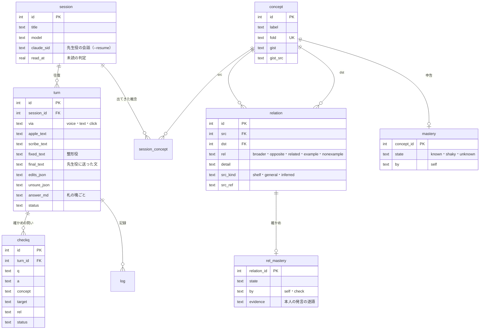

# となり（声で回す概念の学び）設計 v0.1（2026-10-29）

本人の依頼（2026-10-29・音声入力）を受けて作った、自分の Mac だけで使う学びのアプリの設計書。コードは同じフォルダ（`tonari/`）、使い方は `README.md`、調べた材料は `research/`。

## 0. 結論

話題（セッション）を何本も並べ、話題Aで声で質問したら答えを待たずに話題Bへ移り、Bで質問したらCへ、答えが届いた話題に戻って読む、という回し方を既定にしたデスクトップアプリにした。名前の「となり」は、本人の考え「言葉は、その周りの言葉との関係が分かれば分かる」から取った。

答えは声ではなく文字と図で返す。毎回の答えは、最初の1〜2文の言い切り、中身に合わせて選んだ図1つ、散文の説明、関係を確かめる問い1〜2個、の順に並ぶ。図の形は v0.2（2026-10-30・12章）から中身の形で決める。条件で結論が変わるなら分岐の木、期間なら時間軸、手順なら流れ、比べるなら比較の表、重なりなら重なりの図、計算なら計算の例、分類なら階層の木、言葉の意味なら位置の図、一言で足りれば文だけ。位置の図は置き場所に意味を固定していて、上が上位概念、下が下位概念、左右が対の概念、斜めが関係する概念になる。

頭脳は話題ごとに1本ずつ常駐させた Claude Code の opus（`claude -p`・Max プランのログイン・API キーは使わない）。声は Apple の端末内の文字起こしと ElevenLabs Scribe（この話題の用語の一覧つき）を並べて走らせ、整形役（sonnet）が2本を突き合わせて聞き違いだけを直してから先生役に送る。手元の試しでは、用語の一覧を渡した Scribe と、用語集を渡した整形役が、どちらも用語の聞き違いをほぼ消した（3章）。

理解度は概念ごとの申告（分かる・あやしい・分からない）と、関係ごとの確かめ（確かめの問いへの答えを先生役が判定し、根拠に本人の発言の逐語を要求する）の2本で持つ。本人の考えをそのまま数える形にして、概念Aの理解を「Aの周りの関係のうち確かめ済みの割合」として右の地図に出す。

## 1. 依頼と、設計で守ったこと

本人の依頼を要件に直すと次の表になる。

| 依頼の言葉 | 設計での形 |
|---|---|
| 返答まで時間がかかるのは仕方ない。その間に別のセッションで話す | 話題ごとに先生役を常駐させ、話題をまたいで並んで進める。送ったら答えの届いた話題へ自動で移る（切れる） |
| 音声入力が既定。返答は文字でよい | 押して話す（Space）・もう一度押すと送る。答えは画面に文字と図で出し、読み上げない |
| 裏は Claude の Opus 5.5 で問題ない | 先生役は `claude -p --model opus`（Max プラン）。整形役だけ sonnet |
| 音声入力の精度はばらつくので、誤字を推測して正しい文に直してから送る | 整形役が Apple と Scribe の2本を突き合わせて直す。直した箇所は下線で見せ、1つずつ戻せる |
| 音声認識の精度は高めておきたい（途中の追加の依頼） | 用語の一覧を Scribe に渡し、整形役には用語集・棚の題・過去の聞き違いを渡す。測り方も同梱（3章） |
| アーティファクトのようにリッチに見せる画面 | 答えの中に位置の図・比較の表・流れ図・全体の木・棚の札を描く。見た目は家のデザインシステム「精密・白」のトークン |
| 既存のまとめたアーティファクトを元に答えると早くなるかも | 棚（アーティファクト棚の写し156枚・約324万字）を先生役の作業フォルダに写し、Grep と Read で根拠にさせる |
| ER 図のように体系的に概念マップを、あなたも理解し私にも見せる | 概念と関係を記録に溜め（話題をまたいで1つの地図）、右の地図で見せ、毎回の問いに「この話題の概念」と「理解の記録」を添えて先生役に渡す |
| 分かる・分からないを相互に、どこまで分かっているか | 本人は図の札・確かめの問いで申告し、先生役は答えを判定して関係ごとの記録を更新し、次の説明は「分かる」の概念を足場にする |
| 言葉の意味は周りの言葉との関係で分かる | 答えの型そのものにした（位置の図と、分かる概念を足場にした説明）。理解の割合も関係で数える |
| デスクトップアプリとして | `~/Applications/となり.app`（swiftc 単体の WKWebView の窓。作りは作者の別のアプリの殻の写し） |

依頼に書かれていないが守った決まりは3つある。1つ目はリポジトリの正典の「Anthropic API は基本使わない」で、先生役も整形役も手を加えていない `claude -p` を本人のログインで動かし、子の環境から `ANTHROPIC_*` を外す。2つ目は捏造ゼロで、答えの「」は棚の本文と照らして一致したものだけに印を付け、判定は本人の発言の逐語が無ければ記録しない。3つ目は人の裁定を前提にしないことで、直しすぎ・判定の根拠・関係の出どころはすべて決まった規則で機械が決める（9章）。

## 2. 使い方の一巡と画面

一巡はこう回る。⌘N で新しい話題を作ると、そのまま録音が始まる。話し終えて Space を押すと送られ、画面は答えの届いている話題へ移る（届いていなければその場に残り、短い知らせが出る）。答えの届いた話題は左の列で青い印と「答えが届きました」になり、⌘] で古い順に回れる。⌘1〜⌘9 で直接開ける。話題を開くと上に「前回」の帯が光り、最後に聞いたことと経過時間と、答えが届いているかどうかを1行で示す（中断から戻ったときの手がかり。研究は7章）。

画面は3列にした。左が話題の列で、話題ごとに名前（最初の発言から整形役が付ける）、状態（録音中・文字にしています・聞き違いを直しています・考えています・答えが届きました・止まりました）、最後の問い、概念の数、経過時間を出す。真ん中が往復の列で、本人の発言（直した箇所に下線、決めきれなかった箇所に点線、聞き取りの元の2本は畳んで添える）と答えが並ぶ。右が地図で、「位置」は選んだ概念を中心にした記録の地図と、申告のボタン、関係で見た理解の割合、関係ごとの確かめのボタン、出てきた話題の一覧を出す。「この話題」と「全部」は概念を理解の状態ごとに並べる。

図の札を押すと右の地図がその概念を中心に描き直し、札を2回押すとその概念の説明を今の話題で頼む。右の地図の「これを説明して」は、本人が分かっている周りの概念を足場にした説明を頼み、「関係を問題にして」は周りの関係を確かめの問いにして出させる。

## 3. 声の精度

### 3.1 手元で測ったこと（2026-10-29）

合成音声6本（macOS の Kyoko と Eddy が、社労士と学習科学の用語を入れた3文を読んだもの・計45.8秒・`tests/audio/`）で、方式ごとの文字誤り率（句読点と空白を除いた CER）を測った。測り方は `uv run python -m tests.stt_eval --scribe` と `--fixer`。

| 方式 | CER | 中身 |
|---|---|---|
| Apple SpeechTranscriber（端末内・無料・1本0.3〜0.4秒） | 14.2%（33/232字） | 合格伴走→合格友層・寡婦加算→か不加算・ベイズ→レイズ・フレイヤー→プレイヤー |
| ElevenLabs Scribe v2（用語なし・1本約1秒） | 9.9%（23/232字） | 合格伴走→同核伴走・寡婦加算→加付加さん |
| Scribe v2 に用語の一覧（keyterms）を渡す | 0.0%（0/232字） | 6本とも一致 |
| Apple の結果を整形役（sonnet・用語集つき）に通す | 0.9%（2/232字） | 残ったのは「入り→あり」「を→に」の2字 |

この表は条件が甘い。用語の一覧と用語集には、読ませた文の用語がちょうど入っている。実際には、新しい話題の最初の発言では用語集が空で、渡せるのは棚の題とほかの話題の概念の名前だけになる。合成音声で、本人の肉声・部屋のマイク・言いよどみは測っていない。Scribe（用語なし）は同じ音声でも回によって結果が変わった（Kyoko-3 は1回目に誤り、2回目は正しかった）。

Apple の側でも2つ確かめた。SpeechTranscriber に文脈の語（`AnalysisContext.contextualStrings`）を渡しても結果は1字も変わらなかった。旧来の口述の方式（DictationTranscriber）は文脈の語が効き（「レイズ知識分析」が「ベイズ知識追跡」に直った）、そのかわり素の精度が落ちた。SpeechTranscriber は字ごとの確信度と別候補（「つ→対」「容→上」「了→理」）を返せるので、これを整形役への手がかりにした。

#### 3.1.1 端末内の2本目に Haas を試した（2026-11-02）

X のブックマークで見つけた日本語特化の認識モデル Haas-ja-v1.0（Third Intelligence・Apache-2.0・Parakeet-TDT 系・616M）を、speech.cpp（MIT・Mac は Metal、Windows は Vulkan か CPU）の `speech asr haas-ja-v1.0` で動かし、Scribe を切っているときの2本目になるかを測った。測り方は `uv run python -m tests.stt_eval --haas` と `--fixer --haas [--no-glossary]`。

| 方式 | CER | 中身 |
|---|---|---|
| Haas（用語なし・1本0.22秒、読み込み込み・M4 Pro） | 13.8%（32/232字） | Apple の 14.2% とほぼ同じ。合格伴走→楼鶴伴奏・寡婦加算→化不可さん |
| Haas に用語の一覧（`--keywords`）を渡す | 6.0%（14/232字） | 用語は直るが、6本中1本で前後の語を落とした（「の違い」）。用語に読み（かな）を添えると 7.8% で良くならず、6本中2本で語を落とした（「の違い」「の見せ方」） |
| 整形役に Apple と Haas の2本を渡す（用語集なし） | 4回で 3.4〜6.0%、平均 4.4% | 同じ条件の Apple だけは5回で 3.9〜9.1%、平均 5.2%。回ごとの揺れの方が大きく、差は言えない |
| 整形役に Apple と Haas の2本を渡す（用語集つき） | 0.4%（1回） | Apple だけは 0.9%（10/29 の1回）。どちらも1回で、差は揺れの中 |
| 本人の肉声10本（10/29〜30 の声の往復・計約7分19秒） | Apple 14.3%・Haas 22.7%・Haas を声の区間ごとに切って 25.5% | 基準は本人が通した文で、Apple の結果を整形役が直したものなので Apple に有利。整形役が Apple を直した64か所のうち、Haas が直したあとと同じ字を書いていたのは18か所（28%） |

決めたこと。Mac では、整形役を通したあとの得が回ごとの揺れより小さく、本人の肉声で Apple より良い証拠も無いので、既定では使わない（`TONARI_LOCAL_ASR=haas` で入る）。入れたときは、Haas が語を落とすことがあるので、整形役が失敗したときに戻す元の文は Apple にし（`fixer.base_text`）、整形役には「Apple にあって Haas に無い語は Apple から戻す」と指示した（試しでは、落ちた「の違い」を整形役が戻した）。Apple の無い PC（Windows など）では、既定の `TONARI_LOCAL_ASR=auto` で Haas が1本目になり、Haas だけで文字にする（`stt.apple_available`。2026-11-03 に Mac で Apple を外して試し、試しの音声1本を 0.37秒で、句読点のほかは誤りなく書いた）。整形役を比べるときは、1回ずつでなく3回以上回して平均と幅で見る。

### 3.2 決めた作り

録音は WKWebView の MediaRecorder（webm/opus。作者の別のアプリで実際に通った経路）で取り、サーバーが ffmpeg で 16kHz の wav にする。そこから Apple（`stt/bin/stt-helper`。作者の別のアプリの道具に確信度と別候補の出力を足したもの）と Scribe v2 を同時に走らせる。Scribe には、この話題の概念の名前を先に、ほかの話題の概念と過去の聞き違いの正しい字を後に並べて、50語まで渡す。

整形役は温めておいた sonnet（effort low）を1回だけ使って閉じる（話題をまたいで文脈を持ち越さない）。渡すのは、用語集（概念の名前120語まで）、棚のページの題、過去の聞き違い、直前のやりとり、Apple の本文と確信度の低い字と別候補、Scribe の本文。返すのは、直した文、直した箇所（元の字・直した字・理由）、決めきれなかった箇所と候補、往復の見出し、発言の種類（新しい問い・確かめへの答え・進め方の指示）。

整形役の結果は機械で確かめる。直した文と元の文（Scribe があれば Scribe、無ければ Apple）の一致の度合いが 0.6 を切ったら直しすぎとみなして元の文を使う。直した箇所は、元の字がどちらかの文字起こしにあり、直した字が直した文にあるものだけを見せる。決めきれなかった箇所は、本文の字と候補をそのまま先生役に添え、答えを左右するなら両方に触れるか確かめるよう指示してある（2026-10-29 の試しでは、先生役が「『合格バンド』はアプリの名前から『合格伴走』と読みました」と断ってから答えた）。

本人が「直して聞き直す」で字を書き換えると、書き換えた区間（両方20字以内）を聞き違いの台帳に足し、次から Scribe の用語と整形役の手がかりに入れる。使うほど本人の声と話題に合っていく、という狙い。

### 3.3 Scribe の費用と口座

Scribe は既定で「自動」にした。ElevenLabs の口座の残りが 5,000 を切ったら使わず、Apple と整形役だけにする（作者の別のアプリの読み上げと同じ下限）。左の列の下で「精度優先（毎回 Scribe）」「端末だけ（Apple）」に切り替えられ、今月 Scribe に送った分数を出す。2026-10-29 時点で口座は Starter、残りは 11,615。同じ日に Scribe を約3分ぶん使ったあと、口座の文字数の枠の数字はほとんど動かなかった（11,647 から 11,615）。音声の文字起こしがこの枠からどう引かれるかは確かめきれていないので、使った秒数をアプリの記録（`stt_usage`）に残し、月末に口座の数字と見比べる。録音は ElevenLabs に送られる（アプリのマイクの許可の説明にも書いた）。端末の外に出したくない日は「端末だけ」にする。

## 4. 答えの型

先生役の指示（`server/tutor.py` の SYSTEM）で、答えを次の順に書かせる。最初の段落で問いに1〜2文で答える。続けて `tonari-map` の塊（中心の概念・一文の説明・上位2・下位5・対2・関係6・例3・非例2、それぞれに出どころ）を出す。本文は散文で、対の概念があれば3〜5行の比較の表、仕組み・手順・データの関係なら mermaid の図（flowchart・sequenceDiagram・erDiagram）を1つ添える。最後に `tonari-check` で関係を問う短い問いを1〜2個出す。「全体像」「地図」「体系」を頼まれたら位置の図の代わりに `tonari-tree`（3段まで）を出す。確かめへの答えのときは先頭に `tonari-grade` を出す。

opus に JSON Schema で出させる方法（`--json-schema`）は1回約20秒かかった（作者の別のアプリでの測り）ので使わず、流れてくる文から札の塊を切り出す。塊が壊れていたら本文から外して記録に理由を残し、画面には出さない。

説明の芯は本人の考えにした。先生役には毎回、本人の理解の記録（分かる・あやしい・分からないの概念、確かめた関係）と、この話題の概念の一覧を添え、「分からない概念を、さらに分からない言葉で説明しない」「分かると記録した周りの概念を足場にする」と指示してある。

根拠は棚の写しで、先生役は作業フォルダの `<id>.txt` を Grep・Read で読む（`--restricted --tools Read,Grep,Glob` で、作業フォルダの外は読めない）。「」は棚の本文を写すときだけに使わせ、画面が畳んだ字で本文と照らして、一致したものに緑の地と「棚」の印を付ける。一致しない「」は印を付けずにそのまま出す。ページは〔id｜見出し〕の札になり、押すとそのページを開く。

（v0.2 で、上の「答えの型」は12章の見せ方の語彙に置き換えた。位置の図は定義の答えだけに描き、ほかの答えでも記録の地図には毎回書く。）

## 5. 知識の構造

記録の地図は概念（concept）と関係（relation）の2つの表でできている。概念は名前を畳んだ字（NFKC・空白なし・小文字）で1つにまとめ、話題をまたいで共有する。話題Aで出た「知識空間理論」と話題Bで出た「知識空間理論」は同じ札になり、右の地図の「出てきた話題」から行き来できる。

| 関係 | 向き | 図の置き場所 | 例 |
|---|---|---|---|
| broader（上位） | src の上位が dst | 中心の上（中心が src のとき）、下（中心が dst のとき） | 知識空間理論 → 学習者モデル |
| opposite（対） | 向きなし（id の小さい方を src にそろえる）・軸を detail に | 左右 | 知識空間理論 ⇔ ベイズ知識追跡（技能間の構造か時間の変化か） |
| related（関係） | 中心から相手へ・種類を detail に（前提・原因・結果・部分・道具・同時に出る・似ている） | 斜め | 知識空間理論 → 適応型テスト（結果） |
| example（例） | 例が src・概念が dst | 図の下の緑の札 | 分数の足し算ができる人は約分もできる |
| nonexample（例ではない） | 同上 | 図の下の打ち消し線の札 | 1問ごとの正答率だけを並べた成績表 |

関係には出どころを持たせる。棚に根拠があれば shelf（実線）、一般の知識なら general（破線）、先生役の推測なら inferred（点線）。同じ関係を何度も言われたら、出どころの強いほう（棚 > 一般 > 推測）を残す。〔id〕の札が棚の目録に無ければ推測に落とす。

位置の図の置き場所は固定した。毎回同じ規則で置くので、何枚見ても「上にあるのは広いほう」「左右にあるのは比べる相手」と読める。答えの中の図（680×420）と右の地図（400×460・字が小さくならない詰めた配置）は同じ規則で、置き場所の数だけ違う。

ほかに、聞き違いの台帳（mishear：聞こえた字・正しい字・回数）、Scribe に送った秒数（stt_usage）、画面の設定（pref）がある。表の正典は `server/db.py` の SCHEMA。

## 6. 理解度

理解度は2本で持つ。1本目は概念ごとの申告で、本人が右の地図で「分かる・あやしい・分からない」を押す。もう一度押すと消せる。2本目は関係ごとの確かめで、答えの最後の確かめの問いに、ボタン（分かる・あやしい・分からない）で申告するか、「声で答える」で答える。声か文字で答えると先生役が `tonari-grade` で判定し、当たり・半分・まだ、と根拠の逐語を返す。根拠の字が本人の発言に無い「当たり」は記録しない（2026-10-29 の試しでは、2問とも本人の発言から逐語を引いて当たりと判定し、関係ごとの記録に入った）。

本人の考えを数える形にしたのが「関係で見た理解」で、概念Aの周りの関係（上位・下位・対・関係）のうち、確かめ済み（分かる）の割合を右の地図に棒で出す。申告の「分かる」と、関係で見た割合が食い違う概念（申告は分かるのに、周りの関係を1つも確かめていない）が、分かった気になっている候補になる。研究で分かっていることと限界は7章。

申告も確かめも記録（log）に足すだけで、今の状態はそこから引き直せる。忘れの模型（いつ問い直すか）はまだ入れていない。作者の別のアプリで式と検算を作ってあるので、記録が溜まってから足す。

## 7. 研究から分かっていることと仮説

調べ役2本（opus・一次ソースで確かめた数字だけ・2026-10-29）の結果を、設計に効くところだけ畳む。原文と出典の URL は `research/a-概念の理解と関係の学び-2026-10.md`（意味と関係・語彙の深さ・コンセプトマップ・比較と非例・自己説明と分かった気）と `research/b-見せ方と話題の回し方-2026-10.md`（中断と再開・交互と分散・図と文・図の読みやすさ・声と文字起こしの直し・自己申告の当たり外れ）。

### 7.1 本人の考えへの判定

前半の「言葉の意味は周りの言葉との関係で決まる」は、言語学と計算言語学の主流と合う（構造意味論の意義関係、意味ネットワーク、WordNet と ConceptNet の関係の種類。研究 a の1章）。概念の教え方の研究も、分類の構造、非例、比べることを重んじる（a の4章）。土台は正しい側にある。

ただし「関係が分かっていれば理解できる」は言い過ぎ、というのが調べ役の判定で、この設計もそれに従う。理由は3つ。仕組みの知識（どう働くか、なぜそうなるか）は上下左右の関係とは別の知識で、しかも分かった気が最も出やすい（説明の深さの錯覚・a の5-3）。語の知識には関係の図で表せない側面（使い方・連語・表記）が多い（a の2-1）。そして関係を見せることの効果は小さく、効いたのは関係を自分で思い出し、作り、説明したときだった（コンセプトマップのメタ分析で、見るは g＝0.43、作るは g＝0.72。検索練習はマップ作りより強い。a の3章）。「分かる」の中身が「見て納得した」なのか「何も見ずに言える」なのかで、本人の考えの当たり外れが分かれる。

後半の「文脈から推測もできる」は、日常語を大量の読書で増やす場面では成り立つが、新しい専門概念を1回の説明で分かる支えにはならない（自然な文脈で一度出会って分かる確率は .05〜.15。a の2-5）。

### 7.2 研究が支えていて、v0.1 に入れたこと

| 設計 | 研究 |
|---|---|
| 線に関係の名前を付ける（上位・下位・対・前提・原因・結果・部分・道具） | マップの利点の1つが線の名前で関係を明示すること。「関係」の一枠には部分・原因・前提・用途が混ざるので名前で分ける（a の1-5・3-2） |
| 下位は「一種」だけ、部品は related の「部分」 | WordNet の hyponym と meronym、ConceptNet の IsA と PartOf の区別（a の1-5） |
| 対は、同じ上位の下で取り違えやすい兄弟を第一候補にし、無ければ空にする。反意語は尺度を書く | 学びに効くのは構造を共有して決め手の1点だけが違う相手（Gentner・Schwartz & Bransford・Tennyson。a の4章）。ConceptNet は Antonym と DistinctFrom を分ける |
| 比較の表は共通点の行が先、決め手の違いが後 | 事例比較のメタ分析では共通点を探させる方が学びが大きい（Alfieri ほか 2013。a の4-5） |
| 非例は見かけをそろえて決め手だけ違うもの | Tennyson の概念教授（a の4-4） |
| 理解の記録を申告と確かめの2本にし、関係ごとに持つ | 漠然とした「分かった？」は過大に出る。仕組みの説明の知識で特に強い（b の6章・a の5-3） |
| 申告は「分かる」なのに関係を1つも確かめていない概念に注意を出す | 同上（申告と確かめのずれを別の印にする。a の6-3） |
| 確かめの問いを答えの最後に置き、声で答えられる | 練習テストの効用は「高い」（Dunlosky ほか 2013。a の5-2）。人に説明するつもりの学び（a の5-5） |
| 話題の最初の答えで「あとで自分の言葉で説明してもらう」と予告する | 声で説明する学びは、学ぶ前に説明を予告したときだけ効き、予告なしに後から説明させても得はなかった（b の5-2） |
| 戻ったときに「前回」の帯を目立たせ、最後の問いをはっきり指す | 直前の操作を大きな印で指すと再開が速く、控えめな印は印なしと変わらなかった（Trafton ほか。b の1-3） |
| 同じ概念は話題をまたいで同じ札、図の置き場所は固定 | 配置を保つと図の中で場所を見つけ直すのが速く正確になった（b の4-4）。ただし理解が深まる証拠は無い |
| 上下に上位・下位 | 上下は順位として自然に読まれる（Tversky ほか 1991。b の4-5） |
| 文字起こしの直しに別候補（N-best）と専門語の一覧を渡し、直したあとに機械で確かめる | 生成による誤り訂正の研究（N-best を渡す・専門語で偏らせる・N-best の範囲に縛る・直したあとに検証。b の5-4・5-5） |

### 7.3 研究が設計に不利なこと（隠さない）

関係の薄い話題を交互に回すことの学習上の得は見つかっていない（b の2-4）。交互練習の得は、似ているが違うものを見分ける学習で確かめられていて、似ているほど大きい。だから話題を回すことは「待ち時間を埋める効率」であって、学習の効果としては扱わない。待ち時間に別の話題へ移ると、覚えていたことを落とし、終わっていない話題に注意が残り、移る判断そのものにも時間がかかる（b の1-5・1-6）。

完成した図を渡すのは、本人が作るより得が小さい（b の3-8・a の3章）。左右に対を置く決まりは、効果を測った研究が見つからなかった（b の4-5）。慣れの効果に頼っている。配置を毎回同じにしても理解が深まる証拠は無い（b の4-4）。

言語モデルによる文字起こしの直しには、文法的に正しいが発話と違う文を作る危険がある（b の5-5）。整って読みやすい見た目は分かった気を上げ、言語モデルのまとめから学ぶと知識が浅くなるという大規模な実験もある（b の6-4・6-5）。この設計の答え（整った文と図のまとめ）は、この偏りが起きやすい条件にそのまま当たる。

### 7.4 v0.2 の候補（研究に沿うが、まだ入れていないこと）

同じ概念に何度目かで戻ったときは、完成した図を見せる前に、中心だけの空の図を出して本人が声で上位・下位・対を埋め、そのあとで先生役の図を重ねる（検索に基づくマップ作り・a の6-2。図を段階的に空ける・a の7-3）。答えを待つ間に、いまの話題の中で予想や知っている用語を一言言ってもらう形も選べるようにする（b の推測1。移ることの費用を払わない）。別の話題へ移る瞬間に「戻ったら何を確かめるか」を声で一言残し、戻ったら最初に見せる（b の1-2・推測2）。「分かる」を押したら、決め手の一語を声で言ってもらい、申告そのものを小さな思い出しにする（a の推測7-6）。似た概念どうしを意図して続けて問う（交互の得を本当に取る・b の2-3）。日をまたいで同じ関係を問い直す（分散の得は数分の行き来では取れない・b の2-6。狩り場の忘れの模型を使う）。確かめが通った話題では補助（事前訓練・合図）を減らす（熟達化反転・b の3-9・推測10）。

### 7.5 仮説（研究の外の推測・確かめる前提）

関係ごとに記録する方が、概念ごとより誤概念の場所を特定しやすいかもしれない。Tennyson らの誤りの3分類（過剰な一般化・過少な一般化・誤概念）は、どれも「どの概念がどの概念の一種か」という線の誤りとして書ける（a の7-2）。ただし関係ごとに記録して学びが良くなったという研究は見つかっていない。

戻ったときの手がかりは、操作の場所より「自分が最後に言った問い」と「そのとき引っかかっていた点」の方が学びの再開に効くかもしれない（b の推測3。研究は操作の場所しか調べていない）。v0.1 の「前回」の帯は最後の問いを出している。

関係を作るのが Claude であることの危険は残る。誤った上位や取り違えでない対は、そのまま誤概念の種になる（a の7-5）。棚に根拠のある関係（実線）と、一般の知識（破線）・推測（点線）を図で分けたのはこのためで、社労士のように一次の出典がある分野では、条文に結びついた関係だけを実線にするのが筋になる。

## 8. 並行と遅延（手元の実測・2026-10-29）

opus の `claude -p` を3本同時に起動し、1秒以内に短い問いを投げても、3本とも約2秒（モデルの時間1.8〜2.5秒・起動込み5.7〜6.6秒）で返り、混雑の拒否は出なかった。先生役は話題ごとに常駐させ、常駐は6本まで、30分使わなければ閉じる。閉じた話題は `--resume <会話の id>` で続きから始める（stream-json の入力で再開できることを sonnet で確かめた）。混雑やプロセスの停止で落ちたら、20秒・40秒・60秒あけて3回まで送り直し、画面に「先生役が混んでいます」と出す。送る文は先に記録に書いてあるので、落ちても失われない。

| 段 | 文字の質問（棚を読んだ） | 声の質問（Apple のみ） |
|---|---|---|
| 文字にする | — | 0.4秒（8.9秒の録音） |
| 聞き違いを直す | — | 4.2秒 |
| 先生役の最初の文字 | 23秒（Grep・Read を3回） | 約3秒で道具、文は道具のあと |
| 先生役の答え終わり | 33秒 | 34秒 |
| 確かめへの答えの判定（棚を読まない） | 15.5秒 | — |

答えまで30秒前後かかるので、その間に別の話題で1つ話す、という回し方に合う。整形役の4秒は、送ったあとに次の話題へ移っている間に済む。

## 9. 守っていること

Claude の API キーは使わない。サーバーは 127.0.0.1 だけで待ち受け、/api は独自の見出し `X-Tonari: 1` が無いと断る（ほかのサイトのページから本人の Max プランの枠と学びの記録を使わせないため）。録音と記録は `~/Library/Application Support/tonari/` に置き、リポジトリには入れない。先生役は作業フォルダ（棚の写し）の外を読めず、書く道具を持たない。

機械で決める規則（人の裁定を待たない）は次の5つ。直しすぎは一致の度合い0.6で切る。直した箇所は元の字と直した字の両方が見つかるものだけ見せる。判定の当たりは本人の発言の逐語が無ければ記録しない。関係の出どころは棚 > 一般 > 推測で強いほうを残し、目録に無い〔id〕は推測に落とす。「」の照合は畳んだ字の完全一致で、札のページを先に、無ければ棚の全体を見る。規則の検査は `uv run --group dev pytest`（8件）。

## 10. 確かめたこと・まだのこと

確かめたこと（2026-10-29）。文字の質問で、先生役が棚を Grep・Read して、位置の図・比較の表・流れ図・確かめの問い2つを返し、概念9つと関係が記録に入った。声の質問（合成音声のファイルを録音の代わりに送った）で、Apple の文字起こし→整形役が「中、高齢化価算→中高齢寡婦加算」「株価算→寡婦加算」を直し「合格バンド」を決めきれない箇所として添え→先生役が断ってから答える、まで通った。確かめへの答えで、判定が逐語つきで関係の記録に入り、関係で見た理解が 0/8 から 2/8 になった。アプリの窓を出さないモード（`--selftest --snapshot`）で、画面の読み込み・安全な場所の扱い・マイクと録音（webm/opus）の機能があること・3列の画面・位置の図・比較の表・流れ図・確かめの問いの表示を撮って確かめた。

本物のマイクでの録音は、2026-10-30 に本人が実際に使って通った（声の往復10回がすべて完了・録音は最長135秒・聞き取りは「端末だけ」に切り替えて Apple と整形役だけ・文字にするのに0.4〜1.5秒、直しに3〜16.5秒で長い発言ほど長い）。

まだのこと。本人の肉声での文字誤り率（記録に Apple・Scribe・直した文・本人が直した文が残るので、溜まったら同じ関数で測る）。話題を5本以上同時に回したときの混雑。Scribe の費用が口座の枠からどう引かれるか。

## 11. これから

先に効きそうな順に、本人の肉声での測り直し、忘れの模型（狩り場の式）で「そろそろ問い直す関係」を出す、申告と関係の割合が食い違う概念を知らせる、棚の見出しから用語集の種を作る（新しい話題の最初の発言の精度）、全体の地図（全部の概念を同じ規則で並べた図）、を考えている。

## 12. 見せ方の語彙（v0.2・2026-10-30）

本人の依頼（2026-10-30）は「表現をもっと多様に。マップだけでなく、答えによって別の表現を。シンプルなときはシンプルに、複雑さが要るときは複雑に。理解させるのに適した表現を選べるように」。調べ役 c（`research/c-表現の選び方-2026-10.md`・一次ソースで確かめた数字だけ）の結論で、作りを4か所変えた。表現は本人の好みでなく中身の構造で決める（学ぶ人に表現を選ばせる効果はほぼ無い・g＝0.05）。重なりはオイラー図か線形の図にする（ベン図は不可）。「別の見せ方」は置き換えず横に並べる（順に切り替えて見せる版が伸びが最も小さく誤解が最も多かった）。詳しさは2段にとどめ、既定は確かめの問いの結果で決める。

### 12.1 形の選び方（先生役の指示・`server/tutor.py` の SYSTEM）

中身の形を、上から順の問いに当てて、最初に当てはまった形の図を1つだけ出す。

| 順 | 中身の形 | 図 | 塊 |
|---|---|---|---|
| 1 | 一言で足りる（単純な事実・はい/いいえ・一つの数字） | 文だけ | なし |
| 2 | 場合によって結論が変わる | 分岐の木 | `tonari-decide` |
| 3 | 期間・年齢・期限の区間 | 時間軸 | `tonari-timeline` |
| 4 | 順番のある手順・原因から結果への仕組み | 流れ | `tonari-flow` |
| 5 | 2つ以上を観点ごとに比べる | 比較の表 | `tonari-compare` |
| 6 | 集合の重なり・含む含まれない | 重なりの図（2つはオイラー図、3つは線形の図） | `tonari-overlap` |
| 7 | 金額・日数・割合の計算 | 計算の例 | `tonari-calc` |
| 8 | 分類・全体像 | 階層の木 | `tonari-tree` |
| 9 | 多対多・データやシステムの関係 | 関係の図 | `mermaid` |
| 10 | 一つの概念の意味 | 文と例・非例、関係が実在するときだけ位置の図 | `tonari-map`（show: true） |
| 別 | 抽象的な仕組みを身近な物で | たとえ（成り立たない所を必ず書く） | `tonari-analogy` |

どの図の塊にも表現の名前（name・1〜2語）と、中身の構造の理由（why。「場合分けが2段あるので」のように書き、正しさの主張は書かない＝説明は誤った図の受け入れも増やすため・研究 c の6-2）を入れさせ、確かでない項目には一人称の短い言葉（unsure）を入れさせる（不確かさの一人称の表現は過度の依存を減らした・同）。記録の地図（`tonari-map`）は図の種類にかかわらず毎回出させ、描かない答えでは show: false にする。これで関係ごとの理解度と話題をまたいだ地図は v0.1 のまま育つ。

### 12.2 機械の決まり（`verify_view`・決まりに合わない塊は捨てて本文だけ残す）

| 塊 | 決まり |
|---|---|
| 分岐の木 | 問いと2本以上の枝がそろう。深さ4段まで。結論の出どころが無ければ推測として描く（点線） |
| 時間軸・計算の例 | 範囲の数の順が正しい。数字は「例の数字」か、棚・一般の出どころがあるか。どちらでもなければ「確かめていない数字」の札を出す |
| 流れ | 段階が2〜8 |
| 比較の表 | 比べるものが2〜4、値の数が比べるものの数と合う行だけ。共通の行を先に並べ直す |
| 重なりの図 | 集合が2〜3、要素が2つ以上、番号が範囲内。空の領域は描かない |
| たとえ | 対応が2つ以上、成り立たない所が1つ以上（無ければ捨てる） |
| 階層の木・位置の図 | root・center がある |

捨てた理由は往復の記録（stage_ms の block_errors）に残す。選んだ形と理由も往復ごとに残す（stage_ms の shapes）。あとで「どの形の答えのあとに確かめの問いが当たったか」を数えるため。検査は `uv run --group dev pytest`（15件）。

### 12.3 画面

図の上に表現の名前の札と理由を出し、その形を初めて見るときだけ読み方を1行添える（初めて見る形式では得が逆転しうる・研究 c の3-4。見たことのある形は `pref` の seen_views）。答えの下に「短く」「別の見せ方で」「詳しく」の3つの札を置いた。「別の見せ方で」は新しい往復に見せ直しの元（ref_turn）を持たせ、画面は前の図と新しい図を「前の見せ方」「いまの見せ方」として横に並べ、先生役は2つを結びつける問いを1つ（答えなくてよい）添える。上の帯の「自動・短く・詳しく」は話題ごとの既定で、自動は記録を見て決める（関係を確かめの問いで答えられた概念ほど短く）。矢印は流れ（と分岐の進む向き）にだけ使い、位置の図・重なり・比較には使わない（研究 c の1-5）。狭い所に置いた流れは縦に並べ、矢印も下向きにする。

### 12.4 確かめたこと（2026-10-30・本物の opus）

| 問い | 選んだ形 | 理由（先生役の why） |
|---|---|---|
| 遺族基礎年金をもらえるかどうかは、どう判断するの？ | 分岐の木 | 亡くなった人の立場で道が分かれ、そのあと納付要件と遺族の条件が続くので |
| 中高齢寡婦加算と経過的寡婦加算は、それぞれ何歳から何歳まで付くの？ | 時間軸 | 2つの加算の違いが、付く年齢の区間そのものなので |
| ベイズ知識追跡で、答えが来たときに確率を更新する手順を教えて | 流れ | 答えが来てから p が新しくなるまで、段が順に進むので |
| 社会保険と労働保険には、それぞれどの保険が入る？重なるものはある？ | 重なりの図（線形・3集合） | 広い意味の社会保険が、狭い意味の社会保険と労働保険の両方を含む関係なので |
| BKT の slip って何？一言で | 文だけ（353字） | — |
| 老齢基礎年金で…年金額の計算を、例の数字でやって見せて | 計算の例（例の数字） | 月数の割合を満額に掛ける計算なので |
| 知識空間理論を、身近なものにたとえて説明して | たとえ | 前提をたどって状態が広がる仕組みが、依存関係の解決と同じ形なので |
| コンセプトマップの「命題」ってどういう意味？ | 位置の図 | 命題はコンセプトマップの部分で、ノードとリンク語からできているので |
| Kafka と RabbitMQ の違いは？ | 比較の表 | 2つの仕組みを、共通点と違いの観点ごとに並べるので |
| 労働基準法の全体像を見せて | 階層の木 | 法律の章立てを、中身のまとまりで上下に分けたものなので |

10問とも狙った形になり、捨てた塊は0、10問とも記録の地図が書かれた。答えまで15〜39秒（v0.1 と同じ程度）。形の選び方の安定（研究 c の推測1）は、迷いやすい4問（分岐・重なり・比較・定義）を新しい話題で3回ずつ聞いて、12回とも同じ形だった。「別の見せ方で」は時間軸の答えを流れで描き直し、「時間軸では2本の帯が65歳でぴったりつながっていました。流れの図では、その継ぎ目にどの段階が入っていますか」と結びつける問いを添えた。詳しさ「短く」では212字・比較の表1つ・確かめの問い1つになった。

### 12.5 不利な点とこれから

研究 c で設計に不利だったのは次のとおり。本人に表現や詳しさを選ばせる効果はほぼ無い（だから「別の見せ方で」も形は先生役が選ぶ。詳しさの切り替えは本人の依頼なので残したが、既定は自動）。ChatGPT（2026-10-07 から）と Claude はすでに中身に合わせて図を出すので、形を変えること自体は差にならない。差になりうるのは、形の名前と理由を示すこと、2つの表現を並べて見せること、たとえの成り立たない所を示すこと、本人の過去の答えで詳しさを決めること、そして話題をまたいで育つ関係ごとの理解の記録（研究 c の推測8）。図に説明や出典を添えると、誤った図でも信じられやすくなりうる（研究 c の6-2）。

まだのことは、並べた2つの図の対応する所を指したら光らせる連動、同じ手順を二度目に聞かれたら段階の一部を空けて埋めてもらう（だんだん消す例題）、復習のときに図の前に関係を1つ予想してもらう、形ごとの確かめの当たりの集計。

## 13. 理解の確かめ方（v0.3・2026-11-03）

研究 d（`research/d-人が理解する仕組み-2026-11.md`）の結論は、図を足すより本人が自分で考えて言う場面を増やす方が効く、だった。10/29〜30 の記録では、確かめの問い24問のうち20問が手つかずで、問いの多くは関係の名前を問う形だった。一方で本人は「確認ですけど〜ですよね」と自分から3回言い直していて、記録に入ったのは1回だけだった。v0.3 はここを直す。

### 13.1 先生役の側（コミット A）

言い直しを判定する。整形役の発言の種類に confirm（前の答えの中身を自分の言葉で言い直して確かめる発言）を足し、先生役は confirm のとき、言い直しに含まれる関係のうち記録の地図にあるもの（`<この話題の関係>` で渡す）を tonari-grade で判定する。言い直しの判定では、手つかずの確かめの問いを「答えた」にしない（`apply_grades` の kind）。

判定のあとの返し方を決めた。違う所は本人の言葉のまま1文で名指しし、打ち消し、正しい説明を厚めに書き、推論のずれた所を1文で言う。ほめ言葉・点数・比較は書かない。誤った理由をもっと説明させる問いは出さない。聞き取りで決めきれなかった語は名指ししない（研究 d の 1-14・4-7・4-8・4-10・5-8）。

確かめの問いの型を4つにした。もしも（仕組みや手順。条件・順番・依存だけを変え、法令の金額・日数・年齢の値は変えない）、当てはめ（やり方や判断）、共通点（例が2つ以上）、見分け（言葉の意味）。関係の名前だけを問う問いは出さない。想定の答えの字（畳んだ字で4字以上）が答えの本文にそのまま含まれる問いは機械で外す（`tutor.filter_checks`）。型は `checkq.qtype` に残す（あとで型ごとの当たりを比べるため）。

二度目の判定。先生役の当たり・半分を、判定役（sonnet・`server/judge.py`）がもう一度判定し、一致したものだけを記録する。判定役が取れなかったときも記録しない。先生役が自分で作った問いを自分で採点するので、1回の判定を記録の根拠にしない（研究 d の 1-3）。

迷いの語。整形役に通す前の文字起こしから「でしたっけ」「たぶん」「ですよね」などを拾い、往復の記録（`stage_ms.hedges`）に残して先生役に添える。今は記録だけで、判定の規則は変えていない。

本物の opus で確かめたこと（2026-11-03・一時的な記録で4往復）。Next.js の SSR と SSG の質問に、確かめの問いが「もしも」と「当てはめ」の型で2つ付き、どちらも本文を写しては答えられない問いだった（32秒）。半分間違えた言い直しには、「あなたは『ISRはSSRにキャッシュを付けたもの』と言いましたが」と名指しして正しい説明を返し、手つかずの問いは残った。前半の当たりは判定役が半分と見て食い違ったので記録せず、後半の半分は一致して記録した。わざと間違えた答えには、本人の言葉で名指しし、ずれた所（SSR の性質を SSG に当てはめた）を返し、ほめ言葉は無かった（16秒）。合っている答えは判定役も当たりで一致し、記録に入った（判定役 1.8秒）。

### 13.2 画面の側（コミット B）

読む前の予想。答えが届いた話題を開くと、問い（question）への答えは畳まれ、「あなたの問い」と「読む前に、答えはどうなると思いますか」が出る。Space で一言話して送ると答えが開き、予想は文字になりしだい答えの上に「読む前の予想」として出る。Enter（または「すぐ読む」）なら予想せずに開く。予想は先生役に送らず（往復は最初から superseded で作り、列にも話題の「最後」にも出ない・`pipeline.run_predict`）、次の発言のときに `<前の答えを読む前の本人の予想>` として先生役に添える。予想の効き目（外れたときの驚き）は予想の直後に答えを見る手続きで確かめられている（研究 d の 3-5・3-6）ので、送るときでなく開くときに置いた。命令（短く・詳しく）と確かめへの答えのあとには出さない。左の列の下の「答えを読む前に予想を一言話す」で止められる。開いた時刻は往復の `stage_ms.revealed_at`（v0.3 より前の答えは起動時に1回だけ、届いた時刻で埋める）。

戻ったときの確かめ。確かめの問いは答えの下には出さず（「次にこの話題に戻ったときに出します」とだけ書く）、答えを開いてから2分（`TONARI_RETURN_AFTER_SEC`）以上たってその話題を開いたときに、型のある開いた問いを古い順に1つだけ、上の帯に出す。そのあいだ元の答えと右の地図は伏せる。Space で声で答えると、その問いだけが「答えた」になり（`check_id`）、先生役が判定して二度目の判定役と一致すれば記録に入る。「分からない」は理解の記録に分からないと入り、「飛ばす」は記録に入れない（`checkq.status=skipped`）。1回の戻りにつき1問だけで、直近に済んだ3問がすべて飛ばしなら、その話題では出さなくなる（煩わしさの見張り）。話題を回す動きそのものが、数分から数日の間隔を空けた思い出す練習になる、という狙いで、研究 b の分散と研究 d の 3-7 に沿うが、間隔を空けた確かめが答える率を上げるかは確かめていない（仮説）。

確かめたこと（2026-11-03・一時的な記録・本物の opus と見えない Chrome）。遺族基礎年金と遺族厚生年金の質問（50秒）に「もしも」と「当てはめ」の問いが付き、話題を開くと予想の帯が出て Space の札が「予想を話す」になった。Enter で開き、答えの下は「確かめの問い 2問は、次に戻ったときに」になった。20秒（試しの設定）たって別の話題から戻ると、1問目が帯に出て答えと地図が伏せられ、「飛ばす」で記録に skipped が残って答えが開いた。試験音声を予想として送ると、往復の列にも話題の最後にも出ず、元の答えに予想が書き添えられた。戻ったときの問いに文字で答えると、その問いだけが答えたになり、ほかの問いは残り、判定役も当たりで一致した（28秒）。

まだのこと。本人の発話で正しく使った概念を「自分で使った」として記録する案（研究のブラッシュアップの仮説3）、迷いの語を判定に使うこと（いまは記録だけ）、問いの型ごとの当たりの集計と、話題ごとに型を交互にした比べ（記録が溜まってから）。本人の実際の使用で、確かめの問いに答えた率（v0.2 は24問中4問）がどう動くかを見る。

## 14. 設定の画面と、Windows で clone から起動まで（2026-11-03）

本人の依頼は「友人の Windows でも最低限のセットアップで使いやすく。キーの設定などの UI、無ければ既定。git clone して、どこかで claude を立ち上げてプロンプトを打てば自動でできるように」。公開の写し（GitHub の nomura-t/tonari）を前提に、次の形にした。公開のときに本人が「友人に送る文でなく、みんなが使える形に」と言ったので、README の文は誰でも Claude Code に貼れる一般の形にした。

設定の画面。左の列の下の「設定を開く」で `<dialog>` を開き、この PC の準備（`/api/health`＝`server/health.py`）、キーの割り当て、聞き取りの方式、ElevenLabs の鍵、先生役のモデル、読み方を1か所に集めた（これまで左の列の下にあった3つも移した）。準備の項目は、欠けると声の往復ができないもの（Claude Code・ffmpeg・声を文字にする方法の1つ以上）と、任意のもの（Apple・Haas・Vulkan・Scribe の鍵）に分け、欠けたものには OS ごとの直し方を添える。必須が欠けていれば、左の列と最初の画面に1行で知らせる。鍵は中身を返さず、どこから読んだか（環境変数・設定で入れた鍵・作者の手元の .env）だけを出す。

キーの割り当て。操作は6つ（新しい話題・答えの届いた話題へ・番号で開く・話す・予想せずに開く・録音をやめる）。形は `e.code` を + でつないだもの（例 `Alt+KeyN`、番号で開くは `Alt+Digit`）で、`pref.keys` には既定から変えたものだけを入れる。何も変えなければ今までと同じに動く（既定は Mac が ⌘、ほかが Alt。Ctrl+N・Ctrl+1〜9 はブラウザが先に取るため）。修飾キーつきの操作は文字の欄にいても効き、修飾キーの無い操作は文字の欄では効かない。同じキーを2つの操作に割り当てるのは画面とサーバーの両方で断る。番号で開くは数字だけを断る（文字の入力とぶつかる）。画面の `<kbd data-key>`・左の列の番号・案内の文は、今の割り当てから描き直す。

先生役のモデル。`pref.tutor_model` を新しい話題から使う（いまある話題は作ったときのモデルのまま。会話を `--resume` で続けるため）。opus の使えないプランの人の逃げ道で、`prepare.py` も claude に1回だけ短く聞いて、opus が答えなければ sonnet を記録の置き場の `.env` に書く。

起動と用意。`setup.ps1` は、Windows でしかできない入れ物（uv・ffmpeg・speech.cpp）だけを入れて `prepare.py` を呼ぶ薄い殻にし、確かめられる処理は Python に寄せた（作者の Mac で試せるように）。`launch.py` はサーバーを `sys.executable -m uvicorn` で立て、Edge のアプリ窓（専用の `--user-data-dir`）で開く。窓を閉じても Edge が裏に残る場合があるので、ブラウザの終わりを待つのではなく、サーバーが画面のつながり（`/api/events`）を数え、0 のまま15秒たったら自分で止まる（`TONARI_EXIT_WHEN_CLOSED`。開き直しの間は待つ。一度もつながらなければ2分で止まる）。Mac のとなり.app はこの変数を立てないので、動きは変わらない。記録の置き場の `.env` の `TONARI_*` は設定として読む（環境変数が勝つ・鍵の行は環境変数に入れない）。

確かめたこと（2026-11-03・作者の Mac）。規則の試験 29本。Windows に見せかけた見えない Chrome で、既定の表記が Alt+N、Alt+N で話題が増える、new を Ctrl+M に変えると Alt+N は効かず Ctrl+M で増える、重なりと数字だけを断る、すべて既定に戻すと Alt+N に戻る。Mac に見せかけると ⌘ のまま。`launch.py --headless --close-after 6` で、起動2.6秒、窓を閉じて16秒後にサーバーが止まり、窓もサーバーも残らなかった。`prepare.py` は Apple を外した状態で Haas のモデルを確かめ（0.3秒）、準備の表は、外した Apple のほかは全部「使えます」になった。`setup.ps1`・ショートカット・Edge の窓・マイクの許可は Windows の PC で初めて動かす。

試しの途中で見つけた不具合。画面がつながったまま `/api/shutdown` を呼ぶと、uvicorn が画面への流れ（`/api/events`）の終わりを待ち続けて止まらなかった（Mac のとなり.app は4秒後に SIGTERM を重ねて止めていた）。止めるときに `events.close_all()` で流れを終わらせ、止め始めたあとのつなぎ直しも受けないようにした。直したあとは、画面がつながったままでも 0.9秒で止まった。`launch.py` は念のため `--timeout-graceful-shutdown 5` も付ける。

